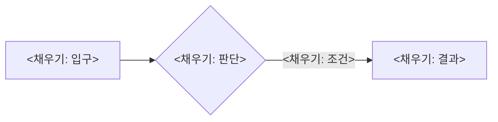

Closes #<채우기: 이슈 번호>
<!-- 이슈 완료 조건을 다 채웠으면 Closes, 일부만이면 Refs. 이슈가 없으면 이 줄을 「티켓 없음 — 이유」로 바꾼다.
     위의 세 절(무엇이 좋아지나 · 검증 · 정리)은 모든 PR이 채운다.
     아래 「화면 · 코드를 바꿨을 때」 절들은 app/ 아래 파일을 바꾼 PR만 채운다. 문서만 바꾼 PR이면 지워도 되고 그대로 둬도 CI가 막지 않는다. -->

## 무엇이 좋아지나

<!-- 한 문단, 줄글로. 이 기능이나 문서를 쓰는 사람이 어떤 상황이었고, 이제 무엇을 할 수 있게 됐는지만 쓴다. 구현 수단(라이브러리 이름 등)은 쓰지 않는다. -->

<채우기: 한 문단>

## 검증

<!-- 다음 사람이 그대로 따라 할 명령과 기대 결과, 사람이 확인한 행동. 문서 PR이면 무엇을 대조해 확인했는지. 리뷰 뒤 다시 돌렸으면 이 절을 고친다. -->

- <채우기: 확인한 것 — 그것이 보장하는 결과>

## 정리

- 이번에 하지 않은 것: <채우기: 이슈 범위 밖으로 남긴 것과 이유 / 없음>
- 결정이 필요한 것: <채우기: 물음 / 없음>
- 고위험: <채우기: REVIEW.md 4절 항목 / 없음>
- [ ] 비밀값 · 실명 · 개인 연락처가 코드 · 본문 · 캡처에 없다
- [ ] 「됐다」고 쓴 것은 직접 실행하거나 눌러 봤다
- [ ] 이슈의 「하지 않을 것」 밖으로 범위를 넓히지 않았다

<!-- ───────── 여기부터 화면 · 코드(app/)를 바꿨을 때 ───────── -->

## 바로 확인

<!-- 리뷰어가 그대로 해 볼 수 있게. -->

- 확인 주소 · 실행 방법: <채우기>
- 직접 누른 경로: <채우기: 예) 첫 화면 → 질문 입력 → 답변의 근거 조항 누르기 → 뒤로 가기>
- 확인한 상태: <채우기: 정상 · 결과 없음 · 정보 없음 · 불러오지 못함 중 해당하는 것>

## Before / After

<!-- 바뀐 부분마다 한 행. 리팩터링 PR이면 「동작 같음」 증거(같은 테스트 결과, 같은 화면). 화면 변화가 없으면 「Before/After 없음 — 이유」. -->

| 바뀐 부분 | Before | After |
| --- | --- | --- |
| <채우기> | <채우기: 화면 이미지> | <채우기: 화면 이미지> |

## 이 흐름이 자연스러운가

<!-- 한 문단. 직접 눌러 본 뒤 어색했던 곳과 어떻게 고쳤는지. 어색함이 없었다면 무엇을 눌러 보고 그렇게 판단했는지. 화면이 없으면 「화면 없음 — 이유」. -->

<채우기: 한 문단>

## 화면 점검

<!-- 화면이 없으면 「화면 없음 — 이유」. -->

| 점검 | 결과 |
| --- | --- |
| 처음 보는 사람이 설명 없이 누를 곳을 아나 | <채우기> |
| 하려던 일까지 몇 번 누르나, 지금 쓰는 방법보다 적나 | <채우기> |
| 원치 않는 선택을 하게 만드는 화면(다크 패턴)이 없나 | <채우기> |
| 빈 화면 · 결과 없음 · 불러오지 못함이 서로 다른 문장으로 보이나 | <채우기> |
| 휴대폰 폭에서 가려지거나 잘리지 않나 | <채우기> |
| 화면 문구가 content 파일과 같나 | <채우기> |

## 흐름 다이어그램

<!-- 로직(분기 · 상태 변화 · 권한 · 호출 순서)을 바꿨을 때. 노드 8개 이하로. 아니면 「흐름 다이어그램 없음 — 이유」. -->

