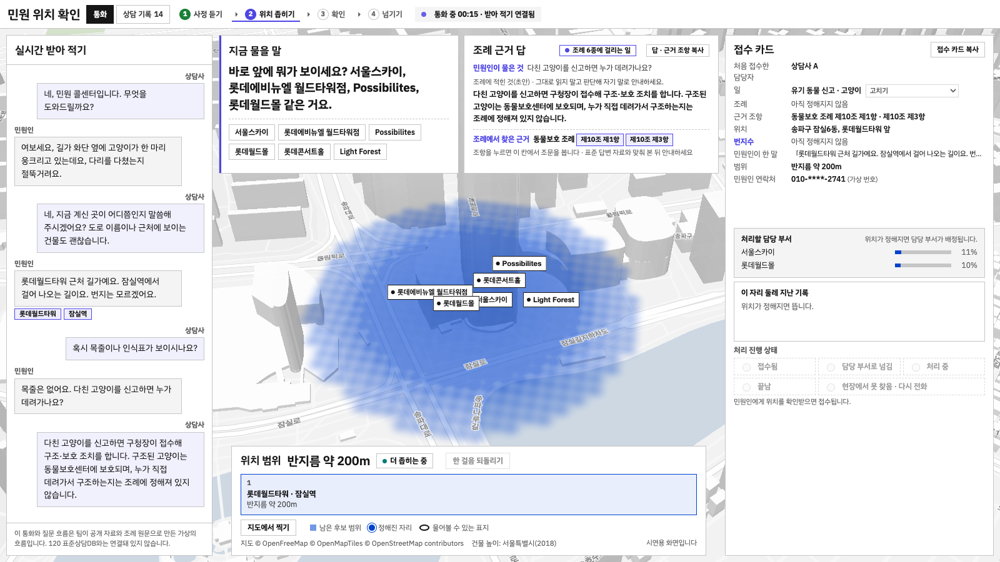
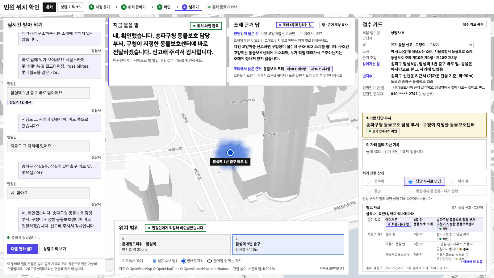
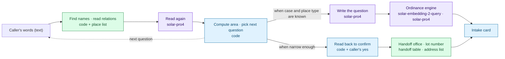

<!-- README decision pending 2 (English name): default = "Call Locate", taken from the repository folder name call-locate. Pending 3 (what the top leads with): default = the service as the title, the scored engine in the second paragraph and the "Ordinance engine (scored API)" section. -->
<h1 align="center">Call Locate (통화로 위치 좁히기)</h1>

<h3 align="center">Even when the caller cannot give an address, we narrow down the place through the call, find the basis in the ordinance text, and turn it into one intake case.</h3>

<p align="center">General complaint lines such as 120 cannot get the caller's location from the phone call alone, so the call agent has to hear the place in words. This screen reads location clues from what the caller says, shrinks the candidate area on the map, and shows one next question that splits that area best. When the place is fixed, the intake card gets one line the field worker can read to find the spot, the lot number of the nearest building, and the office to hand the case to. If the case falls under one of the six Seoul ordinances, the team's ordinance Q&A engine shows an answer with the cited articles on the same screen.</p>

<p align="center">
  This is Team GG's repository for the Upstage track, "Public law Q&A AI with Upstage AI Studio", of the 2026 AI Bootcamp Competition. It holds two things: the <b>ordinance Q&A engine</b> (<code>engine/</code>, the API the contest scores) and the <b>demo screen</b> built on it (<code>demo/call/</code>). To run the demo without an API key, follow <a href="#getting-started">Getting started</a>.
</p>

<p align="center">
  <a href="README.md">한국어</a> · <b>English</b>
</p>

<p align="center">
  
  
  
  
</p>

<p align="center">
  <a href="#screens">Screens</a> •
  <a href="#why-we-built-it">Why we built it</a> •
  <a href="#features">Features</a> •
  <a href="#architecture-and-models">Architecture and models</a> •
  <a href="#measurements">Measurements</a> •
  <a href="#getting-started">Getting started</a> •
  <a href="#what-you-should-know">What you should know</a>
</p>

---

## Screens

> [!NOTE]
> The service and these screenshots are in Korean. The call is a made-up call the team wrote. It is not a real complaint or a real person, the agent's name tag is "상담사 A" (Agent A), and the caller's phone number ("민원인 연락처") is made up with the middle digits hidden. The bottom left of the screen also says "This call and question flow is a made-up flow the team built from public material and the ordinance text. It is not connected to the 120 standard consultation database." The scripted scene was played in "saved answers" mode: the team ran the script once with real calls, saved the Upstage model responses, and replays them for the same words.

<p align="center">
  
  <br>
  <b>During the call.</b> The caller says "It's an alley near the Sangdo 1-dong community center, on the way up from Sangdo Station. I don't know the lot number." The candidate area shrinks to a radius of about 210 m, and the next question appears in "지금 물을 말" (What to ask now) with landmark names to pick from. The caller asked "Who comes to take it?", so the "조례 근거 답" (Ordinance answer) box shows a draft the engine made from the ordinance and the cited articles (Animal Protection Ordinance, Article 10(1), and others). Even before the place is fixed, the intake card already shows "민원인이 한 말" (what the caller said).
</p>

<p align="center">
  
  <br>
  <b>After the call.</b> "Right in front of the Sangdo 1-dong community center" shrinks the area to a radius of about 40 m. The screen reads the place back ("Dongjak-gu, Sangdo 1-dong, right in front of the Sangdo 1-dong community center, is that right?"), and the caller says yes, so the place is fixed. The intake card now shows the lot number "near 437 Sangdo-dong, Dongjak-gu (nearest building, about 10 m)" and the office "Dongjak-gu Office animal protection team · the animal shelter the district office designated". At the bottom, a reference table shows how the handoff changes with "alive or dead, and where it is". The "What to ask now" box shows the closing words, and the bottom left shows "다음 전화 받기" (Take next call) and "상담 기록 보기" (View records) buttons.
</p>

## Why we built it

Some complaints depend on the location (an injured animal, a dead animal on the road, a broken road), because someone has to go to the spot. But a place heard over the phone may not be exact.

| What we checked | Source |
| --- | --- |
| The law lets only the special numbers 119, 122, and 112 get the caller's location from the call. 120 is not one of them. To get a location, 120 needs the caller's separate consent | Act on the Protection, Use, etc. of Location Information, Article 15(1) and Article 29, and its Enforcement Decree, Article 29 |
| In 2025, 120 handled 6,443,378 consultations. Phone calls were the largest channel at 3,310,889 (51.4%) | Seoul 120 Dasan Call Foundation, reply to an information disclosure request (2026-11-17) |
| Field workers find places by lot number, but callers describe them like "from the ○○ intersection toward ○○", so the field worker has to guess. If they cannot find it, they call the caller back | One phone call with a road complaint officer at a district office (2026-11-17). This is one person's account, and "they call back" was an answer to a question we asked first |

So we narrow down the place during the call. Once the place is fixed, the district office and team to hand the case to and the lot number follow, and if the case falls under the six ordinances, the engine answers with the cited articles. Each source and how to use it carefully is in the [evidence notes](docs/call-locate/근거.md) (Korean).

## Features

- 🗣️ **Reads location clues from speech.** It finds names in a place list (143,988 OpenStreetMap places and 348,712 small-business records) and uses the words right after a name to tell "right in front of", "near", "past", and "before reaching". A name the caller takes back ("oh, no, wait") is dropped. Fixes for real speech are also on by default: "a few minutes' walk", saying where you are now apart from where you saw it, "not X but Y", "across from", "from A toward B", giving only an exit number, naming a brand and its branch separately, giving an address, and more (`SPEECH_ON` in `demo/call/locate.py`). It also handles speech-to-text mistakes: station names split or off by one letter, numbers written out in Korean words, particles after a name, and "no" (아니에요) to the inside-or-outside-the-park question (`STT_ON`).
- ❓ **Shows only one next question.** It computes which question splits the remaining candidates most evenly. Questions that change the handoff office (is the animal alive, is it inside a park or on the street) come first.
- 📍 **Reads the place back before fixing it.** When the area is within a 50 m radius (a 200 m stretch on a road), it asks "…is that right?" and drops the pin only after the caller says yes.
- 🗂️ **Fills the intake card.** It writes a line for finding the spot, the lot number of the nearest building with its distance, map coordinates, and the office in charge. The office line also says whether it was "confirmed in official guidance" or is "not yet confirmed (a guess)". If the agent picks a different case type in "일" (Case), the screen keeps the call text and the area and decides the office and whether the six ordinances apply again.
- 📜 **Adds the ordinance answer.** If the case falls under the six ordinances, a draft the engine made from the ordinance and the cited articles stay in the same box during the whole call. Clicking an article number shows the article text, effective date, and source link in that box. The screen tells the agent not to read the draft as is but to judge and explain in their own words, and the answer and cited articles can be copied.
- 🏫 **Knows large places and intersection names.** For schools, stations, large stores and similar places bigger than 60 m, it adds their size to the area instead of treating them as one center point, and it does not drop a pin in their center. It understands 994 names of major intersections in Seoul (such as "강남역사거리").
- ☎️ **Calls you turn on with a switch (off by default).** `CALL_DIRECT=1` is the direct call for the deployed version: a visitor plays the caller and types, and the next line the screen picked and the ordinance answer appear in the chat as the agent's words (with an access code and usage limits). `CALL_VOICE=1` is a voice call placed and answered from a phone browser; its speech-to-text and reading aloud are not Upstage models, so it is for development experiments and making the demo video only (see "What you should know" 4). Details are in [`demo/call/voice/README.md`](demo/call/voice/README.md) (Korean).
- 🏙️ **Draws map buildings at their real height.** 68,197 Seoul buildings that are taller in reality than in the map tiles are redrawn with heights from Seoul's building data, and the buildings in the script get a roof outline. The heights in Seoul's data are not measured; they are floors × 3.5 m. Add `?heights=off` to the address to turn this off.
- 🗒️ **Keeps consultation records.** Calls with a confirmed place are saved, and past records nearby (within 400 m) appear on the intake card and the map. The status has five steps: received, handed to the office, in progress, not found on site / call back, and done.
- 🙅 **Says when it does not know.** The engine answers "확인 불가" (cannot confirm) when it finds no basis. The screen writes what is missing as it is, for example "the six Seoul ordinances have no article on handling animal carcasses", "not yet confirmed (a guess)", or "no lot number (inside a park)".

## How one call goes

Four steps at the top of the screen show where the call is.

1. **Hear the situation.** The caller's words come in one line at a time. In the demo, they come from a script or are typed in.
2. **Narrow down the place.** For each line, code reads names and relations and shows the area and the next question right away. Then solar-pro4 reads the same line again into fixed fields and corrects it. If the case is one to ask the ordinances about, the screen writes a question for the engine once the case type and place type are known, and gets the ordinance answer.
3. **Confirm.** When the area is small enough, the screen reads the place back. If the caller says no, it lowers the chance of that spot and keeps narrowing.
4. **Hand off.** From the fixed place it decides the office and the lot number and fills the intake card. A case with a confirmed place is saved to the records, and the agent sets the status to "handed to the office" (the scripted scene shows it as already chosen). When the call ends, "Take next call" and "View records" buttons appear.

The demo does not file or send anything for real. The status changes only inside the screen.

## Architecture and models

Every model call is a single call that returns fixed fields (JSON), and code decides what happens next. Things that must not be made up, such as place names, article names, source links, and effective dates, come only from tables and the ordinance text.



Purple is an Upstage model call, blue is code, and green is a table or data lookup (code does the lookup in green boxes too).

### Upstage models by stage

The table follows the five stages the contest notice asked teams to describe. We checked the model names in `engine/config.py` and in the calls in each file.

| Stage | What we do | Upstage model |
| --- | --- | --- |
| Collection | The original text of the six Seoul ordinances is kept as a data file (`engine/data/ordinances.json`), with the source link and effective date for each | None |
| Document parsing | The tables in the annexes (fee tables and so on) were read with Document Parse and saved. On top of the starter kit's results, we re-read them in a mode that keeps table cells, and code turns each row into "header: value" lines. It is not called per question | Document Parse (`document-parse`) |
| Search | The 528 ordinance chunks are turned into vectors in advance. The question is turned into a vector to find close chunks, mixed with a keyword score | `solar-embedding-2-passage` (chunks) · `solar-embedding-2-query` (questions) |
| Answer generation | Break the question into fields, read the full text of the chosen ordinance and write the answer, then rewrite it in plain words | `solar-pro4` |
| Verification | Judge whether the remaining evidence really covers what the question asks. Three code gates add to this: choosing which ordinance to read, checking that the quoted phrase appears word for word in the article, and checking the output format | `solar-pro4` + code |
| (Demo screen) read again · write the question · shorten for reading aloud | The purple boxes above. Only when the engine answer is longer than two sentences or 160 characters is it shortened to one or two sentences. The short version is dropped if it adds a number or changes the conclusion | `solar-pro4` |
| (Voice switch `CALL_VOICE`, off by default) speech-to-text · reading aloud | For development experiments and making the demo video only. Not a model the service calls (see "What you should know" 4) | Not an Upstage model |

<details>
<summary><b>Stages in more detail (files and functions)</b></summary>

**For each line** (`demo/call/server.py` · `locate.py` · `gaz.py`)

| Stage | Who | What it does | File · function |
| --- | --- | --- | --- |
| Remove fillers | code | Removes fillers such as "um" and "so" | `server.py` `FILLER` |
| Find names | code + place list | Finds names in the place list, longest first, and also links names that sound alike | `server.py` `shortlist`, `gaz.py` |
| Read relations | code | Uses the words right after a name to tell the relation, and reads words such as the animal and whether it is alive | `server.py` `code_read` |
| Read again | solar-pro4, once | Gets the name candidates code found and the options of the last question, and answers only in fixed fields. Names not on the list are dropped. If the format is wrong, only the code reading is used | `server.py` `model_read`, `READ_PROMPT` |
| Compute area | code | Places candidate points every 20 m where the clues point, and multiplies for each point "how likely the caller would say this if it were here". The area is where 90% of the likelihood sits | `locate.py` `infer` |
| Pick next question | code | Questions that change the handoff come first, then the one location question that splits the area best. At most 10 location questions | `locate.py` `questions`, `LOCCAP` |
| Narrow enough · confirm | code | Within a 50 m radius (a 200 m stretch on a road), it reads the place back | `locate.py` `is_done` |

**After the place is fixed**

| Stage | Who | What it does | File · function |
| --- | --- | --- | --- |
| Place type | code + data | Street, city park, Han River park, neighborhood park, or motorway | `locate.py` `place_class` |
| Handoff office | table | Picks one row by case type × place type × animal, and fills in the district name | `server.py` `route_of`, `data/routes.json` |
| Write the question | solar-pro4, once | Turns the call into a one- or two-sentence question that starts with "[place] …" | `server.py` `_run_engine`, `ASK_PROMPT` |
| Ordinance engine | table below | Calls the same code as the scored API | `engine.pipeline.answer` |
| Attach articles | code + data | Adds the ordinance name, article text, link, and effective date for each cited article from the ordinance data | `server.py` `engine_card` |
| Lot number | address list | The lot number of the address point closest to the pin (162,442 addresses from the small-business data) and its distance. If it is more than 100 m away, "no lot number" comes first | `server.py` `nearest_addr` · `bunji_of` |

**Inside the ordinance engine** (`engine/flow2/flow.py`, submitted settings `eval/configs/release.json`)

| Stage | Who | What it does |
| --- | --- | --- |
| Search | solar-embedding-2-query, once + code | Picks 20 candidates from the chunks of the six ordinances |
| Analyze the question | solar-pro4, once | Does not answer. Only breaks the question into fields (subject, what is asked, type, any ordinance named, region) |
| Choose the ordinance | code | Picks at most two ordinances to read. If the question is about another ordinance, a district, or another city, it ends here with "cannot confirm" |
| Read the ordinance · write the answer | solar-pro4, once | Reads the full text of the chosen ordinance (annexes included) and returns an answer and evidence (article name + a phrase copied from it) |
| Phrase gate | code | Keeps a citation only if the copied phrase appears word for word in that article |
| Check against the question | solar-pro4, 0 or 1 time | Judges whether the remaining evidence really covers what the question asks |
| Plain words · opening word | solar-pro4, once + code | Rewrites the answer in plain words and drops the rewrite if a number or the conclusion changes. Adds "yes" or "no" to the front of answers to yes/no questions |
| Output | code | Keeps only articles that are in the index, and code adds the source link and effective date. With no citation left, the answer becomes "cannot confirm" |

</details>

### Ordinance engine (scored API)

Send a question to `POST /ask` and it answers in the contest's four-field JSON. This is a real response from the submitted settings (2026-11-18). The answer is in Korean; in English it says: "Yes, parking fees are reduced for people with disabilities. With the disabled vehicle sign attached, a person with a disability on board, and the disability card shown, the fee is 80% off. At subway transfer parking lots, the first 3 hours per day are free and 80% off after that."

```json
POST /ask  {"question": "장애인 주차요금 감면되나요?"}

{"answer": "네, 장애인 주차요금은 감면됩니다. 장애인자동차표지를 부착하고 장애인이 탑승해 장애인등록증을 제시하면 주차요금의 80%가 할인됩니다. 지하철 환승주차장에서는 1일 1회당 최초 3시간까지 주차요금이 면제되고 이후 80%가 할인됩니다.",
 "citation": ["서울특별시 주차장 설치 및 관리 조례 제7조 제1항"],
 "source_url": "https://www.law.go.kr/ordinInfoP.do?ordinSeq=2171833",
 "effective_date": "2026-10-01"}
```

- When it finds no basis, `answer` starts with "확인 불가" (cannot confirm) and `citation` is empty.
- Each question has a 75-second deadline, and any error still returns HTTP 200 with the four-field JSON.
- `GET /health` returns the fingerprint of the loaded settings (`settings`). The submitted version is `4fb47ff9df76`.

The ordinances are the versions in force on 2026-10-01, as the contest set. Each ordinance has its own effective date, and `effective_date` in the response is the effective date of the cited ordinance.

| Ordinance | Effective date |
| --- | --- |
| 서울특별시 주차장 설치 및 관리 조례 (parking lots) | 2026-10-01 |
| 서울특별시 동물보호 조례 (animal protection) | 2026-10-01 |
| 서울특별시 자전거이용 활성화에 관한 조례 (bicycle use) | 2026-10-01 |
| 서울특별시 도시공원 조례 (city parks) | 2026-07-13 |
| 서울특별시 청년 기본 조례 (youth) | 2025-07-14 |
| 서울특별시 금연환경 조성 및 간접흡연 피해방지조례 (smoke-free areas) | 2026-10-01 |

## Measurements

### Ordinance engine

Scores of the submitted engine on questions never used in development (unseen questions) and on development questions. The weighted score averages the scores by type with the starter kit's example ratio (simple 3, conditional 3, combined 3, trap 2). It is the team's own measurement, not the contest's hidden scoring.

| | 166 unseen questions, 3 runs | 693 development questions, 3 runs |
| --- | --- | --- |
| **Weighted score** | **93.0** (91.1 to 94.7) | **95.1** (94.7 to 95.6) |
| Simple lookup | 97.5 | 95.6 |
| Conditional | 94.3 | 96.7 |
| Combining several articles | 92.8 | 91.8 |
| No basis (trap) | 84.8 (11 questions) | 96.7 (40 questions) |
| Over-abstaining ("cannot confirm" when an answer exists) | 1.5% | 2.1% |
| Errors · format errors · answers over 90 s | 0 | 0 |

- Unseen questions: three runs on 2026-11-18 (simple 63, conditional 63, combined 29, trap 11). Development questions: the same version, two runs on 11-15 and one on 11-18. The engine was called directly without the server, four questions at a time.
- The 2.0-point gap between the two sets all comes from trap questions. Without traps, the average of the other three types is the same (94.8 and 94.7). The unseen set has only 11 trap questions, so one question moves the trap score by 9.1 points.
- One run of the 166 unseen questions made 704 to 705 Upstage calls (about 4.2 per question, embeddings included). The logged cost (tokens × list price) was $0.37 to $0.40.

<details>
<summary><b>What we changed from the starter kit (improvement history)</b></summary>

| Cycle | Weighted score on development questions | Over-abstaining | Questions · scoring rule |
| --- | --- | --- | --- |
| 0 Start (the starter kit, moved over) | 67.0 | 28.4% | 661 questions, rule before 11-11 |
| 1 | 76.9 | 18.8% | 661 questions, rule before 11-11 |
| 3 | 92.5 | 7.2% | 693 questions, current rule |
| 4 Submitted | 94.8 | 2.0% | 693 questions, current rule |

The question set and the scoring rule changed in the middle, so cycles 0 and 1 should not be compared directly with cycles 3 and 4. The record for each cycle is in [`docs/engine/releases.md`](docs/engine/releases.md) (Korean).

| | Start | Submitted |
| --- | --- | --- |
| Flow | search → pick evidence · write answer → judge → output | search → analyze the question → choose the ordinance (code) → read the full ordinance and write the answer → phrase gate (code) → check against the question → plain words → output check (code) |
| What it reads | A few chunks from search | The full text of the chosen ordinance |
| Annexes | The table text the kit read | Re-read keeping table cells, turned into "header: value" lines |
| Questions outside the six ordinances | Left to search scores and a model judgment | Code ends them before reading |
| Citations | Names of the chunks the model picked | Only phrases that appear word for word in the article. Code adds the link and effective date |

The stages and switches of the new flow are in [`docs/engine/flow2.md`](docs/engine/flow2.md) (Korean).

</details>

### Narrowing the location

<!-- Numbers to update at the Friday/Saturday number check: the table, the lines below, and "What you should know" 2. Current values: 600 calls measured on 11-19 with the current defaults (six location-reading switches on, PR #123). "우리 측정" in docs/call-locate/README.md still has the 11-18 values -->

All of these come from simulated calls. In a simulated call, code picks a true location in Seoul, and a simulated caller answers the screen's questions with what can be seen from that spot. We have not measured with real people speaking yet.

| What we measured | Result |
| --- | --- |
| Calls narrowed to one point | When the caller answers what they see, 421 of 600 calls (70.2%) were narrowed to one point, and 0 calls were fixed at a wrong place. On 11-18, before we found and fixed four causes of wrong fixes, the same 600 calls gave 414 (69.0%) and 4 wrong fixes |
| When the caller makes mistakes | With 10% wrong answers and 10% "I don't know": 398 calls (66.3%) and 0 wrong fixes. With 10% wrong answers and a caller who easily says yes to a wrong place: 417 calls (69.5%) and 5 wrong fixes |
| How close the lot number is | Median distance from the true location to the nearest lot number: 18 m in alleys and shopping streets, 25 m around station exits, 39 m on main roads. Share more than 100 m away: 48% on motorways, 80% inside parks |

- Measured on 2026-11-19 with the current defaults (all location-reading fixes on). The 600 calls are four runs of 150. Two of the four random seeds that pick true locations were never used in development. When the caller answers what they see, a call has 6.5 exchanges on average.
- The simulated caller never says speech-to-text mistakes or intersection names, and names a large place like a school only when standing near its point. So the fixes turned on on 11-19 (speech-to-text mistakes, large places, intersection names) did not change the one-point or wrong-fix counts of these 600 calls; their effect was checked with separate sets of made-up phrases.
- "One point" means the area was narrowed within a 50 m radius (a 200 m stretch on a road), the caller confirmed it, and the point is within 60 m (120 m on a road) of the true location. A "wrong fix" means the confirmed point is farther than that.
- Measurements up to 11-18 and how we fixed things are in "우리 측정" (Our measurements) in [`docs/call-locate/README.md`](docs/call-locate/README.md) (Korean).

## Getting started

You need Python 3.10 to 3.13 (3.12 is recommended). Run every command from the repository root.

### 1. Run the demo without an API key

You only need numpy. The saved-answers mode calls neither the Upstage API nor the engine.

```bash
OPENBLAS_NUM_THREADS=1 CALL_MODE=saved python3 demo/call/server.py
```

Open <http://127.0.0.1:8772> and press "받기" (Answer) or Enter to play the main scene (an injured cat in a residential alley). Change the port with `CALL_PORT`.

| Address | Scene |
| --- | --- |
| `/?auto=cat_street` | Plays the main scene right away. Add `&speed=3` to play it faster |
| `/?auto=cat_park` | An injured cat inside Seoul Forest park (a place with no lot number) |
| `/?auto=roadkill` | A dead cat seen while driving (a motorway stretch, outside the six ordinances) |
| `/?view=records` | The consultation records screen |

In "직접 통화" (Live call, keyboard `0`) you can type any place in Seoul. For example: "마포구인데요, 스타벅스 앞 가로등이 꺼져 있어요" (It's Mapo-gu, the streetlight in front of Starbucks is out) → "합정역 근처예요" (It's near Hapjeong Station). In saved-answers mode, words that are not in the script are read by code only, without a model.

The browser loads map tiles (OpenFreeMap) and the map library (MapLibre GL, from unpkg) from the internet. The font (IBM Plex Sans KR) is in the repository at `demo/call/web/fonts/`. The server fetches nothing from outside. The screen is light by default; add `?tone=dark` to the address for a dark screen.

### 2. With an Upstage API key

Create the engine's virtual environment and add the key. Keep the key only in `.env` and never commit it (`.gitignore` blocks it).

```bash
python3 -m venv .venv
.venv/bin/pip install -r engine/requirements.txt
cp .env.example .env          # put your key after UPSTAGE_API_KEY=
```

Run the demo with real calls. solar-pro4 reads each line again, and the ordinance answer calls the engine directly.

```bash
OPENBLAS_NUM_THREADS=1 ENGINE_CONFIG=eval/configs/release.json .venv/bin/python demo/call/server.py
```

Ask the engine one question (about 4 Upstage calls).

```bash
.venv/bin/python -m engine.pipeline "장애인 주차요금 감면되나요?" eval/configs/release.json
```

Run the scoring API server (the submitted version). Run a single worker (do not pass `--workers`).

```bash
ENGINE_CONFIG=eval/configs/release.json .venv/bin/uvicorn engine.server:app --host 0.0.0.0 --port 8000
curl -s -X POST http://localhost:8000/ask -H 'Content-Type: application/json' -d '{"question": "장애인 주차요금 감면되나요?"}'
```

> [!NOTE]
> Without a key, the engine answers every question with "확인 불가" (cannot confirm), still as HTTP 200 and four-field JSON. On Windows, use `.venv\Scripts\python`. Other differences are in "윈도우에서 다른 것" (On Windows) in [`engine/README.md`](engine/README.md) (Korean).

### 3. Checks

| What it checks | Command | Key |
| --- | --- | --- |
| Runs the demo server in saved-answers mode and plays the scripted scenes, buttons only, places outside the script, saving a nickname, consultation records, and reference values to the end. Exit code 1 on failure | `OPENBLAS_NUM_THREADS=1 python3 demo/call/check.py` (port 8779, change with `CALL_CHECK_PORT`) | No |
| Self-test of the location math | `python3 demo/call/locate.py` | No |
| 30 simulated calls: number of exchanges, error of the fixed point, handoff office (code only, about 30 s) | `OPENBLAS_NUM_THREADS=1 python3 demo/call/tools/sim_calls.py` | No |
| Server side of the voice call and direct call switches (off by default). Speech-to-text is fake, and outside services are replaced by fake servers on this computer | `OPENBLAS_NUM_THREADS=1 python3 demo/call/voice/check_voice.py`, `OPENBLAS_NUM_THREADS=1 python3 demo/call/voice/check_direct.py` | No |
| Self-tests of the engine's response format and flow | `.venv/bin/python -m engine.contract --selftest`, `.venv/bin/python -m engine.flow2.flow --selftest` | No |
| Score the 693 development questions (two runs) | `.venv/bin/python eval/run.py --config eval/configs/release.json --split dev --repeat 2` | Yes |

<details>
<summary><b>Environment variables</b></summary>

| Name | Used by | If missing |
| --- | --- | --- |
| `UPSTAGE_API_KEY` | The engine and real calls in the demo | The engine only answers "cannot confirm" |
| `ENGINE_CONFIG` | Engine settings file (submitted: `eval/configs/release.json`) | The start version (defaults in `engine/config.py`) |
| `ENGINE_LOG_DIR` | Folder for per-question logs from the scoring server | `logs/` (an empty value turns logging off) |
| `LAW_OC` | Only for downloading the ordinance text again (`eval/fetch_source.py`) | Not needed to run (the text is in the repository) |
| `CALL_MODE` | Demo: `saved` for saved answers, `code` for code only without a model, anything else for real calls | Real calls |
| `CALL_PORT` | Demo port | 8772 |
| `CALL_MODEL` | Model the demo uses to read lines and write the question | solar-pro4 |
| `CALL_DIRECT` | `1` turns on the direct call (text) for the deployed version | Off |
| `CALL_VOICE` | `1` turns on the voice call (development experiments and video making only, not a model the service calls) | Off |

The demo's other environment variables are in [`demo/call/README.md`](demo/call/README.md) (Korean).

</details>

## What you should know

<!-- README decision pending 4 (standard consultation database sentence): default = the same words as the screen text (the "가상 흐름" row in docs/content/A-05). Change both together -->
1. **The demo calls are made up.** This call and question flow is a made-up flow the team built from public material and the ordinance text, and it is not connected to the 120 standard consultation database (the bottom left of the screen says the same). The team wrote the call scripts and question wording, and chose the complaint types from Seoul's field complaint handling standard. The line "표준 답변 자료와 맞춰 본 뒤 안내하세요" (check against the standard answers before you tell the caller) leaves that check to the agent. The 14 past records on the records screen are also examples the team made.
2. **The call accuracy numbers come from simulated calls.** No call with a real person speaking has been measured yet.
3. **The handoff table mixes "confirmed" and "guessed" rows.** Of 30 rows across 12 case types, 11 were confirmed in official guidance or the ordinance text, and 19 are guesses. The screen shows them as "확인 전(추측)" (not yet confirmed, a guess), and team names may differ by district.
4. **The only models the service calls are Upstage models.** With the default settings, the only outside model API that the engine and the demo server call is Upstage's, and the browser loads only map tiles and the map library from outside. The repository also holds code for a voice call switch (`CALL_VOICE`, off by default). Its speech-to-text and reading aloud (ElevenLabs, Whisper running on this computer, Return Zero) are not Upstage models, so they are for development experiments and making the demo video only, and are not models the service calls. They are not used for deployment or scoring until the contest office answers ([`docs/decisions.md`](docs/decisions.md), 11-19, Korean).

## Limitations

- It cannot understand shop or building names that are not in the map data (OpenStreetMap and the small-business data). It also has no motorway signs or exit numbers.
- The lot number is not the lot number of the spot itself. It is the lot number of the nearest building with a shop, so the distance is always shown with it.
- Distance ranges such as "right in front" = 18 m and "near" = 100 m, and the rule for when to stop, were not tuned with real calls.
- The first question assumes the caller is at the spot. If someone reports something they saw while passing by from another place, the screen may narrow down the wrong place (only the motorway scene asks separately which bridge the driver passed).
- Roads, stations, or bridges that share a name are not fixed until another clue tells them apart.
- The screen assumes it receives text from the call center's speech-to-text tool. It has never been connected to that tool. The demo uses script playback and typed input.
- It does not actually file or send a case.
- Engine: on unseen questions, the trap score (questions where "cannot confirm" is correct because there is no basis) is lower than on development questions (84.8 vs 96.7). For cases under the six ordinances, the engine sometimes gives different answers to the same question.

Some evidence is still missing. We filed an information disclosure request for the number of call-backs caused by unclear locations and have not received it. A test where real people describe their own location in their own words is prepared but has 0 calls so far (section 7 of the [evidence notes](docs/call-locate/근거.md), Korean).

## Data sources and terms

| Data | Source · terms |
| --- | --- |
| Text of the six Seoul ordinances (`engine/data/ordinances.json`) | National Law Information Center (law.go.kr). The version as of 2026-10-01 that the contest starter kit downloaded |
| Annex reading results (`engine/data/annex/`, `engine/flow2/annex/`) | Results of reading the annexes with Upstage Document Parse |
| 528 ordinance chunks and embeddings (`engine/data/`) | Made by the starter kit and used as is (solar-embedding-2-passage, 1024 dimensions) |
| Places · roads · parks (`places.tsv.gz` · `roads.json.gz` · `areas.json` · `park_things.tsv.gz` · `park_names.tsv.gz` · `ramps.tsv.gz` in `demo/call/data/seoul/`) | © OpenStreetMap contributors, ODbL 1.0 (BBBike Seoul extract, 2026-11-08). The reduced tables also follow ODbL (attribution, share-alike) |
| Shops · addresses (`shops.tsv.gz` · `addrs.tsv.gz`) | Public Data Portal 15083033, "소상공인시장진흥공단_상가(상권)정보_20260930" (small-business commercial data). No restriction on use |
| Streetlight numbers (`lamps.tsv.gz`) | Public Data Portal streetlight locations (15107934 Seoul, 15070592 Gwangjin-gu, 15107876 Yeongdeungpo-gu, 15062578 Seodaemun-gu). No restriction on use |
| Park restrooms (`park_toilets.tsv.gz`) | Seoul Open Data Plaza OA-22586, Seoul public restroom locations. KOGL Type 1 (attribution) |
| Motorway interchange and tunnel names (`road_nodes.tsv.gz`) · major intersection names (`cross_nodes.tsv.gz`) | National Transport Information Center standard node-link data (2026-11-11) |
| Sizes of large places (`extents.tsv.gz`) | © OpenStreetMap contributors, ODbL 1.0 (areas from the Seoul extract above) + station exits from the same place list |
| A few demo places (`demo/call/data/extra_places.json`) | Added by hand by the team because the map data had no name for them |
| Saved answers (`demo/call/data/saved.json`) | Upstage model and engine responses saved from running the scripted scenes with real calls |
| Building heights (`demo/call/web/heights/`) | Seoul Metropolitan Government, "서울시 건물 태양에너지 등급도(2018년)" (Seoul building solar energy grade map, 2018), Seoul Open Data Plaza OA-15944, KOGL Type 1 (attribution). Heights are not measured; they are floors × 3.5 m. Footprints: © OpenStreetMap contributors · OpenFreeMap tiles |
| Map tiles (screen) | © OpenFreeMap · © OpenMapTiles · © OpenStreetMap contributors (shown at the bottom of the screen) |
| Font (`demo/call/web/fonts/`) | IBM Plex Sans KR 1.1.0, © 2017 IBM Corp., SIL Open Font License 1.1 (`demo/call/web/fonts/OFL.txt`) |

The original data is not in the repository; only the reduced tables are. The scripts that rebuild them are `demo/call/tools/osm_fetch.py` and `build_*.py`.

## Documentation map

All of these documents are in Korean.

| What you want to know | Document |
| --- | --- |
| How to run and click through the demo, scene addresses, environment variables | [`demo/call/README.md`](demo/call/README.md) |
| An introduction to the service and its measurements | [`docs/call-locate/README.md`](docs/call-locate/README.md) |
| Evidence that the problem is real, with sources | [`docs/call-locate/근거.md`](docs/call-locate/근거.md) |
| The words on the screen and the call scripts (the source of all screen text) | [`docs/content/A-05_통화위치좁히기.md`](docs/content/A-05_통화위치좁히기.md) |
| How to run the engine, its files, and its logs | [`engine/README.md`](engine/README.md) |
| The engine's new flow | [`docs/engine/flow2.md`](docs/engine/flow2.md) |
| The scoring rules we received | [`docs/engine/scoring-rules.md`](docs/engine/scoring-rules.md) |
| How to measure scores and keep records | [`docs/engine/reproducibility.md`](docs/engine/reproducibility.md) |
| Engine scores by cycle | [`docs/engine/releases.md`](docs/engine/releases.md) |
| Contest judging criteria | [`docs/evaluation.md`](docs/evaluation.md) |
| What the team decided and why | [`docs/decisions.md`](docs/decisions.md) |
| How we work | [`AGENTS.md`](AGENTS.md) · [`CONTRIBUTING.md`](CONTRIBUTING.md) |

<details>
<summary><b>Folders</b></summary>

```text
engine/              # Ordinance Q&A engine (scoring API: engine/server.py)
├── flow2/           # Flow of the submitted version
└── data/            # Ordinance text, annex results, chunks, embeddings
eval/                # Evaluation questions, scoring tools, experiment settings (eval/configs/)
demo/call/           # Demo screen "Call Locate"
├── server.py        # Call server (reading lines, handoff office, intake card)
├── locate.py        # Area math and next-question choice
├── gaz.py           # Place list
├── data/            # Handoff table, place and address tables, saved answers, example records
├── web/             # Screen
└── tools/           # Data builders, simulated-call measurement
docs/                # Introduction, evidence, screen text, engine docs, decisions, meetings
```

</details>

<!-- README decision pending 1 (license): default = no license section (the repository has no LICENSE file). If one is chosen, add a "## License" section here and keep the "Data sources and terms" table as is -->
## Team

Team GG · 2026 AI Bootcamp Competition, Upstage track "Public law Q&A AI with Upstage AI Studio"
