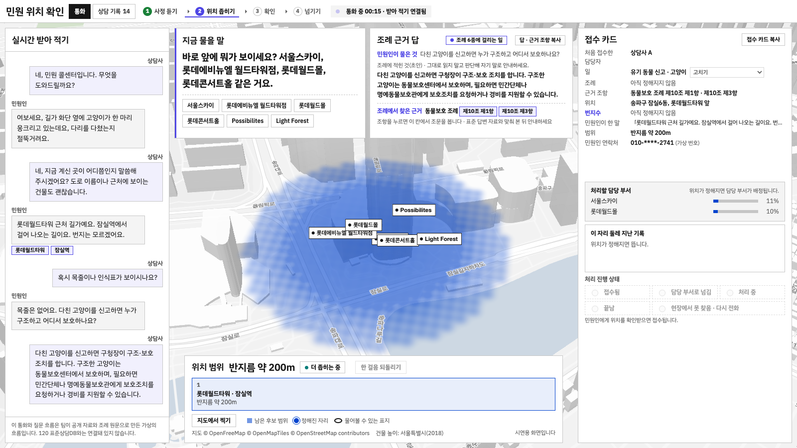
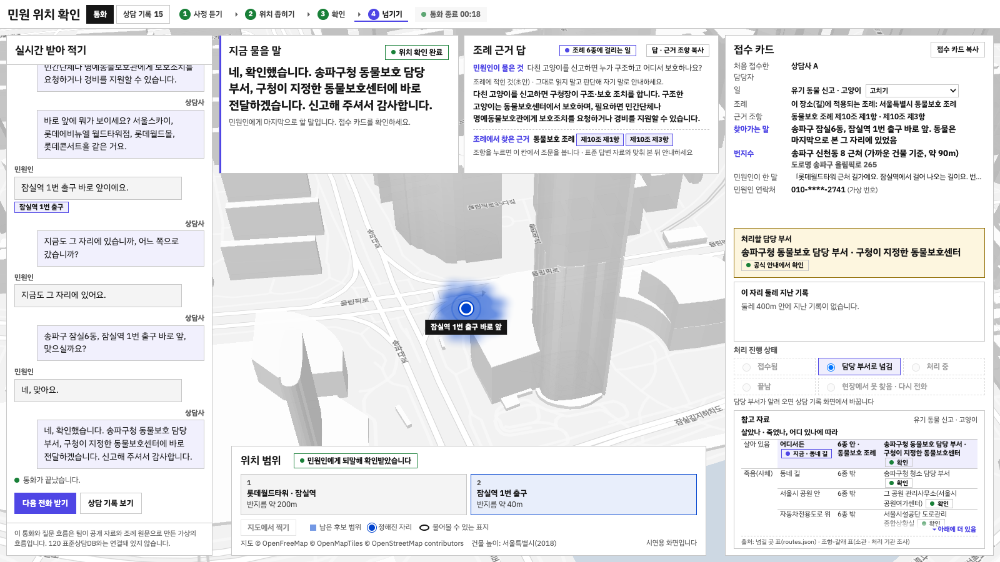
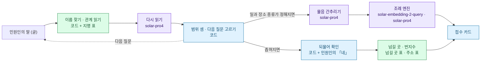

<!-- README 결정 대기 3(맨 위를 무엇으로 시작할지): 기본값 = 서비스 「통화로 위치 좁히기」를 제목으로, 채점받는 엔진은 머리 둘째 문단 · 「조례 엔진 (채점 API)」 절. 바뀌면 머리(h1 · h3 · 그림 아래 두 문단)를 고친다. 서비스 이름도 아직 정하지 않았다(11-21): 정하면 h1과 영어 판 제목을 바꾼다. -->
<h1 align="center">통화로 위치 좁히기</h1>

<h3 align="center">주소를 못 대는 민원 전화도, 통화로 자리를 좁히고 조례 원문에서 근거를 찾아 접수 한 건으로 만듭니다.</h3>

<!-- 시연 장소(11-21 PM 결정): 롯데월드타워 근처 길가 → 잠실역 1번 출구. 아래 두 장은 main 08bd360(둘째 묶음 #157, 보기 한글 이름)을 저장된 답으로 찍은 것이다(차례 2 물음 「누가 구조하고 어디서 보호하나요?」). 장소나 대본이 다시 바뀌면 `_orch-tools`의 README 그림 도구로 다시 찍고 두 설명의 장소 · 반지름 · 번지 · 넘길 곳을 고친다 -->
<p align="center">
  
  <br>
  <sub>통화 중인 상담 화면. 팀이 지어낸 가상 통화를 「저장된 답」으로 재생했습니다(<a href="#통화-한-건의-흐름">통화 한 건의 흐름</a>).</sub>
</p>

<p align="center">120 같은 일반 민원 전화는 건 사람의 위치를 받을 수 없어서, 상담사가 자리를 말로 듣습니다. 이 화면은 민원인의 말에서 위치 단서를 읽어 지도 위 범위를 줄이고, 다음에 물을 질문을 하나 띄웁니다. 자리가 정해지면 접수 카드에 번지수와 처리할 담당 부서를 적고, 서울특별시 조례 6종에 걸리는 일이면 조례 근거 답을 같은 화면에 붙입니다.</p>

<p align="center">
  <b>써 보기</b> — 심사위원용 시연 화면 주소는 LMS 제출 칸에 있습니다. 내 컴퓨터에서 열쇠 없이 띄우려면 <a href="#시작하기">시작하기</a>를 따릅니다.<br>
  팀 GG가 2026 AI 부트캠프 경진대회의 업스테이지 주제 「Upstage AI Studio를 활용한 공공 법령 Q&A AI」에 낸 저장소입니다. <b>조례 Q&A 엔진</b>(<code>engine/</code>, 대회 채점을 받는 API)과 그 엔진을 붙인 <b>시연 화면</b>(<code>demo/call/</code>)이 들어 있습니다.
</p>

<p align="center">
  <b>한국어</b> · <a href="README.en.md">English</a>
</p>

<p align="center">
  
  
  
  
</p>

<p align="center">
  <a href="#시작하기"><b>내 컴퓨터에서 띄우기</b></a> •
  <a href="#통화-한-건의-흐름">통화 한 건의 흐름</a> •
  <a href="#주요-기능">주요 기능</a> •
  <a href="#구조와-쓰는-모델">구조와 쓰는 모델</a> •
  <a href="#잰-값">잰 값</a> •
  <a href="#밝혀-둘-것">밝혀 둘 것</a> •
  <a href="#라이선스">라이선스</a>
</p>

---

## 통화 한 건의 흐름

> [!NOTE]
> 팀이 지어낸 가상 통화로 찍은 화면입니다. 실제 민원이나 실제 사람이 아니고, 접수 담당자 「상담사 A」는 이름표, 「민원인 연락처」는 가운데를 가린 가상 번호입니다. 대본 장면은 「저장된 답」으로 재생했습니다. 대본을 실제 호출로 한 번 돌려 받아 둔 업스테이지 모델 응답을 같은 말에 다시 보여 주는 방식입니다.

화면 맨 위의 단계 넷이 통화가 어디쯤인지 보여 줍니다.

1. **사정 듣기.** 민원인의 말이 한 줄씩 들어옵니다. 시연에서는 대본 재생이나 직접 입력으로 넣습니다.
2. **위치 좁히기.** 말마다 코드가 이름과 관계를 읽어 범위와 다음 질문을 바로 띄웁니다. 이어서 solar-pro4가 같은 말을 한 번 더 읽어 장소 이름 · 관계 · 무슨 일을 고칩니다. 조례에 물을 일이면, 일과 장소의 종류가 정해질 때 엔진에 물어 조례 답을 받습니다.
3. **확인.** 범위가 반지름 50m(길 위는 구간 200m) 안으로 좁혀지면 좁힌 자리를 「…맞으실까요?」로 되묻습니다. 민원인이 「네」라고 해야 핀을 찍고, 「아니요」라고 하면 그 자리의 가능성을 낮추고 다시 좁힙니다.
4. **넘기기.** 확정한 자리로 번지수와 넘길 곳을 정해 접수 카드를 채우고, 상담 기록에 쌓습니다. 상담사가 처리 상태를 「담당 부서로 넘김」으로 고릅니다(대본 장면은 고른 것으로 보입니다). 통화가 끝나면 「다음 전화 받기」 · 「상담 기록 보기」 단추가 뜹니다. 실제 접수나 전달은 하지 않고, 처리 상태는 화면 안에서만 바뀝니다.

<p align="center">
  
</p>

- **통화 중(맨 위 그림).** 「롯데월드타워 근처 길가예요. 잠실역에서 걸어 나오는 길이요. 번지는 모르겠어요.」에 범위가 서울 전체에서 반지름 약 200m로 줄고, 「지금 물을 말」에 다음 질문(「바로 앞에 뭐가 보이세요?」)과 고를 수 있는 표지 이름이 뜹니다(말로 읽는 보기는 한글 이름이고, 표지 칸에는 지도 자료에 적힌 영어 이름도 보입니다). 「다친 고양이를 신고하면 누가 구조하고 어디서 보호하나요?」에는 「조례 근거 답」 칸에 초안과 근거 조항(동물보호 조례 제10조 제1항 · 제3항)이 뜹니다. 접수 카드에는 위치가 정해지기 전부터 「민원인이 한 말」이 채워집니다.
- **통화 끝(이 그림).** 「잠실역 1번 출구 바로 앞이에요」로 범위가 반지름 약 40m까지 줄고, 「송파구 잠실6동, 잠실역 1번 출구 바로 앞, 맞으실까요?」에 「네」라고 답해 자리를 확정했습니다. 접수 카드에 번지수 「송파구 신천동 8 근처 (가까운 건물 기준, 약 90m)」와 처리할 담당 부서 「송파구청 동물보호 담당 부서 · 구청이 지정한 동물보호센터」가 채워지고, 맨 아래 참고 자료에 「살았나 · 죽었나, 어디 있나에 따라」 넘길 곳이 어떻게 갈리는지 보입니다.

## 왜 만들었나

위치가 중요한 민원(다친 동물, 길 위의 동물 사체, 도로 파손 등)은 누군가 현장에 가야 합니다. 그런데 전화로 들은 자리는 정확하지 않을 수 있습니다.

| 확인한 것 | 출처 |
| --- | --- |
| 전화만으로 건 사람의 위치를 받을 수 있게 법이 정한 특수번호는 119 · 122 · 112이고 120은 없습니다. 120에서 위치를 받으려면 본인 동의를 따로 받아야 합니다 | 위치정보의 보호 및 이용 등에 관한 법률 제15조 제1항 · 제29조, 같은 법 시행령 제29조 |
| 2025년 120 상담 6,443,378건 가운데 전화가 3,310,889건(51.4%)으로 가장 큰 경로입니다 | 서울특별시120다산콜재단 정보공개 회신(2026-11-17) |
| 현장 담당자는 번지수로 찾는데 민원인은 「○○ 사거리에서 ○○ 가는 방향」처럼 말해서 자리를 추정할 수밖에 없고, 못 찾으면 민원인에게 다시 전화합니다 | 한 구청의 도로 민원 담당자와 한 통화(2026-11-17). 한 사람의 말이고, 「다시 전화한다」는 우리가 먼저 묻고 받은 답입니다 |

그래서 통화 안에서 자리를 좁힙니다. 근거마다의 출처와 쓸 때 조심할 점은 [근거 모음](docs/call-locate/근거.md)에 있습니다.

## 주요 기능

- 🗣️ **말에서 위치 단서를 읽습니다.** 지명 표(오픈스트리트맵 143,988곳과 상가정보 348,712곳)에서 이름을 찾고, 이름 뒤의 말로 「바로 앞 · 근처 · 지나서 · 못 미쳐」를 가립니다. 실제 말투와 받아쓰기가 틀린 글도 잇습니다(아래 접는 칸).
- ❓ **다음 질문을 하나만 띄웁니다.** 남은 후보를 가장 고르게 가를 질문을 계산으로 고릅니다. 넘길 곳이 갈리는 질문(동물이 살아 있나, 공원 안인가 바깥 길인가)은 먼저 묻습니다.
- 🗂️ **접수 카드를 채웁니다.** 찾아가는 말, 가장 가까운 건물의 번지수와 그 거리, 지도 좌표, 처리할 담당 부서를 적습니다. 담당 부서에는 「공식 안내에서 확인」인지 「확인 전(추측)」인지가 같이 붙습니다.
- 📜 **조례 근거 답을 붙입니다.** 조례 6종에 걸리는 일이면 엔진이 조례에서 찾아 만든 초안과 근거 조항이 통화 내내 같은 칸에 뜹니다. 조항 번호를 누르면 그 칸에서 조문 · 시행일 · 원문 링크를 봅니다.
- 🏫 **넓은 장소와 교차로 이름을 압니다.** 크기가 60m 넘는 학교 · 역 · 큰 마트는 그 넓이를 범위에 더하고, 호수 · 공원 둘레길 · 광장 가장자리는 둘레로 읽습니다. 서울 큰길 교차로 이름 994개를 알아듣습니다.
- 🗒️ **상담 기록을 쌓습니다.** 위치를 확인받은 통화가 쌓이고, 같은 둘레(400m 안)의 지난 기록이 접수 카드와 지도에 뜹니다. 기록마다 「그때 나눈 대화」를 펼쳐 볼 수 있습니다.
- 🏙️ **건물을 실제 높이로 그립니다.** 지도 타일보다 실제가 높은 서울 건물 68,197채를 서울시 건물 자료의 높이로 다시 그립니다. 주소에 `?heights=off`를 붙이면 끕니다.
- 📱 **휴대폰에서도 봅니다.** 세로로 들든 가로로 들든 칸을 감추지 않고 한 줄로 쌓습니다.
- 🙅 **모르면 모른다고 말합니다.** 엔진은 근거를 찾지 못하면 「확인 불가」로 답하고, 화면은 「확인 전(추측)」 · 「번지 없음(공원 안)」처럼 비어 있는 것을 그대로 적습니다.

<details>
<summary><b>기능을 더 자세히 (말 읽기 고침 · 접수 카드 · 조례 답 · 스위치로 켜는 통화)</b></summary>

- **실제 말투(기본 켬, `demo/call/locate.py`의 `SPEECH_ON`).** 「걸어서 몇 분」, 지금 있는 곳과 본 곳을 나눠 말하기, 「X가 아니라 Y」, 건너편, 「A에서 B 가는 방향」, 출구 번호만 말하기, 상표와 지점을 따로 말하기, 주소를 말하기 등. 「아, 아니다」로 고친 이름은 뺍니다.
- **받아쓰기가 틀린 글(`STT_ON`).** 띄어 적거나 한 글자 틀린 역 이름, 한글로 적은 숫자, 이름 뒤 토씨, 공원 안팎을 묻는 말에 「아니에요」.
- **11/19 현장 테스트에서 나온 실패 고침(기본 켬).** 「자리 · 여기 · 근처」 같은 흔한 말을 가게 이름으로 읽지 않습니다. 이미 좁혀진 범위가 말 한 마디로 수 km 옮겨 가지 않게 막습니다. 되묻기에 「네, 근데 바로 앞은 아니고 조금 옆이에요」라고 하면 「아니요」로 읽지 않습니다.
- **업스테이지 모델이 다시 읽을 때.** 민원인이 하지 않은 말로 범위나 일을 옮기지 않습니다. 되묻기에 「네? 뭐라고요?」처럼 되묻는 답이나 확신 없는 답이 오면 확정하지 않고 한 번 더 묻습니다.
- **질문.** 한 번 답을 들은 일 질문은 통화 끝까지 되풀이하지 않습니다.
- **넓은 장소.** 그런 곳의 한가운데에는 핀을 찍지 않습니다. 교차로 이름의 예는 「강남역사거리」입니다.
- **접수 카드.** 상담사가 「일」을 다른 종류로 고르면 통화 글과 범위는 그대로 두고 넘길 곳과 조례 6종 안팎을 다시 정합니다. 처리 상태는 「접수됨」, 「담당 부서로 넘김」, 「처리 중」, 「현장에서 못 찾음 · 다시 전화」, 「끝남」 다섯 칸입니다.
- **조례 답.** 화면은 초안을 그대로 읽지 말고 판단해 자기 말로 안내하라고 적어 두며, 답과 근거 조항은 복사할 수 있습니다. 길가 흡연은 금연구역이 「길」이 아니라 장소로 정해지므로, 자리가 좁혀진 뒤 가까운 버스 정류장 · 지하철 출구를 넣어 엔진에 묻습니다. 따릉이 대여소 · 거치대에 세운 킥보드는 자전거 조례의 일로 받습니다. 「서울시 조례 6종에는 동물 사체 처리를 정한 조항이 없습니다」처럼 조례에 없는 것도 그대로 적습니다.
- **건물 높이.** 대본에 나오는 건물에는 지붕 둘레 띠를 두릅니다. 서울시 자료의 높이는 잰 값이 아니라 층수 × 3.5m입니다.
- **휴대폰.** 세로(폭 600px 아래) · 가로(높이 500px 아래)에서 대화 칸(입력 칸 포함) → 지금 물을 말 → 조례 근거 답 → 위치 범위 → 접수 카드 순서로 쌓습니다.
- **상담 기록.** 기록마다 그 통화에서 나눈 말을 남기고, 「그때 나눈 대화」는 처음에 접혀 있습니다.
- **11-21 둘째 묶음(기본 켬).** 길이 120m를 넘는 다리 · 고가는 이름 하나만 대면 한가운데 점이 아니라 다리 전체로 읽고, 「○○ 쪽 끝」은 그 다리의 그쪽 끝으로 읽습니다. 같은 종류의 자리 질문이 바로 이어지면 들은 것을 받아 주고 말을 바꿔 묻습니다. 말로 읽는 보기는 한글 이름으로 바꿔 끼웁니다(예: 「Possibilites」 → 「롯데콘서트홀」). 「○○ 보여요」만 답하면 「바로 앞」이 아니라 보이는 거리로 받습니다.
- **넘길 곳 고침(11-21).** 한강 다리 위의 도로 파손 · 가로등은 서울시로, 올림픽공원 안은 국민체육진흥공단으로, 청계천은 서울시설공단으로, 지하철 역 안이라고 말한 일은 그 역을 운영하는 기관으로 넘깁니다.
- **스위치로 켜는 통화(기본 끔).** `CALL_DIRECT=1`은 직접 통화입니다. 방문자가 민원인이 되어 글로 말하면, 화면이 고른 다음 말과 조례 답이 상담사 말로 대화창에 오릅니다(접근 코드 · 횟수 상한을 둘 수 있음). `CALL_VOICE=1`은 휴대폰 브라우저로 걸고 받는 음성 통화로, 발표용 서버에서만 켭니다(「밝혀 둘 것」 4). 자세한 것은 [`demo/call/voice/README.md`](demo/call/voice/README.md).

</details>

## 구조와 쓰는 모델

모델 호출은 모두 한 번 묻고 정해 둔 항목(JSON)으로 답을 받는 호출이고, 다음에 무엇을 할지는 코드가 정합니다. 지명 · 조항 이름 · 원문 링크 · 시행일처럼 지어내면 안 되는 것은 표와 조례 원문에서만 나옵니다.



보라는 업스테이지 모델 호출, 파랑은 코드, 초록은 표 · 자료 조회입니다(초록 칸도 찾는 일은 코드가 합니다).

### 단계마다 쓴 업스테이지 모델

대회 공지가 적으라고 한 다섯 단계에 맞춰 적었습니다. 모델 이름은 `engine/config.py`와 각 파일의 호출에서 확인했습니다.

| 단계 | 우리가 하는 일 | 업스테이지 모델 |
| --- | --- | --- |
| 수집 | 서울특별시 조례 6종 원문을 자료 파일(`engine/data/ordinances.json`)로 둡니다. 조례마다 원문 링크와 시행일이 같이 있습니다 | 없음 |
| 문서 파싱 | 별표(요금표 등)의 표를 Document Parse로 읽은 결과를 미리 저장해 씁니다. 스타터 킷이 읽은 결과에 더해, 표의 칸을 살리는 방식으로 다시 읽은 결과를 코드가 「머리글: 값」 줄로 폅니다. 질문마다 부르지는 않습니다 | Document Parse (`document-parse`) |
| 검색 | 조문 조각 528개를 미리 숫자 벡터로 바꿔 두고, 질문도 벡터로 바꿔 가까운 조각을 찾습니다. 낱말 점수와 섞습니다 | `solar-embedding-2-passage`(조각) · `solar-embedding-2-query`(질문) |
| 답변 생성 | 질문에서 조례 이름 · 지역 · 알고 싶은 것을 뽑기(답은 아직 쓰지 않음), 고른 조례의 원문 전체를 읽고 답 쓰기, 쉬운 말로 다듬기 | `solar-pro4` |
| 검증 | 질문이 묻는 것을 남은 근거가 정말 정하는지 판정합니다. 여기에 코드의 확인 셋(읽을 조례 정하기, 옮긴 구절이 조문에 글자 그대로 있는지, 출력 꼴 검사)이 더해집니다 | `solar-pro4` + 코드 |
| (시연 화면) 말 다시 읽기 · 물음 간추리기 · 읽을 말로 줄이기 | 위 그림의 보라 칸. 엔진 답이 두 문장 · 160자를 넘을 때만 한두 문장으로 줄이고, 없던 숫자가 생기거나 결론이 바뀌면 버립니다 | `solar-pro4` |
| (발표용 서버에서만, 음성 스위치 `CALL_VOICE`) 받아쓰기 · 읽어 주기 | 소리를 글로, 글을 소리로 바꾸는 일만 합니다. 위치 좁히기 · 질문 고르기 · 조례 답에는 쓰지 않습니다(「밝혀 둘 것」 4) | 업스테이지 모델 아님: 일레븐랩스 `scribe_v2_realtime`(받아쓰기) · `eleven_multilingual_v2`(읽어 주기) |

<details>
<summary><b>단계를 더 자세히 (파일과 함수)</b></summary>

**말 한 마디마다** (`demo/call/server.py` · `locate.py` · `gaz.py`)

| 단계 | 누가 | 하는 일 | 파일 · 함수 |
| --- | --- | --- | --- |
| 군말 지우기 | 코드 | 「음 · 어 · 그러니까」를 지웁니다 | `server.py` `FILLER` |
| 이름 찾기 | 코드 + 지명 표 | 지명 표의 이름을 긴 것부터 찾고, 소리가 비슷한 이름도 잇습니다 | `server.py` `shortlist`, `gaz.py` |
| 뒷말로 관계 읽기 | 코드 | 이름 바로 뒤의 말로 관계를 가리고, 동물 · 살았나 같은 낱말도 읽습니다 | `server.py` `code_read` |
| 다시 읽기 | solar-pro4 1번 | 코드가 찾은 이름 후보와 방금 물은 질문의 보기를 주고, 정해 둔 항목으로만 답하게 합니다. 목록에 없는 이름은 버리고, 꼴이 틀리면 코드가 읽은 것만 씁니다 | `server.py` `model_read`, `READ_PROMPT` |
| 범위 셈 | 코드 | 단서가 가리키는 곳에 20m 간격으로 후보 점을 놓고, 점마다 「여기라면 그렇게 말했을 가능성」을 곱합니다. 가능성 90%가 모인 곳이 범위입니다 | `locate.py` `infer` |
| 다음 질문 고르기 | 코드 | 넘길 곳이 갈리는 질문을 먼저, 그다음 범위를 가장 잘 가를 위치 질문 하나를 고릅니다. 위치 질문은 많아야 10번입니다 | `locate.py` `questions`, `LOCCAP` |
| 좁혀졌나 · 확인 | 코드 | 반지름 50m(길 위는 구간 200m) 이하면 좁힌 자리를 되물어 확인받습니다 | `locate.py` `is_done` |

**자리가 잡히면**

| 단계 | 누가 | 하는 일 | 파일 · 함수 |
| --- | --- | --- | --- |
| 장소 종류 | 코드 + 자료 | 길 · 시 공원 · 한강공원 · 동네 공원 · 자동차전용도로 가운데 무엇인지 | `locate.py` `place_class` |
| 넘길 곳 | 표 | 일의 종류 × 장소 종류 × 동물로 한 줄을 고르고 구 이름을 넣습니다 | `server.py` `route_of`, `data/routes.json` |
| 물음 간추리기 | solar-pro4 1번 | 통화 글을 「[장소]에(서) …」로 시작하는 질문 한두 문장으로 줄입니다 | `server.py` `_run_engine`, `ASK_PROMPT` |
| 조례 엔진 | 아래 표 | 채점받는 API와 같은 코드를 그대로 부릅니다 | `engine.pipeline.answer` |
| 조항 붙이기 | 코드 + 자료 | 인용 조항마다 조례 이름 · 조문 · 링크 · 시행일을 조례 자료에서 붙입니다 | `server.py` `engine_card` |
| 번지수 | 주소 표 | 핀에서 가장 가까운 주소 점(상가정보의 주소 162,442곳)의 번지와 거리. 100m 넘게 멀면 「번지 없음」을 먼저 적습니다 | `server.py` `nearest_addr` · `bunji_of` |

**조례 엔진 안** (`engine/flow2/flow.py`, 제출 판 설정 `eval/configs/release.json`)

| 단계 | 누가 | 하는 일 |
| --- | --- | --- |
| 검색 | solar-embedding-2-query 1번 + 코드 | 6종 조문 조각에서 후보 20개를 뽑습니다 |
| 질문 분석 | solar-pro4 1번 | 질문에서 묻는 대상 · 알고 싶은 것 · 유형 · 이름을 든 조례 · 지역만 뽑습니다. 답은 아직 쓰지 않습니다 |
| 조례 확정 | 코드 | 읽을 조례를 많아야 둘 정합니다. 6종이 아닌 조례나 자치구 · 다른 시도의 일이면 여기서 「확인 불가」로 끝냅니다 |
| 조례 읽기 · 답 쓰기 | solar-pro4 1번 | 고른 조례의 원문 전체(별표 포함)를 읽고 답과 근거(조항 이름 + 그 조항에서 옮긴 구절)를 냅니다 |
| 구절 확인 | 코드 | 옮긴 구절이 그 조문에 글자 그대로 있어야 인용으로 남깁니다 |
| 질문 대조 | solar-pro4 0~1번 | 남은 근거가 질문이 묻는 것을 정말 정하는지 판정합니다 |
| 쉬운 말 · 답 첫머리 | solar-pro4 1번 + 코드 | 답을 쉬운 말로 다듬고, 숫자나 결론이 바뀌면 다듬은 글을 버립니다. 다듬은 글이 맞는 초안의 값을 빼거나 초안에 없던 「정해져 있지 않다」를 붙여도 초안을 냅니다(쉬운 말 검사). 조건을 묻는 답 앞에 「네 · 아니요」를 붙입니다 |
| 출력 | 코드 | 색인에 있는 조항만 남기고, 원문 링크와 시행일은 코드가 붙입니다. 인용이 없으면 「확인 불가」로 바꿉니다 |

</details>

### 서버

세 서버 모두 AWS에 두고, 11/22 제출과 함께 코드 · 서버 · 주소를 고정합니다. 제출 뒤에는 고치지 않습니다.

| 서버 | 하는 일 | 소리 | 제출 |
| --- | --- | --- | --- |
| 채점용 API | 대회 채점 문항에 `POST /ask`로 답합니다. 11/25 ~ 11/27 채점 기간에 켜 둡니다 | 없음 | 냄 |
| 시연용 | 심사위원이 직접 써 보는 상담 화면입니다. 11/22 ~ 11/27에 열어 둡니다 | 없음(글로만 주고받음) | 냄 |
| 발표용 | 발표 때 라이브 시연에 팀만 씁니다 | 받아쓰기 · 읽어 주기(일레븐랩스) | 내지 않음 |

<!-- 제출 주소를 적을 자리(채점용 API · 시연용): 주소의 꼴은 PM이 정한다(11-21). 정하기 전에는 주소 · IP를 적지 않는다 -->

### 조례 엔진 (채점 API)

`POST /ask`에 질문을 보내면 대회 규격의 네 칸 JSON으로 답합니다. 아래는 2026-11-18에 그때의 채점 서버 판으로 실제로 받은 응답입니다. 지금 제출 판은 그 판에 쉬운 말 검사만 더한 것이라 인용과 「확인 불가」는 같습니다.

```json
POST /ask  {"question": "장애인 주차요금 감면되나요?"}

{"answer": "네, 장애인 주차요금은 감면됩니다. 장애인자동차표지를 부착하고 장애인이 탑승해 장애인등록증을 제시하면 주차요금의 80%가 할인됩니다. 지하철 환승주차장에서는 1일 1회당 최초 3시간까지 주차요금이 면제되고 이후 80%가 할인됩니다.",
 "citation": ["서울특별시 주차장 설치 및 관리 조례 제7조 제1항"],
 "source_url": "https://www.law.go.kr/ordinInfoP.do?ordinSeq=2171833",
 "effective_date": "2026-10-01"}
```

- 근거를 찾지 못하면 `answer`가 「확인 불가」로 시작하고 `citation`은 비어 있습니다.
- 문항마다 75초에 마감하고, 어떤 오류에도 HTTP 200과 네 칸 JSON으로 답합니다.
- `GET /health`는 띄운 설정의 지문(`settings`)을 돌려줍니다. 제출 판은 `7327ca7e355b`입니다.

<details>
<summary><b>조례 6종과 시행일</b></summary>

조례는 대회가 정한 2026-10-01 기준 판을 씁니다. 조례마다 시행일이 다르고, 응답의 `effective_date`는 인용한 조례의 시행일입니다.

| 조례 | 시행일 |
| --- | --- |
| 서울특별시 주차장 설치 및 관리 조례 | 2026-10-01 |
| 서울특별시 동물보호 조례 | 2026-10-01 |
| 서울특별시 자전거이용 활성화에 관한 조례 | 2026-10-01 |
| 서울특별시 도시공원 조례 | 2026-07-13 |
| 서울특별시 청년 기본 조례 | 2025-07-14 |
| 서울특별시 금연환경 조성 및 간접흡연 피해방지조례 | 2026-10-01 |

</details>

## 잰 값

### 조례 엔진

제출 판(설정 지문 `7327ca7e355b`)을 2026-11-20에 개발에 쓰지 않은 문항(홀드아웃)과 개발용 문항으로 잰 팀의 측정값입니다. 대회의 비공개 채점 점수가 아닙니다.

| | 개발에 쓰지 않은 문항 174개, 열두 번 | 개발용 문항 693개, 두 번 |
| --- | --- | --- |
| **가중 점수** | **93.1** (90.5 ~ 95.9) | **95.2** (95.3 · 95.1) |
| 단순 조회 | 95.0 | 94.8 |
| 조건 판단 | 94.3 | 96.3 |
| 여러 조항 결합 | 91.6 | 92.0 |
| 근거 없음 · 함정 | 90.9 (11문항) | 98.7 |
| 과잉 포기 (답이 있는데 「확인 불가」) | 2.8% | 2.9% |
| 오류 | 0 | 0 |

<details>
<summary><b>어떻게 쟀나</b></summary>

- 정답 표기는 11/19 채점 공지 기준입니다. 가중 점수는 유형별 점수를 스타터 킷 예시의 비율(단순 3 · 조건 3 · 결합 3 · 함정 2)로 가중 평균한 값입니다.
- 개발에 쓰지 않은 문항: 2026-11-20에 다른 후보 판과 같은 시각에 나란히 세 번씩 네 차례, 모두 열두 번 잼(단순 71 · 조건 63 · 결합 29 · 함정 11). 유형별 값은 열두 번의 평균입니다. 개발용 문항: 제출 판을 만들 때의 기록(2026-11-20, 두 번, 동시에 4문항씩). 개발용 문항에서는 형식 오류와 90초 넘은 답도 0이었습니다.
- 같은 판도 잴 때마다 점수가 흔들립니다(개발에 쓰지 않은 문항에서 90.5 ~ 95.9). 두 묶음의 차이(2.1점)는 대부분 함정 문항에서 나옵니다. 개발에 쓰지 않은 문항의 함정은 11개뿐이라 한 문항이 함정 점수를 9.1점 움직입니다.
- 개발용 693문항을 두 번 돌릴 때 업스테이지 호출은 5,873번(문항당 약 4.2번, 임베딩 포함)이었고, 토큰에 표준 단가를 곱한 기록 비용은 3.06달러였습니다.

</details>

<details>
<summary><b>스타터 킷에서 무엇을 바꿨나 (개선 과정)</b></summary>

| 판 (잰 날) | 개발용 문항 가중 점수 | 과잉 포기 | 문항 · 채점 기준 |
| --- | --- | --- | --- |
| 출발 판, 스타터 킷을 옮긴 판 (11-07) | 67.0 | 28.4% | 661문항, 11-11 전 기준 |
| 11-10 | 76.9 | 18.8% | 661문항, 11-11 전 기준 |
| 11-13 | 92.5 | 7.2% | 693문항, 11-11 기준 |
| 11-15, 채점 서버에 먼저 올린 판 | 94.8 | 2.0% | 693문항, 11-11 기준 |
| 11-20, 제출 판(11-15 판 + 쉬운 말 검사) | 95.2 | 2.9% | 693문항, 11-19 공지에 맞춘 표기 |

중간에 문항 묶음과 채점 기준이 바뀌어서, 11-10까지의 숫자와 11-13 뒤의 숫자를 바로 빼서 견주지 않습니다. 판마다의 기록은 [`docs/engine/releases.md`](docs/engine/releases.md)에 있습니다.

| | 출발 판 | 제출 판 |
| --- | --- | --- |
| 흐름 | 검색 → 근거 고르기 · 답 쓰기 → 판정 → 출력 | 검색 → 질문 분석 → 조례 확정(코드) → 조례 원문 전체를 읽고 답 쓰기 → 구절 확인(코드) → 질문 대조 → 쉬운 말(맞는 초안을 망치면 초안을 냄) → 출력 검사(코드) |
| 무엇을 읽나 | 검색으로 뽑은 조각 몇 개 | 고른 조례의 원문 전체 |
| 별표 | 킷이 읽어 둔 표 글 | 표의 칸을 살려 다시 읽고 「머리글: 값」 줄로 폄 |
| 6종 밖의 질문 | 검색 점수와 모델 판정에 맡김 | 코드가 읽기 전에 끝냄 |
| 인용 | 모델이 고른 조각의 이름 | 조문에 글자 그대로 있는 구절만 남김, 링크 · 시행일은 코드가 붙임 |

새 흐름의 단계와 스위치는 [`docs/engine/flow2.md`](docs/engine/flow2.md)에 있습니다.

</details>

### 통화로 위치 좁히기

<!-- 이 절의 600통 값은 11-21 main 바탕(위치 코드는 main 5000e28과 같음)으로 잰 r75-c2m(보고 78번 「바탕」 줄: 421 · 397 · 416 / 0 · 0 · 5). 위치 고침 열 가지(#149, main 16d57be)와 둘째 묶음(#157, main 08bd360)도 이 600통을 바꾸지 않았다(#149 · #157 본문: 같음). 93통 값은 #157 본문 「새 잣대」 줄(씨앗 셋 합, 원 어림 110/7 → 110/0 · 테두리 136/10 → 136/3). docs/call-locate/README.md 「우리 측정」은 아직 11-18 값 -->

main 08bd360의 기본값(위치 읽기 고침을 모두 켠 판, 2026-11-21)으로 가상 통화를 600통씩 잰 값입니다. 코드가 서울 안의 참 위치를 하나 뽑고, 가상의 민원인이 그 자리에서 보이는 것으로 화면의 질문에 답합니다. 실제 사람의 말로 거리를 잰 통화는 아직 없습니다.

| 민원인 (600통씩) | 한 점까지 좁힌 통화 | 틀린 자리로 확정한 통화 |
| --- | --- | --- |
| 본 대로 답함 | **421통 (70.2%)** | **0통** |
| 10% 틀리게 말하고 10% 「모르겠어요」 | 397통 (66.2%) | 0통 |
| 10% 틀리게 말하고 틀린 자리에도 「네」라고 답하기 쉬움 | 416통 (69.3%) | 5통 |

고치는 쪽이 보지 않고 따로 만든 사례 묶음 93통(현장에서 실패한 꼴: 큰 건물의 뒤 · 옆, 행사장, 다리 위, 별명 등)을 씨앗 셋으로 돌린 합(279통)입니다. 가상 민원인이 큰 건물과의 거리를 원으로 어림하는 판과 실제 테두리로 재는 판, 두 가지로 쟀습니다.

| 93통 × 씨앗 셋 | 한 점까지 좁힌 통화 | 틀린 자리로 확정한 통화 (둘째 묶음 전 → 후) |
| --- | --- | --- |
| 건물을 원으로 어림 | 110통 | 7 → **0**통 |
| 건물의 실제 테두리로 | 136통 | 10 → **3**통 |

- 「한 점」은 반지름 50m(길 위는 구간 200m) 안으로 좁혀 민원인에게 확인받고, 그 점이 참 위치에서 60m(길 위는 120m) 안인 경우입니다. 「틀린 확정」은 확인받은 점이 그보다 멀리 떨어진 경우입니다.
- 번지수까지의 거리(참 위치에서 가장 가까운 번지): 중간값이 골목 · 상가 길 18m, 역 출구 둘레 25m, 큰길 39m. 100m 넘게 먼 비율은 자동차전용도로 48%, 공원 안 80%.

<details>
<summary><b>어떻게 쟀나</b></summary>

- 지금 기본값(위치 읽기 고침을 모두 켠 판)으로 2026-11-21에 잰 값입니다. 600통은 150통씩 네 번이고, 참 위치를 뽑는 씨앗 넷 가운데 둘은 개발에 쓰지 않은 것입니다. 민원인이 본 대로 답할 때 통화는 평균 6.4번 주고받습니다.
- 가상의 민원인은 받아쓰기가 틀린 글이나 교차로 이름을 말하지 않고, 학교 같은 넓은 곳은 그 점 가까이 있을 때만 이름을 댑니다. 그래서 11-19에 켠 고침(받아쓰기가 틀린 글 · 넓은 장소 · 교차로 이름)은 이 600통의 한 점 · 틀린 확정 수를 바꾸지 않았고, 효과는 따로 만든 말 묶음으로 확인했습니다. 11-20의 고침(현장 테스트에서 나온 실패 고침 · 둘레로 읽기 등)도 이 600통의 숫자를 거의 바꾸지 않았고(398 → 397, 417 → 416), 효과는 실제 통화의 말을 다시 넣어 보는 시험과 따로 만든 사례 묶음으로 확인했습니다. 11-21 둘째 묶음(긴 다리 · 「보여요」 · 한글 보기 등)도 이 600통의 숫자를 바꾸지 않았고, 효과는 위 93통 묶음의 틀린 확정으로 보입니다.
- 11-18까지의 측정과 고친 과정은 [`docs/call-locate/README.md`](docs/call-locate/README.md) 「우리 측정」에 있습니다.
- 11-18에 틀린 확정을 낸 까닭 넷을 찾아 고치기 전에는, 같은 600통에서 본 대로 답할 때 414통(69.0%) · 틀린 확정 4통이었습니다.

</details>

## 시작하기

파이썬 3.10~3.13이 필요합니다(3.12를 권합니다). 명령은 모두 레포 맨 위 폴더에서 돌립니다.

### 1. 시연 화면을 열쇠 없이 띄우기

numpy만 있으면 됩니다. 저장된 답 방식이라 업스테이지 열쇠도, 엔진도 부르지 않습니다.

```bash
OPENBLAS_NUM_THREADS=1 CALL_MODE=saved python3 demo/call/server.py
```

브라우저로 <http://127.0.0.1:8772>를 열고 「받기」(또는 Enter)를 누르면 주 장면(롯데월드타워 근처 길가의 다친 고양이)이 재생됩니다. 포트는 `CALL_PORT`로 바꿉니다.

| 주소 | 장면 |
| --- | --- |
| `/?auto=cat_street` | 주 장면을 열자마자 재생합니다. `&speed=3`을 붙이면 빠르게 재생합니다 |
| `/?auto=cat_park` | 서울숲 안의 다친 고양이(번지가 없는 자리) |
| `/?auto=roadkill` | 운전하다 본 고양이 사체(자동차전용도로 구간, 조례 6종 밖) |
| `/?view=records` | 상담 기록 화면 |

화면의 「직접 통화」(키보드 `0`)에서는 서울의 아무 곳이나 글로 넣어 볼 수 있습니다. 예: 「마포구인데요, 스타벅스 앞 가로등이 꺼져 있어요」 → 「합정역 근처예요」. 저장된 답 방식에서 대본에 없는 말은 모델 없이 코드만으로 읽습니다.

화면은 인터넷에서 지도 타일(OpenFreeMap)과 지도 라이브러리(MapLibre GL, unpkg)를 받습니다. 글꼴(IBM Plex Sans KR)은 레포 안 `demo/call/web/fonts/`에 있습니다. 서버는 바깥에서 받는 것이 없습니다. 기본은 밝은 화면이고, 주소에 `?tone=dark`를 붙이면 어두운 화면이 됩니다.

### 2. 업스테이지 열쇠가 있을 때

엔진용 가상 환경을 만들고 열쇠를 넣습니다. 열쇠 값은 `.env`에만 두고 올리지 않습니다(`.gitignore`가 막습니다).

```bash
python3 -m venv .venv
.venv/bin/pip install -r engine/requirements.txt
cp .env.example .env          # UPSTAGE_API_KEY= 뒤에 열쇠를 넣는다
```

시연 화면을 실제 호출로 띄웁니다. 말마다 solar-pro4가 다시 읽고, 조례 답은 엔진을 직접 부릅니다.

```bash
OPENBLAS_NUM_THREADS=1 ENGINE_CONFIG=eval/configs/release.json .venv/bin/python demo/call/server.py
```

엔진에 한 문항을 묻습니다(업스테이지 호출 약 4번).

```bash
.venv/bin/python -m engine.pipeline "장애인 주차요금 감면되나요?" eval/configs/release.json
```

채점 API 서버(대회에 낸 판)를 띄웁니다. 워커는 하나로 띄웁니다(`--workers`를 주지 않습니다).

```bash
ENGINE_CONFIG=eval/configs/release.json .venv/bin/uvicorn engine.server:app --host 0.0.0.0 --port 8000
curl -s -X POST http://localhost:8000/ask -H 'Content-Type: application/json' -d '{"question": "장애인 주차요금 감면되나요?"}'
```

> [!NOTE]
> 열쇠가 없으면 엔진은 모든 질문에 「확인 불가」로 답합니다(HTTP 200, 네 칸 JSON). 윈도우는 `.venv\Scripts\python`을 쓰고, 나머지 차이는 [`engine/README.md`](engine/README.md) 「윈도우에서 다른 것」에 있습니다.

### 3. 점검

| 무엇을 보나 | 명령 | 열쇠 |
| --- | --- | --- |
| 시연 화면을 저장된 답으로 띄워 대본 장면 · 단추만 누르기 · 대본에 없는 곳 · 별명 저장 · 상담 기록(그때 나눈 대화 포함) · 참고 자료 값을 끝까지 돌림. 실패하면 종료 코드 1 | `OPENBLAS_NUM_THREADS=1 python3 demo/call/check.py` (포트 8779, `CALL_CHECK_PORT`로 바꿈) | 없음 |
| 위치 계산 스스로 시험 | `python3 demo/call/locate.py` | 없음 |
| 가상 통화 30통으로 주고받은 횟수 · 확정한 점의 오차 · 넘길 곳 재기(코드만, 30초 안팎) | `OPENBLAS_NUM_THREADS=1 python3 demo/call/tools/sim_calls.py` | 없음 |
| 음성 통화 · 직접 통화 스위치(기본 끔)의 서버 쪽. 받아쓰기는 가짜, 바깥 서비스는 이 컴퓨터 안의 가짜 서버로 대신함 | `OPENBLAS_NUM_THREADS=1 python3 demo/call/voice/check_voice.py`, `OPENBLAS_NUM_THREADS=1 python3 demo/call/voice/check_direct.py` | 없음 |
| 엔진 응답 꼴 · 흐름 스스로 시험 | `.venv/bin/python -m engine.contract --selftest`, `.venv/bin/python -m engine.flow2.flow --selftest` | 없음 |
| 개발용 693문항으로 점수 재기(두 번) | `.venv/bin/python eval/run.py --config eval/configs/release.json --split dev --repeat 2` | 필요 |

<details>
<summary><b>환경 변수</b></summary>

| 이름 | 쓰는 곳 | 없으면 |
| --- | --- | --- |
| `UPSTAGE_API_KEY` | 엔진, 시연 화면의 실제 호출 | 엔진은 「확인 불가」로만 답함 |
| `ENGINE_CONFIG` | 엔진 설정 파일(제출 판은 `eval/configs/release.json`) | 출발 판(`engine/config.py` 기본값) |
| `ENGINE_LOG_DIR` | 채점 서버의 문항별 판단 기록 폴더 | `logs/` (빈 값이면 남기지 않음) |
| `LAW_OC` | 조례 원문을 다시 받을 때만(`eval/fetch_source.py`) | 실행에는 필요 없음(원문은 레포에 있음) |
| `CALL_MODE` | 시연 화면: `saved` 저장된 답, `code` 모델 없이 코드만, 그 밖은 실제 호출 | 실제 호출 |
| `CALL_PORT` | 시연 화면 포트 | 8772 |
| `CALL_MODEL` | 시연 화면에서 말 읽기 · 물음 간추리기에 쓰는 모델 | solar-pro4 |
| `CALL_DIRECT` | `1`이면 직접 통화(글) | 끔 |
| `CALL_VOICE` | `1`이면 음성 통화(받아쓰기 · 읽어 주기는 일레븐랩스, 발표용 서버에서만 켬) | 끔 |

시연 화면의 나머지 환경 변수는 [`demo/call/README.md`](demo/call/README.md)에 있습니다.

</details>

<!-- README 결정 대기 4(표준상담DB 문장): 기본값 = 화면 문구(docs/content/A-05 「가상 흐름」 줄)와 같은 말로 둔다. 화면 문구가 바뀌면 같이 고친다 -->
## 밝혀 둘 것

1. **시연의 통화는 가상입니다.** 이 통화와 질문 흐름은 팀이 공개 자료와 조례 원문으로 만든 가상의 흐름이고, 120 표준상담DB와는 연결돼 있지 않습니다(화면 왼쪽 아래에도 같은 말이 있습니다). 통화 대본과 질문 문구는 팀이 썼고, 민원 종류는 서울시 현장민원 처리기준에서 골랐습니다. 화면의 「표준 답변 자료와 맞춰 본 뒤 안내하세요」는 그 확인을 상담사에게 맡긴다는 안내입니다. 상담 기록 화면의 지난 기록 14건도 팀이 만든 예시입니다.
2. **통화 정확도 숫자는 가상 통화로 잰 것입니다.** 실제 사람의 말로 거리를 잰 통화는 아직 없습니다.
3. **넘길 곳 표에는 「확인」과 「추측」이 섞여 있습니다.** 일 12종, 32갈래 가운데 공식 안내나 조례 원문에서 확인한 것은 31갈래이고 1갈래는 추측입니다(넘길 곳 표 `demo/call/data/routes.json`, main 08bd360 · 2026-11-21 기준). 화면에 「확인 전(추측)」으로 보이고, 부서 이름은 구마다 다를 수 있습니다.
4. **답을 만드는 모델은 모두 업스테이지 모델입니다.**
   - 위치 좁히기 · 질문 고르기 · 조례 답은 업스테이지 모델만 씁니다.
   - 소리를 글로 바꾸는 받아쓰기와 글을 소리로 바꾸는 읽어 주기에만 다른 회사 모델(일레븐랩스: 받아쓰기 `scribe_v2_realtime`, 읽어 주기 `eleven_multilingual_v2`)을 씁니다. 업스테이지 제공 모델 가운데 받아쓰기 · 음성 합성을 하는 것이 없어서입니다.
   - 이 둘은 음성 스위치(`CALL_VOICE`, 기본 끔)를 켠 발표용 서버에서만 쓰고, 채점용 API 서버와 시연용 서버는 글로만 돌아 쓰지 않습니다([`docs/decisions.md`](docs/decisions.md) 11-21).
   - 기본 설정에서 엔진과 시연 서버가 부르는 바깥 모델은 업스테이지 API 하나이고, 브라우저가 바깥에서 받는 것은 지도 타일과 지도 라이브러리뿐입니다. 음성 스위치 코드에는 다른 받아쓰기(이 컴퓨터 안의 Whisper · 리턴제로)를 고르는 길도 있지만, 발표용 서버는 일레븐랩스를 씁니다.

<!-- README 결정 대기 5(「한계」 절 이름 · 틀): 발표는 「한계」 대신 「다음에 높일 방향」으로 간다(11-20). README는 내용을 지우지 않고 지금 이름으로 둔다. 정하면 이 절의 제목 · 틀만 바꾼다 -->
## 한계

- 지도 자료(오픈스트리트맵, 상가정보)에 없는 가게 · 건물 이름은 알아듣지 못합니다. 자동차전용도로의 이정표 · 출구 번호도 없습니다.
- 번지수는 그 자리의 번지가 아니라, 정해진 자리에서 가장 가까운 「가게가 있는 건물」의 번지입니다. 그래서 늘 거리를 같이 보입니다.
- 「바로 앞」은 18m, 「근처」는 100m 안팎으로 보는 값과 언제 확인으로 넘어갈지의 기준은 실제 통화로 맞춘 값이 아닙니다.
- 첫 질문은 신고자가 그 자리에 있다고 봅니다. 지나가며 본 것을 다른 곳에서 신고하면 틀린 자리를 좁힐 수 있습니다(자동차전용도로 장면만은 지나온 다리를 따로 묻습니다).
- 소리가 같은 이름이 둘 이상인 길 · 역 · 다리는 다른 단서로 갈리기 전에는 확정하지 않습니다.
- 통화 글은 콜센터의 받아 적기 도구가 만든 글을 넘겨받는다고 봅니다. 그 도구와 이어 본 적은 없고, 시연에서는 대본 재생과 직접 입력으로 넣습니다.
- 실제 접수 · 전달은 하지 않습니다.
- 엔진: 개발에 쓰지 않은 문항의 함정(근거가 없어 「확인 불가」가 정답인 질문) 점수가 개발용 문항보다 낮습니다(90.9 대 98.7). 조례 6종에 걸리는 일에서 같은 물음에 엔진 답이 갈리는 경우가 있습니다.
- 엔진: 조례가 세부를 시장 등 다른 곳에 맡긴 것을 묻는 질문(11/19 채점 공지의 위임 꼴)에 약합니다. 이 꼴을 고친 후보 판들이 미리 정한 기준(모든 묶음에서 넘어야 넣는다)을 넘지 못해 제출 판에 넣지 않았습니다([`docs/decisions.md`](docs/decisions.md) 11-21).

아직 없는 근거도 있습니다. 위치 때문에 민원인에게 다시 연락한 건수는 정보공개를 청구했고 아직 받지 못했습니다. 실제 사람이 자기 자리를 말로 설명하는 통화 시험은 준비했고 아직 0통입니다([근거 모음](docs/call-locate/근거.md) 7절).

## 자료 출처와 이용 조건

지도 · 상가 · 교통 · 건물 높이 자료와 글꼴은 각자의 조건을 따릅니다: © OpenStreetMap 기여자(ODbL 1.0) · 공공데이터포털(이용허락범위 제한 없음) · 서울 열린데이터광장(공공누리 제1유형) · 국가교통정보센터 · 위키데이터(CC0) · 한국어 위키백과(CC BY-SA 4.0) · © OpenFreeMap · © OpenMapTiles · IBM Plex Sans KR(SIL Open Font License 1.1). 파일마다의 출처는 아래 표에 있습니다.

<details>
<summary><b>파일마다의 출처와 조건</b></summary>

| 자료 | 출처 · 조건 |
| --- | --- |
| 서울특별시 조례 6종 원문 (`engine/data/ordinances.json`) | 국가법령정보센터(law.go.kr). 대회 스타터 킷이 받은 2026-10-01 기준 판 |
| 별표 읽은 결과 (`engine/data/annex/`, `engine/flow2/annex/`) | 별표 원문을 업스테이지 Document Parse로 읽은 결과 |
| 조문 조각 528개와 임베딩 (`engine/data/`) | 스타터 킷이 만든 것을 그대로 씀(solar-embedding-2-passage, 1024차원) |
| 지명 · 길 · 공원 (`demo/call/data/seoul/`의 `places.tsv.gz` · `roads.json.gz` · `areas.json` · `park_things.tsv.gz` · `park_names.tsv.gz` · `ramps.tsv.gz`) | © OpenStreetMap 기여자, ODbL 1.0 (BBBike 서울 추출본, 2026-11-08판). 줄인 표도 ODbL을 따릅니다(출처 표시 · 같은 조건) |
| 상가 · 주소 (`shops.tsv.gz` · `addrs.tsv.gz`) | 공공데이터포털 15083033 「소상공인시장진흥공단_상가(상권)정보_20260930」, 이용허락범위 제한 없음 |
| 가로등 번호 (`lamps.tsv.gz`) | 공공데이터포털 가로등 위치 정보(15107934 서울특별시 · 15070592 광진구 · 15107876 영등포구 · 15062578 서대문구), 이용허락범위 제한 없음 |
| 공원 화장실 (`park_toilets.tsv.gz`) | 서울 열린데이터광장 OA-22586 서울시 공중화장실 위치정보, 공공누리 제1유형(출처 표시) |
| 자동차전용도로의 나들목 · 터널 이름 (`road_nodes.tsv.gz`) · 큰길 교차로 이름 (`cross_nodes.tsv.gz`) | 국가교통정보센터 표준노드링크(2026-11-11판) |
| 넓은 장소의 크기 (`extents.tsv.gz`) | © OpenStreetMap 기여자, ODbL 1.0(위 서울 추출본의 면) + 같은 지명 표의 역 출구 |
| 다리의 면 (`bridges.json.gz`) | © OpenStreetMap 기여자, ODbL 1.0(위 서울 추출본의 다리 면) |
| 장소의 다른 이름 (`wiki_alias.tsv.gz`, 기본 끔 스위치만 읽음) | 위키데이터 한국어 별칭(CC0)과 한국어 위키백과 넘겨주기 문서 제목(CC BY-SA 4.0, 출처 ko.wikipedia.org), 2026-11-20 받음 |
| 시연 장소 몇 곳 (`demo/call/data/extra_places.json`) | 지도 자료에 이름이 없어 팀이 손으로 더함 |
| 저장된 답 (`demo/call/data/saved.json`) | 대본 장면을 실제 호출로 돌려 받아 둔 업스테이지 모델 · 엔진 응답 |
| 건물 높이 (`demo/call/web/heights/`) | 서울특별시 「서울시 건물 태양에너지 등급도(2018년)」, 서울 열린데이터광장 OA-15944, 공공누리 제1유형(출처 표시). 높이는 잰 값이 아니라 층수 × 3.5m입니다. 바닥 모양은 © OpenStreetMap 기여자 · OpenFreeMap 타일 |
| 지도 타일(화면) | © OpenFreeMap · © OpenMapTiles · © OpenStreetMap 기여자 (화면 아래에 표시) |
| 글꼴 (`demo/call/web/fonts/`) | IBM Plex Sans KR 1.1.0, © 2017 IBM Corp., SIL Open Font License 1.1(`demo/call/web/fonts/OFL.txt`) |

원본 자료는 레포에 넣지 않고 줄인 표만 둡니다. 다시 만드는 스크립트는 `demo/call/tools/osm_fetch.py` · `build_*.py`입니다.

</details>

## 문서 길잡이

| 알고 싶은 것 | 문서 |
| --- | --- |
| 시연 화면을 띄우고 눌러 보는 법, 장면 주소, 환경 변수 | [`demo/call/README.md`](demo/call/README.md) |
| 이 서비스의 소개와 측정 | [`docs/call-locate/README.md`](docs/call-locate/README.md) |
| 시스템 전체를 30분에 훑는 공부 자료 | [`docs/공부-자료-1120.md`](docs/공부-자료-1120.md) |
| 문제가 실제로 있다는 근거와 출처 | [`docs/call-locate/근거.md`](docs/call-locate/근거.md) |
| 화면에 보이는 말과 통화 대본(문구의 원본) | [`docs/content/A-05_통화위치좁히기.md`](docs/content/A-05_통화위치좁히기.md) |
| 엔진을 돌리는 법, 파일, 판단 기록 | [`engine/README.md`](engine/README.md) |
| 엔진의 새 흐름 | [`docs/engine/flow2.md`](docs/engine/flow2.md) |
| 받은 채점 규칙 | [`docs/engine/scoring-rules.md`](docs/engine/scoring-rules.md) |
| 점수를 재는 순서와 기록 남기는 법 | [`docs/engine/reproducibility.md`](docs/engine/reproducibility.md) |
| 판마다의 엔진 점수 | [`docs/engine/releases.md`](docs/engine/releases.md) |
| 대회 평가 기준 | [`docs/evaluation.md`](docs/evaluation.md) |
| 팀이 정한 것과 그 까닭 | [`docs/decisions.md`](docs/decisions.md) |
| 일하는 규칙 | [`AGENTS.md`](AGENTS.md) · [`CONTRIBUTING.md`](CONTRIBUTING.md) |

<details>
<summary><b>폴더</b></summary>

```text
engine/              # 조례 Q&A 엔진 (채점 API: engine/server.py)
├── flow2/           # 제출 판의 흐름
└── data/            # 조례 원문, 별표 읽은 결과, 조각, 임베딩
eval/                # 평가 문항, 점수 재는 도구, 실험 설정(eval/configs/)
demo/call/           # 시연 화면 「통화로 위치 좁히기」
├── server.py        # 통화 서버 (말 읽기, 넘길 곳, 접수 카드)
├── locate.py        # 범위 셈과 다음 질문 고르기
├── gaz.py           # 지명 표
├── data/            # 넘길 곳 표, 지명 · 주소 표, 저장된 답, 예시 기록
├── web/             # 화면
└── tools/           # 자료 만들기, 가상 통화로 재기
docs/                # 소개, 근거, 화면 문구, 엔진 문서, 결정, 회의
```

</details>

## 라이선스

이 저장소에서 팀이 쓴 코드와 문서의 권리는 팀 GG에 있습니다(Copyright © 2026 Team GG. All rights reserved.). 자세한 조건은 [`LICENSE`](LICENSE)에 있습니다.

- **따로 묻지 않아도 됩니다**: 대회의 운영 · 심사 · 재현성 검증을 위해 열람하고 내려받고 실행하는 것, 개인이 공부하려고 읽고 자기 기기에서 돌려 보는 것.
- **먼저 문의해 주세요**: 그 밖의 모든 이용(다시 배포하기 · 고쳐서 쓰기 · 서비스로 운영하기 · 업무에 적용하기)은 팀의 사전 서면 허락이 필요합니다. 영리 · 비영리를 가리지 않고, 국가 · 지방자치단체 · 공공기관이 업무에 쓰는 경우도 같습니다. [Issues](https://github.com/team-gg-aibc/aibc2026-gg/issues)에 남겨 주시면 반갑게 이야기 나누겠습니다.
- **각자의 조건을 따르는 것**: 스타터 킷에서 온 코드와 자료(팀이 권리를 주장하지 않음), [자료 출처와 이용 조건](#자료-출처와-이용-조건) 표의 자료(오픈스트리트맵에서 뽑은 표는 ODbL 1.0이라 그 조건으로 누구나 쓸 수 있음), 글꼴과 바깥 라이브러리.
