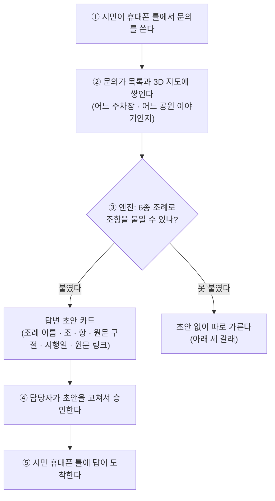

# 문의 답변 창구(가칭) — PRD 쉬운 요약

> 팀원이 5분 안에 읽는 요약이다. 원본은 [`docs/PRD.md`](PRD.md)이고, 절마다 붙은 「원본」 줄이 원본의 어느 절에서 왔는지 가리킨다. 근거 표 · 열린 물음 · 바뀐 까닭은 원본에만 있다.
> **기준 원본**: PRD 3판 초안(팀 확정 전, 11/13 회의에서 확정 예정), 2026-11-11 저녁 판(업스테이지 2차 답 반영), 커밋 `984da0b`. 원본을 고치면 같은 커밋에서 이 파일의 해당 절과 이 줄의 날짜도 고치고, 커밋 칸은 「이 파일과 같은 커밋」으로 적는다(`AGENTS.md` 6절).
> **표시**: 〔추천안〕 = 아직 정하지 않은 것(회의에서 다듬는다). 표시가 없으면 동규가 정한 것이다(팀 확정 전).

## 1. 한 문장

> 원본: 1절 「심사위원이 나가며 할 한 문장」을 제품 소개용으로 줄인 것(동규 11-11 정함, 맨 아래 기록)

**담당자에게 서울시 조례 '몇 조 몇 항'이 붙은 답변 초안을 써 주고, 조례로 답할 수 없는 문의는 지어내지 않는 시민 문의 답변 창구**

- 담당자 = 시민 문의를 배정받아 답을 쓰는 서울시 부서 · 서울시설공단 직원.
- 서울시 조례 = 대회가 정한 6종(주차장 · 동물보호 · 자전거 · 도시공원 · 청년 · 금연). 이 문서의 「6종」은 이 여섯 조례다.

## 2. 왜 이 문제인가

> 원본: 1절 문제 문장, 1-1절 (자) · (다) · (차)

**문제 문장**: 「시민 문의에 답을 쓰는 담당자는 규정을 묻는 문의에 조 번호까지 적어 답하곤 한다. 그런데 알고 보니, 주차 요금 · 감면 · 환불을 묻는 공영주차장 문의의 답에는 조 번호까지 적힌 것이 드물고, 이런 문의는 어느 주차장 · 어느 공원이냐에 따라 답하는 규정부터 달라진다.」

| 본 것 | 숫자 · 예 |
|---|---|
| 조 번호까지 적는 답은 이미 흔하다 | 서울시 응답소 「공개 민원사례」: 규정을 묻는 문의 **65건 가운데 45건**의 답이 조 번호까지 댔다 |
| 공영주차장 문의의 답에는 드물다 | 서울시설공단 주차 「시민의 소리」: 규정을 묻는 문의 **17건 가운데 2건** |
| 장소에 따라 답하는 규정이 갈린다 | 다자녀 감면은 공단이 운영하는 공영주차장에서만 되고, 자치구 주차장은 그 구의 조례를 따른다. 한강공원은 도시공원 조례가 아니라 한강공원 조례로 답한다 |

- 출처: 응답소 「공개 민원사례」 최근 1년 155건과 서울시설공단 주차 「시민의 소리」 공개 글 76건을 모두 세었다(2026-11-11). 글이 문의인지, 규정을 묻는지는 AI가 기준을 먼저 정하고 읽어 가른 것이다(사람 검수 전).
- 예: 「5분당 450원이 적정한가」를 물은 글에 나간 답은 조례 이름까지만 있고 조항이 없었다. 조례 원문에서 근거는 별표 1(급지별 요금표)이다.
- 말하지 않는 것: 답에 근거 조문을 적으라는 규정은 찾지 못했다. 그래서 「담당자는 근거를 적어야 한다」, 「조 번호 없는 답은 틀렸다」고 말하지 않는다.

## 3. 누가 어떤 화면을 쓰나

> 원본: 2절, 1-1절 (아), 미정 21

| 누가 | 화면 | 하는 일 |
|---|---|---|
| **담당자** (주 사용자) | 오른쪽 큰 화면: 문의 목록 + 3D 지도 + 답변 초안 카드 | 초안을 고쳐서 승인한다 |
| 시민 | 왼쪽 휴대폰 틀 | 일상 말로 문의를 쓰고, 승인된 답을 받는다 |
| 대회 채점 | 화면 없음(채점 API) | 6종 질문에 네 칸(답 · 인용 · 원문 링크 · 시행일)으로 답한다 |

- 대회가 정한 범위는 「서울시 조례를 일상 언어로 질문하는 시민과 공무원」이고, 담당자가 초안을 확인 · 승인하는 이 흐름도 그 범위 안이라고 업스테이지가 답했다(11-11).
- 웹 화면 한 장이고 로그인은 없다.
- 시연 화면은 여러 담당자에게 간 6종 문의를 한데 모아 보인 것이라고 밝힌다(한 사람이 여섯 조례 문의를 다 받는다는 뜻이 아니다).

## 4. 화면 흐름

> 원본: 2절 「핵심 흐름」, 3절 「화면」, 6절, 1-1절 (아)

- 엔진 = 문의를 받아 근거 조항이 붙은 답을 만드는 프로그램. 대회 채점도 이 엔진이 받는다.
- 승인 전의 초안은 시민에게 가지 않는다. 지도에는 그 자리의 **급지**(주차장 조례가 공영주차장을 1~3급지로 나눈 등급, 급지마다 요금표가 다르다)와 **공원 구분**(도시공원인지, 한강공원인지)이 보인다.

**조항을 못 붙인 문의는 셋으로 나눠 보인다**

| 갈래 | 뜻 | 화면 |
|---|---|---|
| 6종 밖 | 6종 조례에 그 물음을 다루는 조항이 아예 없다(다른 법만 정하는 내용 · 자치구나 다른 시도의 조례 · 무관한 주제) | 그 내용을 정하는 법이나 맡는 곳을 한 줄로 안내한다 |
| 조항을 찾지 못함 | 6종에 답이 있을 수 있는데 엔진이 못 찾았다 | 「담당자가 직접 확인」으로 보인다 |
| 불러오지 못함 | 시간 초과 · 오류 | 다시 시도 |

- 엔진의 「확인 불가」(근거를 못 찾았을 때 내는 정해진 답)를 곧바로 「6종 밖」이라 부르지 않는다. 엔진이 답을 못 찾았을 때도 확인 불가가 나오기 때문이다.
- 조문은 있는데 금액 · 세부가 조례에 없는 문의는 6종 밖이 **아니다**. 근거 조항을 붙인 초안에 「조례에는 정해져 있지 않다」와 확인할 곳을 적는다. 조항이 세부를 상위 법령으로 넘기는 문의도 같다. 예: 공원 나무를 꺾은 과태료는 도시공원 조례 제23조 제1항을 붙이고 「금액은 시행령에서 정한다」고 적는다(업스테이지 답, 11-11).

## 5. 정해진 것 (동규가 정함 · 팀 확정 전)

> 원본: 맨 위 「읽는 순서」 2번, 0~3절 · 4절 F5. 「대회 규칙」 줄은 대회가 정한 것이고, 나머지는 동규가 정한 것이다. 팀 확정은 11/13 회의에서 한다

| 무엇 | 정한 것 | 원본 |
|---|---|---|
| 무대 | 행사 날 현장 상황실 → 평소 시민 문의에 답을 쓰는 창구 | 0절 |
| 문제 문장 | 위 2절의 문장 | 1절 |
| 화면 앞 담당자 | 서울시 응답소 흐름의 「처리담당자」(문의를 배정받아 답을 쓰는 사람) | 2절 |
| 조항을 못 붙인 문의 | 셋으로 나눠 보인다(위 4절) | 3절 화면 |
| 시연의 때와 장소 | 평소 문의 창구, 낮 3D 지도. 밤 · 불꽃 장면은 쓰지 않는다 | 3절 데모 |
| 승인 | 하나. 모든 답은 담당자가 확인하고 승인한다 | 2절 |
| 부서별 보기 | 조례마다 맡은 부서 여섯 곳으로 거른다. 카드에 「소관 부서」(예: 주차계획과)와 「처리 기관」(예: 서울시설공단 주차시설운영처, 공개 답변 사례 기준)을 함께 보인다 | 4절 F5 |
| 심사위원이 나가며 할 한 문장 | 「그 팀은 시민 문의에 답을 쓰는 담당자에게 서울시 조례의 조항까지 붙은 답변 초안을 지도와 함께 건네고, 조례로 답할 수 없는 문의는 지어내지 않고 갈라 준 팀이었지.」 숫자 칸은 근거가 붙은 답의 수이고, 값은 엔진을 고친 뒤 다시 재서 넣는다 | 1절 |
| 과태료 | 카드에 내세우지 않고 금액을 물을 때만 보인다. 엔진이 묻지 않은 금액을 넣는 문의는 핵심 장면에서 뺀다 | 3절 화면 |
| 시연 | 미리 찍은 영상이 중심이다. 발표는 11/22에 낸 파일과 운영진 PC로 한다 | 3절 데모 |
| 대회 규칙 | 6종만 인용 · 2026-10-01 시행본 기준 · 채점 응답 네 칸 · 문항당 90초 · 서비스 안 모델은 업스테이지 것만. 엔진은 응답 결과로만 채점하고, 안의 단계 수는 채점 항목이 아니다 | 3절, 1-1절 (아) |

## 6. 이번에 만들 것과 안 만들 것

> 원본: 3절 「서비스가 실제로 도는 범위」, 4절, 5절

**「실제로 돈다」의 기준** 〔추천안〕: 시민 화면에서 문의를 보내면 서버가 저장하고 엔진이 그때 답변 초안을 만들며, 담당자가 고쳐 승인하면 그 답이 시민 화면에 도착한다. 이 한 바퀴가 배포된 주소에서 돈다.

| 번호 | 만들 것 |
|---|---|
| F1 · F2 | 엔진: 6종 질문에 조 · 항 · 원문 링크 · 시행일로 답하고, 근거가 없으면 확인 불가. 모델이 옮긴 구절이 원문에 글자 그대로 없으면 그 인용을 버린다 |
| F3 | 답변 화면: 문의 목록 + 3D 지도 점 + 답변 초안 카드, 들어온 순서 번호, 승인 전 · 후 나눠 보기 |
| F4 | 재생(영상 촬영용으로 미리 정한 문의가 차례로 들어옴). 카드에는 동결 판(11/17에 기능을 얼려 제출할 엔진)이 실제로 낸 답을 저장해 쓴다 〔추천안: 서비스와 같은 통로로 미리 받은 답〕 |
| F5 | 부서별 보기(위 5절) |
| F6 | 시민이 문의를 쓰고 답을 받는 화면 〔추천안: 서버에 저장되고 엔진이 그때 초안을 만든다〕 |
| F7 | 고쳐서 승인 → 시민 휴대폰 틀에 답 도착 〔추천안: 고친 글과 승인 상태가 서버에 남는다〕 |
| F8 | 문의 데이터: 가상 문의(NVIDIA Nemotron-Personas-Korea로 만듦, 가상이라고 밝힘) + 공개 게시판의 실제 문의를 뼈대로 |
| F9 | 조항을 못 붙인 문의 가르기(위 4절 세 갈래) |
| F10 | 문의가 가리키는 주차장 · 공원과 그 자리의 급지 · 공원 구분을 지도와 카드에 |
| F11 | 〔추천안〕 서비스 서버: 문의 저장, 엔진 부르기, 고친 글과 승인 상태. 채점 서버와 따로 돌린다 |
| F12 | 〔추천안〕 엔진이 채점 네 칸과 따로 화면용 정보(판정 · 원문 구절 · 글자 대조 결과 · 「6종 밖 / 못 찾음」 구분 · 안내 한 줄)를 내준다 |

| 안 만들 것 | 까닭 |
|---|---|
| 응답소 · 120 · 공단 게시판과 실제 연동 | 공개 연동 통로가 없다. 연동 없이 시연한다 |
| 6종 밖 문의에 답 만들어 주기, 6종 밖 자료(자치구 조례 · 공고문 등) 넣기 | 근거 없는 답은 내보내지 않는다. 확장은 발표에서 말로만 |
| 승인 없이 바로 나가는 답 | 모든 답은 담당자가 승인한다 |
| 답할 부서를 맞혀 배정하기 | 확인된 것은 조례와 맡은 부서의 짝까지다. 부서 추천은 다른 곳이 이미 했다 |
| 로그인 · 음성 입력 | 핵심 흐름과 관계없다 |
| 시나리오 여러 개 · 시나리오 만드는 기능 | 기능으로 만들면 80~90%짜리가 된다 |
| 과태료 · 포상금 강조 | 처벌 대신 안내한다. 포상금은 6종에 없다 |
| 다른 회사 모델 | 대회 규칙상 업스테이지 모델만 |

## 7. 다음 주 일정 (11/22 제출에서 거꾸로)

> 원본: 3절 데모 · 8절 완료 기준. 정해진 날짜는 `docs/schedule.md`, 11/12~14의 엔진 마무리는 동규 안(11-11 저녁), 11/16~20의 날짜는 PM 쪽이 거꾸로 센 안이다. **동규 안 — 11/13 회의에서 정한다**

| 날짜 | 되어야 하는 것 |
|---|---|
| 11/12 (목) 24:00 | 팀원의 엔진 실험은 3주기로 마무리한다 |
| 11/13 (금) 19:00 | 회의: PRD 확정과 다음 주 일 나누기 |
| 11/13 (금) ~ 11/14 (토) | PM 쪽이 낼 엔진 판을 정한다 |
| 11/16 (월) | 화면과 서버가 주고받는 데이터 꼴 한 장 확정 → 서버 · 화면 · 지도 데이터 · 시연 문의를 나란히 시작 |
| 11/17 (화) | 엔진 동결 판단(이 뒤엔 버그만 고침). 서비스 한 바퀴가 내 컴퓨터에서 돈다 |
| 11/18 (수) | 동결 판을 채점 서버에 올리고, 시연 문의를 동결 판으로 다시 돌려 저장한다. 화면이 생기면 사용자 평가(11/18쯤) |
| 11/19 (목) | 업스테이지 사전 점검(공개 예시 문항으로 우리 채점 API를 부름). 서비스 한 바퀴가 배포된 주소에서 돈다 |
| 11/20 (금) | 서비스 화면을 굳힌다. 시연 문의와 촬영 대본 확정 |
| 11/21 (토) | 시연영상 촬영 · 편집 |
| 11/22 (일) 24:00 | 제출: 발표자료 · 시연영상 링크 · 채점 API 주소 · 저장소. 발표자료는 이 뒤 고칠 수 없다 |

## 8. 회의에서 같이 다듬을 것

> 원본: 3절 · F4 · F6 · F7 · F11 · F12의 〔추천안〕(미정 28), 미정 8 · 9 · 13 · 15 · 18

- **무엇을 그때 엔진이 답하고 무엇을 미리 저장하나** (미정 28): 안은 「그 자리에서 보낸 문의만 그때 엔진을 부르고, 재생 문의는 미리 돌려 저장한 답을 쓴다」. 서비스 서버를 채점 서버와 따로 둘지, 어디에 올릴지도.
- **다음 주 일 나누기**: 안은 「팀원의 엔진 실험은 3주기(11/12)로 마무리하고, 금 · 토에 PM 쪽이 낼 판을 정하고, 다음 주(11/16~)는 모두 서비스」. 서비스 조각을 누가 맡나.
- **핵심 장면으로 쓸 문의와 그 기준** (미정 8): 안은 「동결 판으로 세 번 돌려 세 번 다 같은 근거가 나오고, 답 글을 사람이 읽어 내용도 같은 문의만」.
- **지도 데이터** (미정 9 · 13): 공영주차장 자리와 급지, 도시공원 면. 시민이 그 자리에서 쓴 문의의 장소를 어떻게 받나.
- **엔진 쪽 일** (미정 15): 조례가 세부를 시장이나 상위 법령으로 넘긴 문의를 확인 불가로 내지 않기, 「6종 밖」 안내 한 줄 붙이기, 답 앞에 「네 · 아니요」 붙이기, 한강공원을 도시공원으로 보지 않기.
- **발표장에서 화면을 그 자리에서 띄울 수 있나** (미정 18): 운영 공지를 기다린다.
- 그 밖의 열린 물음은 원본 맨 아래 「논의할 것 · 미정 목록」(28개)에 있다.
