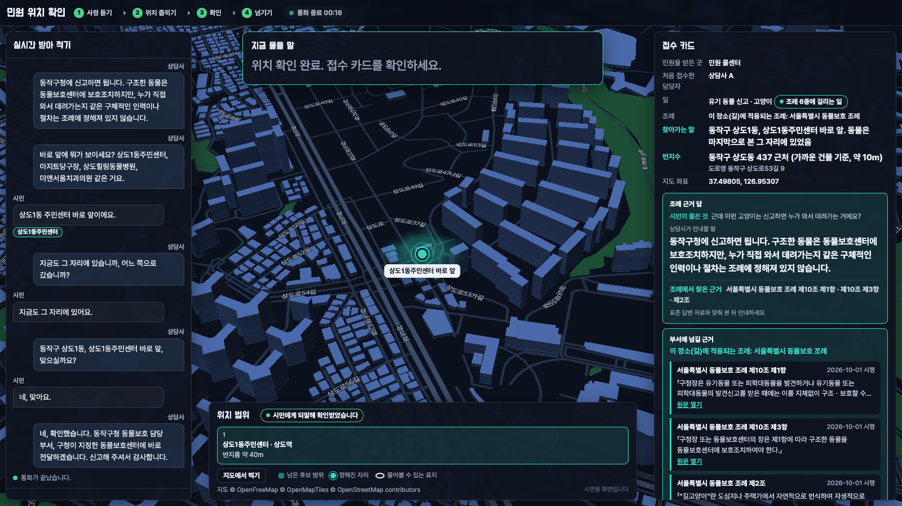
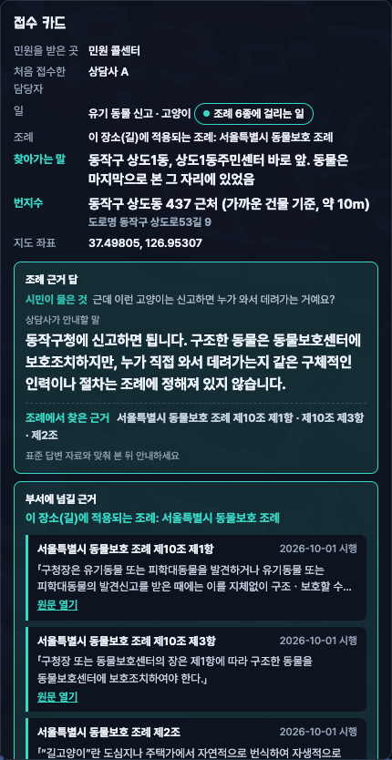
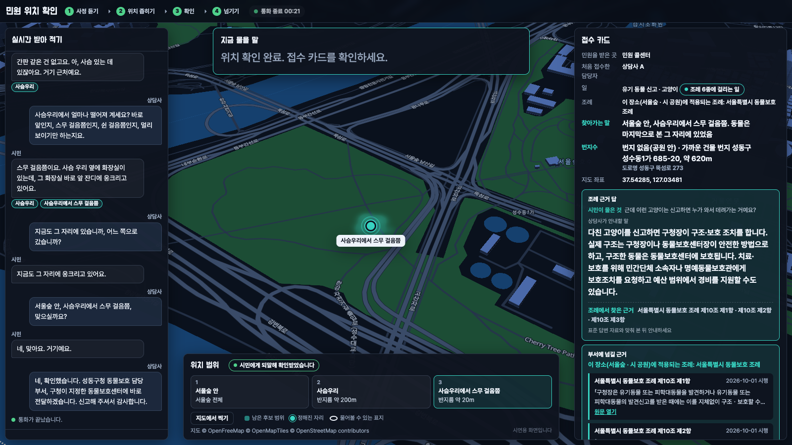
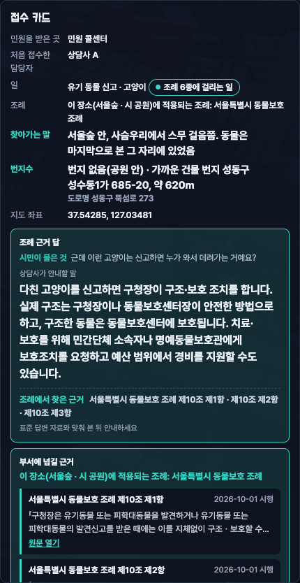
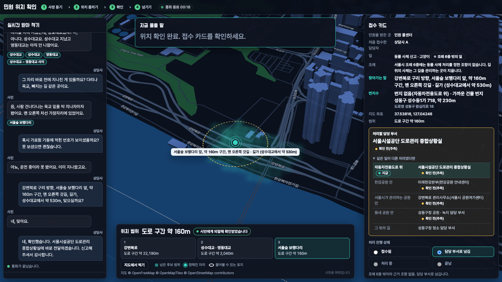
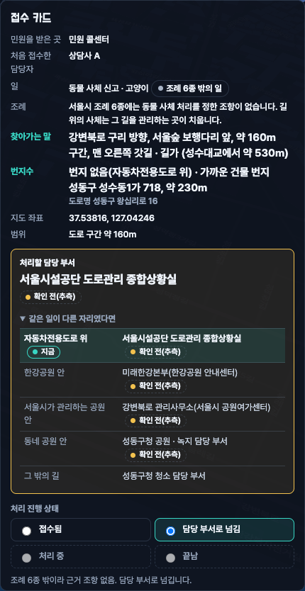

# 통화로 위치 좁히기 — 소개

> 6차 회의(11/17)에서 본 주제 「통화로 위치 좁히기」를 처음 보는 사람에게 소개하는 글이다. 화면 코드는 `demo/call/`에 다른 PR로 들어온다. 이 글의 문장마다 받친 근거는 [근거 모음](근거.md)에 출처와 함께 있다. 그림은 11/17 밤의 화면이다.

## 무엇을 하는 서비스인가

120다산콜 상담사가 민원 전화를 받는 동안 옆에 띄워 두는 화면이다. 시민은 번지수를 모르고 「상도역에서 올라오는 길, 주민센터 근처 골목이에요」처럼 아는 곳과 방향으로 말한다. 화면은 그 말에서 위치 단서를 읽어 지도 위의 후보 범위를 줄이고, 그 범위를 가장 많이 줄일 다음 질문을 하나 띄운다. 자리가 정해지면 접수 카드에 현장 담당자가 읽고 찾아갈 한 줄, 가까운 건물의 번지수, 넘길 곳(구청의 담당 부서 등)을 적는다. 서울시 조례 6종(주차장 · 동물보호 · 자전거 · 도시공원 · 청년 · 금연)에 걸리는 일이면 우리 엔진이 근거 조항이 붙은 답을 함께 보인다.

이런 화면을 만드는 까닭은 셋이다. 120 같은 일반 민원 전화는 건 사람의 위치를 조회할 수 없어서 말로 들을 수밖에 없다. 같은 일도 자리에 따라 맡는 곳이 갈린다. 현장에 나가는 쪽은 번지수로 찾는데, 시민은 아는 곳과 방향으로 말한다. 자세한 근거는 [근거 모음](근거.md)에 있다.

## 누가 언제 쓰나

- **쓰는 사람**: 120다산콜 상담사. 시민이 보는 화면은 없다.
- **쓰는 때**: 누군가 현장에 가야 하는 민원 전화를 받는 동안이다. 예를 들어 다친 동물, 길 위의 동물 사체, 도로 파손 신고가 그렇다.
- **결과를 받는 사람**: 접수 카드를 넘겨받아 현장에 나가는 담당 부서다.
- **지금의 상태**: 시연 화면이다. 통화는 팀이 지어낸 가상 통화이고, 실제로 접수하거나 넘기지 않는다. 지도와 지명은 서울만 다룬다.

## 화면 읽는 법

| 자리 | 화면의 이름 | 무엇이 보이나 |
|---|---|---|
| 맨 위 | 단계 넷 | 사정 듣기 · 위치 좁히기 · 확인 · 넘기기 가운데 지금 어디인지와 통화 시간 |
| 왼쪽 | 실시간 받아 적기 | 통화 글이 흐른다. 시민 말 아래의 초록 이름표는 화면이 알아들은 지명이다(예: 「상도1동주민센터」). 실제로는 다산콜의 받아 적기 도구가 만든 글을 넘겨받는다고 보고, 시연에서는 대본 재생이나 직접 입력으로 넣는다 |
| 가운데 위 | 지금 물을 말 | 상담사가 읽을 다음 질문 하나, 「왜 이 질문인가」, 들은 답을 고르는 단추 |
| 가운데 | 지도 | 초록으로 칠한 곳이 남은 후보 범위이고, 핀이 정해진 자리, 동그라미가 물어볼 수 있는 표지(역 · 다리 · 건물 이름 등)다 |
| 가운데 아래 | 위치 범위 | 단서가 하나 더해질 때마다 범위가 어떻게 줄었는지 차례대로 보인다. 예: 서울숲 안 → 사슴우리, 반지름 약 200m → 사슴우리에서 스무 걸음, 반지름 약 20m |
| 오른쪽 | 접수 카드 | 아래 표 |

**다음 질문은 어떻게 고르나.** 남은 후보를 가장 고르게 가르는 질문을 계산으로 고른다. 예를 들어 범위가 넓으면 「가까운 지하철역이 어디인가요?」를 먼저 묻고, 좁아지면 「바로 앞에 뭐가 보이세요?」를 묻는다. 화면에 보이는 「약 N비트」는 이 질문 하나로 남은 가능성이 몇 번 반으로 줄지의 기대값이다(1비트 = 반으로 한 번). 넘길 곳이 갈리는 질문(동물이 살아 있나, 공원 안인가 바깥 길인가)은 먼저 묻는다.

**접수 카드의 줄**

| 줄 | 뜻 | 그림에 나온 예 |
|---|---|---|
| 민원을 받은 곳 · 처음 접수한 담당자 | 누가 받았나. 담당자는 가상 이름표다 | 「민원 콜센터」 · 「상담사 A」 |
| 일 | 민원 종류와 조례 6종에 걸리는지 | 「유기 동물 신고 · 고양이 · 조례 6종에 걸리는 일」 |
| 조례 | 이 자리에 적용되는 조례, 또는 6종 밖인 까닭 | 「서울특별시 동물보호 조례」 / 「서울시 조례 6종에는 동물 사체 처리를 정한 조항이 없습니다」 |
| 찾아가는 말 | 현장 담당자가 읽고 바로 찾아갈 한 줄. 원이 아니라 「이름 붙은 한 점 + 어느 쪽」으로 끝낸다 | 「동작구 상도1동, 상도1동주민센터 바로 앞. 동물은 마지막으로 본 그 자리에 있었음」 |
| 번지수 | 정해진 자리에서 가장 가까운 건물의 지번과 거리, 그 아래 도로명 주소. 공원 안이나 자동차전용도로 위면 「번지 없음」을 먼저 밝힌다 | 「동작구 상도동 437 근처 (가까운 건물 기준, 약 10m)」 |
| 지도 좌표 · 범위 | 핀의 좌표, 길 위면 구간 길이 | 「도로 구간 약 160m」 |
| 처리할 담당 부서 | 넘길 곳. 공식 안내에서 확인한 것은 「공식 안내에서 확인」, 아닌 것은 「확인 전(추측)」으로 표시한다 | 「서울시설공단 도로관리 종합상황실 · 확인 전(추측)」 |
| 같은 일이 다른 자리였다면 | 같은 일을 자리 종류마다 어디로 넘기는지의 표 | 로드킬 장면: 자동차전용도로 위 · 한강공원 안 · 서울시가 관리하는 공원 안 · 동네 공원 안 · 그 밖의 길 |
| 조례 근거 답 | 조례 6종에 걸리는 일일 때, 상담사가 안내할 말의 초안과 엔진이 찾은 조항 | 「서울특별시 동물보호 조례 제10조 제1항 · 제10조 제3항 · 제2조」 |
| 부서에 넘길 근거 | 조항 원문과 시행일. 시민에게 읽어 주는 글이 아니라 접수 기록에 붙여 넘기는 글이다 | 「제10조 제1항 · 2026-10-01 시행」 |
| 처리 진행 상태 | 접수됨 · 담당 부서로 넘김 · 처리 중 · 끝남. 시연에서는 화면 안에서만 바뀐다 | |

## 장면 셋

화면 위쪽 「통화 장면」에서 고른다. 주소 끝에 `?auto=장면이름`을 붙이면 열자마자 대본이 재생된다. 넷째 칸 「직접 통화」는 대본 없이 글로 넣어 보는 칸이다(예: 「마포구인데요, 스타벅스 앞 가로등이 꺼져 있어요」 → 「합정역 근처예요」).

### 1. 다친 고양이 · 동네 길 (`?auto=cat_street`)

주택가 골목에 다리를 다친 고양이가 있다는 신고다. 시민은 「상도1동 주민센터 근처 골목이에요. 상도역에서 올라오는 길이요. 번지는 모르겠어요.」라고 말한다. 구청에서 도로 민원을 맡는 분이 든 예(번지 대신 아는 곳과 방향으로 말하는 시민)를 따랐다. 화면은 주민센터 바로 앞, 반지름 약 40m까지 좁히고, 접수 카드에 「동작구 상도동 437 근처 (가까운 건물 기준, 약 10m)」를 적는다. 동물보호 조례에 걸리는 일이라 엔진의 근거 답이 붙고, 넘길 곳은 동작구청 동물보호 담당 부서와 구청이 지정한 동물보호센터다.

### 2. 고양이 · 공원 안 (`?auto=cat_park`)

서울숲 안에 다친 고양이가 있다는 신고다. 시민은 「서울숲 안쪽이에요. 여기가 정확히 어딘지는 모르겠어요.」로 시작해 「사슴 있는 데」, 「스무 걸음쯤」, 「화장실 바로 앞 잔디」를 차례로 말한다. 화면은 서울숲 전체에서 사슴우리 둘레 반지름 약 200m, 다시 사슴우리에서 스무 걸음, 반지름 약 20m로 좁힌다. 공원 안이라 번지가 없어서 카드에는 「번지 없음(공원 안) · 가까운 건물 번지 … 약 620m」가 나온다.

### 3. 로드킬 신고 (`?auto=roadkill`)

운전하다 강변북로에서 고양이 사체를 보고 지나온 뒤 전화한 신고다. 시민은 주소를 모르고, 지나온 다리를 한 번 틀리게 말했다가 고친다(「동호대교였나? 아, 아니다. 성수대교요」). 화면은 가는 방향, 지나온 다리와 아직 안 나온 다리, 지나친 육교를 물어 도로 구간 약 160m까지 좁힌다. 동물 사체는 조례 6종에 정한 조항이 없어서 엔진 답 대신 그 까닭과 넘길 곳만 보인다. 넘길 곳은 서울시설공단 도로관리 종합상황실인데 공식 안내로 확인하지 못해 「확인 전(추측)」으로 표시된다. 번지수 줄은 「번지 없음(자동차전용도로 위)」이다.

### 자리가 바꾸는 것과 바꾸지 않는 것

- 고양이 두 장면은 자리가 달라도(동네 길, 시 공원 안) 적용되는 조례가 서울특별시 동물보호 조례로 같고, 넘길 곳도 그 구의 동물보호 담당 부서와 구청이 지정한 동물보호센터로 같다. 달라지는 것은 찾아가는 말과 번지수가 있느냐다.
- 넘길 곳이 자리에 따라 갈리는 일이 있다. 동물 사체가 그렇다. 로드킬 카드의 표처럼 자동차전용도로 위, 한강공원 안, 서울시가 관리하는 공원 안, 동네 공원 안, 그 밖의 길마다 넘길 곳이 다르다.
- 조례 6종에 걸리는지가 자리에 따라 갈리는 일도 있다. 노점이 그렇다. 길 위의 노점은 6종 밖이고, 공원 안의 노점은 도시공원 조례가 걸린다. 이 장면은 지금 장면 고르는 곳에 없다.

## 우리 측정

모두 PM 쪽이 잰 값이고 팀이 같은 조건으로 다시 재지 않았다. 통화는 가상 통화다. 가상 통화란 코드가 서울 안의 참 위치를 하나 뽑고, 가상의 시민이 그 자리에서 보이는 것을 화면의 질문에 답하는 방식이다.

| 무엇을 쟀나 | 결과 | 조건 |
|---|---|---|
| 한 점까지 좁힌 통화 | 민원인이 본 대로 답할 때 600통 가운데 418통(69.7%)이 한 점(수십 m)까지 좁혀졌고, 틀린 자리로 확정한 통화는 0통이다. 고치기 전에는 같은 600통에서 414통(69.0%) · 틀린 확정 4통(0.7%)이었다. 그 4통은 개발에 쓰지 않은 300통에서만 나왔고, 까닭 넷(「지나고 1분쯤」을 「방금 지남」으로 읽음 등)을 고쳤다(11/18) | 가상 통화 600통(150통씩 네 번, 참 위치를 뽑는 씨앗 넷 가운데 둘은 개발에 쓰지 않은 것). 「한 점」은 반지름 50m(길 위는 구간 200m) 안으로 좁혀 시민에게 확인받고 그 점이 참 위치에서 60m(길 위는 120m) 안인 경우, 「틀린 확정」은 확인받은 점이 그보다 멀리 떨어진 경우다 |
| 시민이 틀리게 말할 때 | 민원인이 10% 틀리게 말하고 10% 「모르겠어요」라고 할 때 395통(65.8%)이 한 점까지 좁혀지고 틀린 확정은 1통이다. 10% 틀리게 말하고 틀린 자리에도 「네」라고 답하기 쉬운 조건에서는 413통(68.8%) · 틀린 확정 5통이다(고치기 전 391통 · 4통, 408통 · 10통) | 같은 600통. 고친 뒤 통화는 평균 6.3번 → 6.6번 주고받는다(위치 질문 상한을 8번에서 10번으로 올림) |
| 번지수가 얼마나 가까운가 | 참 위치에서 가장 가까운 번지까지의 거리 중간값이 골목 · 상가 길 18m, 역 출구 둘레 25m, 큰길 39m다. 100m 넘게 먼 비율은 자동차전용도로 48%, 공원 안 80%다 | 같은 가상 통화의 참 위치. 번지 자료는 상가정보(가게가 있는 건물)의 주소다 |

## 알려진 한계

- **실제 사람의 말로는 아직 재지 않았다.** 위 숫자는 모두 가상 통화다. 서울에 있는 사람이 자기 자리를 말로 설명하는 시험은 6차 회의 자료 기준으로 0통이었다.
- **번지수는 그 자리의 번지가 아니다.** 정해진 자리에서 가장 가까운, 가게가 있는 건물의 번지다. 그래서 늘 거리를 같이 보인다. 가게가 없는 집이나 빈 땅의 번지는 자료에 없다.
- **넘길 곳의 3분의 2쯤은 추측이다.** 넘길 곳 표 29갈래 가운데 공식 안내로 확인한 것은 10갈래이고 19갈래는 추측이다. 화면에 「확인 전(추측)」으로 보인다. 로드킬 장면의 넘길 곳도 추측이다.
- **엔진 답이 갈릴 때가 있다.** 조례 6종에 걸리는 일에서 같은 물음에 엔진 답이 두 번 중 한 번 갈리는 경우가 있다(PM 쪽 대조 86줄 가운데 어긋남 23줄, 그중 12줄이 답 갈림).
- **첫 질문은 신고자가 그 자리에 있다고 본다.** 첫 질문이 「지금 계신 곳이 어디쯤인지」라서, 지나가며 본 것을 다른 곳에서 신고하면 틀린 자리를 좁힐 수 있다. 자동차전용도로 장면만은 지나온 다리를 따로 묻는다.
- **지도 자료에 없는 곳은 못 알아듣는다.** 오픈스트리트맵과 상가정보에 없는 가게 · 건물 이름은 알아듣지 못한다.
- **거리 폭은 짐작이다.** 「바로 앞」 18m, 「근처」 100m, 「지나고 조금 뒤」 같은 폭은 실제 통화로 맞춘 값이 아니다.
- **다산콜의 받아 적기 도구와 이어 본 적이 없다.** 마이크로 받아 적는 기능은 서비스 모델 규칙(모델은 업스테이지 것만) 때문에 뺐다.

## 띄우는 법

`demo/call/README.md`를 본다. 그 파일은 시연 코드와 함께 다른 PR로 들어온다.

## 더 보기

- [근거 모음](근거.md): 법 · 통계 · 현장의 말 · 공개 자료 · 비슷한 서비스 조사 · 우리 측정을 문장마다 출처와 함께
- 화면 문구 원본: `docs/content/A-05_통화위치좁히기.md`(시연 코드와 같은 PR로 들어온다)
- 6차 회의 안건: [`docs/meetings/2026-11-17-6차.md`](../meetings/2026-11-17-6차.md)
