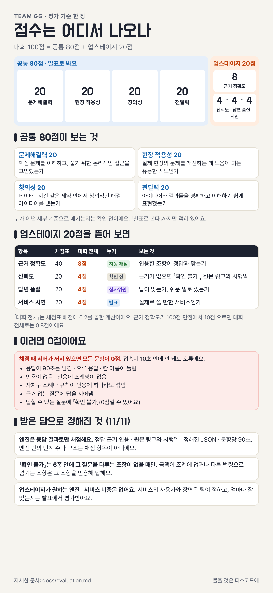

# 평가 기준: 점수는 어디서 나오나

> 팀원이 한 번 읽고 「우리 점수가 어디서 나오고, 누가 무엇을 보고 매기는지」를 알게 하려는 문서다. 무엇을 만들지, 무엇부터 할지 고를 때 사람도 각자의 AI도 이 문서를 먼저 본다.
> 줄마다 출처를 달았다. 레포 문서에서 확인되지 않는 것은 「확인 전」이라고 적었고, 계산한 값은 「계산」이라고 적었다.
> 엔진의 채점 규칙을 자세히 볼 때는 [`docs/engine/scoring-rules.md`](engine/scoring-rules.md)를 읽는다. 우리 팀이 기준마다 지금 어디쯤인지는 [`docs/meetings/2026-11-13-5차.md`](meetings/2026-11-13-5차.md) 2번 안건에 있다.

## 1. 한눈에

1. **대회 100점 = 공통 80점 + 업스테이지 20점.** 공통은 문제해결력 · 현장 적용성 · 창의성 · 전달력이 20점씩이다.
2. **업스테이지 20점은 채점표 100점을 줄인 것이다.** 근거 정확도 40 · 신뢰도 20 · 답변 품질 20 · 서비스 시연 20을 20점으로 환산하면 대회 전체로는 8 · 4 · 4 · 4점이다(계산).
3. **기계가 채점한다고 적힌 것은 근거 정확도다**(대회 전체 8점). 답변 품질은 심사위원이 읽고, 서비스 시연은 발표로 본다. 공통 80점은 발표로 본다고 정리돼 있다.
4. **엔진은 응답 결과로만 채점된다.** 엔진 안의 단계 수나 구조는 채점 항목이 아니다. 업스테이지가 권하는 엔진 · 서비스 비중은 없다.

## 2. 대회 전체 100점

| 구분 | 항목 | 배점 | 보는 것 |
|---|---|---|---|
| 공통 | 문제해결력 | 20 | 기업 현안의 핵심 문제를 이해하고, 풀기 위한 논리적인 접근을 고민했는가 |
| 공통 | 현장 적용성 | 20 | 실제 현장의 문제를 개선하는 데 도움이 되는 유용한 시도인가 |
| 공통 | 창의성 | 20 | 데이터 · 시간 같은 제약 안에서 창의적인 해결 아이디어를 냈는가 |
| 공통 | 전달력 | 20 | 아이디어와 결과물을 명확하고 이해하기 쉽게 표현했는가 |
| 주제별 | 답변 신뢰성 및 품질 | 20 | 정확한 근거로 좋은 답을 내고 신뢰성을 확보했는가 → 아래 업스테이지 채점표 |

- 10/24 특강 팀 정리는 「대회 전체로 보면 업스테이지 표 전체가 20점이고 나머지 80점은 발표로 본다」고 적었다.
- 공통 80점을 누가, 어떤 세부 기준으로 매기는지는 레포 문서에 없다(확인 전). 2차 답은 서비스의 방향이 주제 의도에 얼마나 맞는지를 「발표 당일 심사위원이 평가」한다고 했다.
- 출처: 10/24 업스테이지 특강(팀 정리는 공개 저장소에 두지 않음), `docs/engine/scoring-rules.md` 8절.

## 3. 업스테이지 채점표: 100점을 20점으로

| 항목 | 채점표 배점 | 대회 전체에서 (계산) | 누가 | 보는 것 |
|---|---|---|---|---|
| 근거 정확도 | 40 | 8점 | 자동 채점 | 인용한 조항이 정답과 맞는가. 비공개 질문셋으로 자동 대조 |
| 신뢰도 확보 | 20 | 4점 | 특강 표에는 적혀 있지 않다(확인 전) | 근거가 없을 때 「확인 불가」로 답하는가, 원문 링크와 시행일을 같이 주는가 |
| 답변 품질 | 20 | 4점 | 심사위원 | 답이 맞는가, 일반인이 이해할 말로 썼는가 |
| 서비스 시연 | 20 | 4점 | 발표 | 일반 사용자가 실제로 쓸 만한 서비스인가 |

- 「대회 전체에서」 칸은 채점표 배점에 0.2를 곱한 값이다.
- 신뢰도를 누가 매기는지는 표에 없지만, 2차 답은 자동 채점의 기준으로 「정답 근거 인용, 원문 링크와 시행일, 정해진 JSON 형식, 문항당 90초 이내 응답」을 들었다. 원문 링크와 시행일은 자동으로 본다는 뜻으로 읽히지만, 신뢰도 20점 전체가 자동 채점인지는 확인 전이다.
- 강사는 「60점이 근거와 확인 불가에서 나온다. 화면보다 근거부터 잡아라」라고 했다(근거 정확도 40 + 신뢰도 20).
- 업스테이지가 권하는 엔진 · 서비스 비중은 따로 없고, 시간을 어디에 쓸지는 팀이 판단한다(2차 답).
- 출처: 10/24 업스테이지 특강(팀 정리는 공개 저장소에 두지 않음), `docs/engine/scoring-rules.md` 8절.

## 4. 누가 무엇을 보고 매기나

| 묶음 | 대회 전체에서 (계산) | 어떻게 매기나 | 우리가 내는 것 |
|---|---|---|---|
| 기계가 채점 | 근거 정확도 8점. 신뢰도 4점도 이쪽으로 보이지만 확인 전 | 11/25(수) ~ 11/27(금) 사이에 운영진이 비공개 문항으로 우리 채점 API를 부른다(서버는 그 기간 내내 켜 둔다, 11/19 운영사무국 답). 응답 네 칸(답 · 인용 · 원문 링크 · 시행일)과 시간만 본다. 위임 · 준용 조항을 묻는 문항은 그 조항을 인용해야 하고 「확인 불가」는 0점이다(11/19 채점 공지, `docs/engine/scoring-rules.md` 1절) | 채점 API 주소 |
| 심사위원이 읽음 | 답변 품질 4점 | 답이 맞는가, 쉬운 말인가. 조건을 묻는 질문은 「네」 또는 「아니요」로 시작하면 유리하다 | 엔진이 쓴 답 글 |
| 발표로 봄 | 서비스 시연 4점 + 공통 80점 | 발표 15분 + 질의응답 7분. 낸 파일과 운영진 PC로 발표한다. 누가 어떤 세부 기준으로 매기는지는 확인 전 | 발표자료, 시연영상, 저장소 |

**자동 채점은 이렇게 계산된다**

- 인용한 조항이 정답과 항까지 맞으면 만점, 조까지만 맞거나 항이 다르면 절반, 인용이 없으면 답이 맞아도 0점이다. 별표 인용도 정답으로 인정된다.
- 정답 근거가 여럿이면 근거마다 채점해 평균을 낸다. 정답이 아닌 조항은 「정답 근거 수 + 2개」까지 감점이 없고, 넘으면 비례해 깎인다.
- 「확인 불가」는 조례 6종 안에 질문을 다루는 조항 자체가 없을 때만 정답이다. 조문은 있는데 금액 · 세부가 없거나, 대상 목록에 없거나, 내용을 다른 법령으로 넘기는 경우는 그 조항을 인용해 답해야 한다.
- 엔진 안의 단계 수나 구조는 자동 채점 항목에 없다. 단계가 늘어도 90초 제한은 똑같이 적용된다.
- 출처: 10/24 업스테이지 특강(팀 정리는 공개 저장소에 두지 않음), `docs/engine/scoring-rules.md` 1 · 2 · 8절.

## 5. 0점이 되는 경우

| 상황 | 결과 | 출처 |
|---|---|---|
| 채점 때 서버가 꺼져 있다 | **모든 문항 0점** | 특강 8절 |
| 접속이 10초 안에 안 된다 | 오류로 처리, 다시 시도하지 않는다 | scoring-rules 4절 |
| 응답이 90초를 넘긴다(요청을 보낸 때부터 응답을 다 받을 때까지) | 그 문항 0점 | 특강 8절, scoring-rules 4절 |
| 오류 응답(500, JSON 깨짐), 칸 이름이 틀림 | 그 문항 0점 | 특강 8절 |
| 내용은 맞는데 인용이 없다 | 근거 정확도 0점 | 특강 4 · 8절 |
| 인용에 자치구 조례나 규칙이 하나라도 섞인다 | 그 문항 0점 | scoring-rules 2절 |
| 인용에 조례명이 없다(「제7조 제1항」만 씀) | 인정되지 않는다 | scoring-rules 2절 |
| 근거 없는 질문(함정)에 그럴듯한 답을 지어낸다 | 그 문항 0점 | 특강 8절 |
| 답할 수 있는 질문에 「확인 불가」로 답한다 | 0점일 수 있다 | scoring-rules 1절 |
| 정답이 아닌 조항을 「정답 근거 수 + 2개」보다 많이 인용한다 | 0점은 아니고 비례해 깎인다 | scoring-rules 2절 |

## 6. 숫자로 감 잡기 (계산)

배점에서 바로 나오는 계산이다. 비공개 문항이 우리 평가셋과 비슷하다고 칠 때의 어림이고, 실제 점수는 다를 수 있다.

- 근거 정확도가 100점 만점에서 10점 오르면 대회 전체로는 0.8점이다(10 × 0.4 × 0.2).
- 엔진의 응답으로 받는 점수(근거 정확도 · 신뢰도 · 답변 품질)는 대회 전체 100점 가운데 16점이고, 서비스 시연이 4점, 공통이 80점이다.
- 이 계산을 보고 「엔진은 지금 점수를 잃지 않는 일을 먼저 하고, 다음 주 한 주는 공통 80점이 보는 것(문제 · 현장 · 아이디어 · 전달)을 보이는 서비스를 만든다」는 것이 동규 안이다. 11/13 회의에서 논의하며, 대회 쪽이 권한 것이 아니다(`docs/decisions.md` 11-11, `docs/schedule.md` 「계획 변경 안」).

## 7. 공통 80점에서 들은 말 (공식 기준은 아니다)

공통 기준의 공식 문구는 2절의 표가 전부다. 아래는 강의에서 들은 말이라 참고로만 본다.

- 공공 과제는 「이걸 하면 좋다」가 아니라 「지금 바로 써서 효과가 나는가」를 본다(특화교육 3주차).
- 심사위원의 칭찬과 점수는 별개다. 약점을 우리가 먼저 말하고 대책을 붙인다(특화교육 3주차).
- 심사위원이 「환각을 어떻게 막았나」를 물을 것이라고 했다(10/24 특강).
- 업스테이지는 서비스의 사용자와 시나리오를 팀이 정하라고 했다. 대회가 정한 범위는 「서울시 조례를 일상 언어로 질문하는 시민과 공무원」이다(10/24 답, 2차 답).
- 출처: 11/7 특화교육 3주차와 10/24 업스테이지 특강(팀 정리는 공개 저장소에 두지 않음), `docs/engine/scoring-rules.md` 8절.

## 8. 확인 전인 것

| 모르는 것 | 지금 아는 데까지 |
|---|---|
| 공통 80점을 누가, 어떤 세부 기준으로 매기나 | 「발표로 본다」까지만 적혀 있다 |
| 신뢰도 20점을 누가 매기나 | 표에 없다. 원문 링크와 시행일은 자동 채점 기준에 들어 있다 |
| 답변 품질을 심사위원이 어떤 문항으로 보나 | 적혀 있지 않다 |
| 시연영상을 발표장에서 트는 방식 | 답 받음(11-19 운영사무국): 발표자료는 PDF로 내고 시연 영상은 그 안에 링크로 붙인다. 11/22 자정까지 낸 파일을 기준으로 발표용 PC에 올려 두고 인터넷 · 음향을 지원한다 |

## 9. 출처

| 문서 | 무엇이 있나 |
|---|---|
| 10/24 업스테이지 특강 · 11/7 특화교육 3주차 | 팀 정리는 공개 저장소에 두지 않는다. 받은 채점 규칙과 배점은 `docs/engine/scoring-rules.md`, 이 문서는 그것을 평가 기준으로 다시 묶은 것이다 |
| `docs/engine/scoring-rules.md` | 11/11에 받은 답(1차 · 2차)과 11/19에 받은 기준(채점 공지 · 운영사무국 답 · 사전 점검 회신, 다르면 11/19가 앞섬): 「확인 불가」의 기준(위임 · 준용 조항은 인용), 인용 채점, 서버 조건(채점 서버 11/25 ~ 11/27), 제출과 발표(저장소는 제출 때 공개, 발표자료 PDF), 무엇이 채점되나 |
| `docs/운영사무국-문의-답변.md` | 운영사무국 · 협회에 물은 것과 받은 답(11/18 · 11/19), 11/19 채점 공지 요지 |
| `docs/schedule.md` | 제출과 발표 날짜 |
