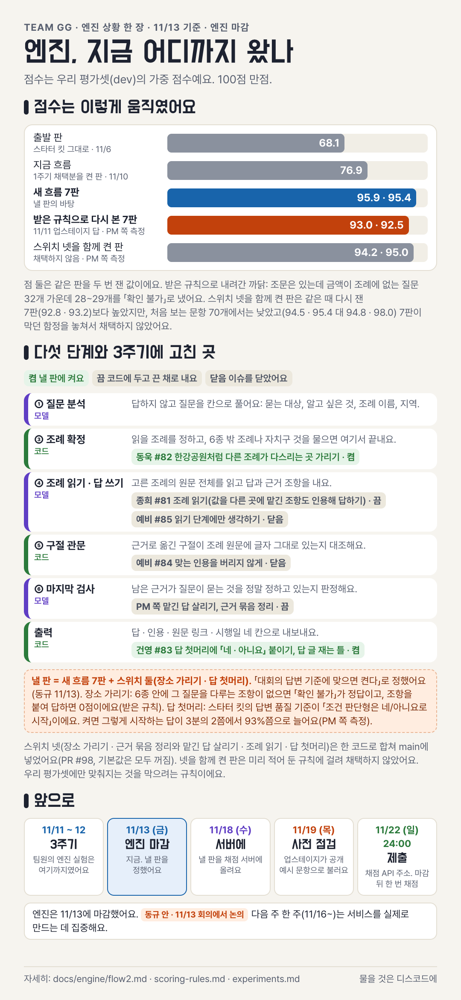
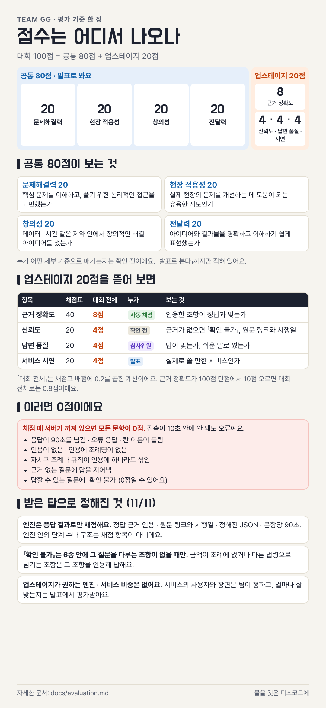
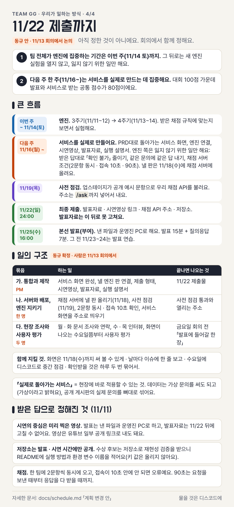

# 5차 회의 (11/13 금 19:00)

> 회의 전에 읽고 오는 자료다(11/11에 씀). 회의는 30분~1시간이다. 회의가 끝나면 맨 아래 「정한 것」 · 「할 일」을 채워 회의록으로 고친다.
> 「PM 쪽 측정」이라고 적은 숫자는 PM 쪽이 잰 값이고, 팀이 같은 조건으로 다시 재지 않았다. 「PM 쪽 생각」 · 「안」이라고 적은 것은 회의에서 고친다.
> 11/12에 고친 곳: 「대회 남은 일정」의 11/13 18:00 줄, 5번 안건(채점 서버는 PM 쪽이 맡음 · 동욱에게 맡길 일 안), 7번 안건(본선 때문에 빠지는 수업 · 본선 일정).
> 11/13에 고친 곳: 엔진을 마감한 사실에 맞춤(「회의 전에 읽고 올 것」, 「대회 남은 일정」, 1번 안건과 그림, 2번 안건의 상태 표와 ⑦ 줄, 3번 안건, 5번 안건), 본선 때문에 빠지는 수업을 7번 안건으로 따로 올림(질문 · 다음 회의는 8번).

참석: (회의 뒤 채움)

## 회의 전에 읽고 올 것 (회의에서는 다루지 않는다)

글로 끝낼 수 있는 것은 회의 전에 글로 끝낸다. 아래는 회의에서 다시 설명하지 않는다. 물을 것은 디스코드에 올린다.

| 무엇 | 어디서 읽나 | 언제 |
|---|---|---|
| 11/11에 받은 업스테이지 · 운영사무국 답(1차와 그날 저녁에 온 2차) | [`docs/engine/scoring-rules.md`](../engine/scoring-rules.md). 받은 규칙마다 우리에게 뜻하는 것과 스스로 확인하는 법을 적었다. 엔진 · 평가 · 답 글을 고치기 전에 각자의 AI에게도 읽힌다 | 지금 |
| 우리 평가셋 정답 표기와 채점 도구를 받은 답대로 고친 것 | 11/11에 고쳤다. 무엇이 바뀌었는지는 [`docs/engine/scoring-rules.md`](../engine/scoring-rules.md) 1절에 있다(dev에서 점수에 드는 문항이 661개에서 693개가 됐다) | 지금 |
| 2주기 판단(채택 · 보류) | 각 이슈와 PR의 판단 글, `docs/decisions.md` 11-11 줄 | 지금 |
| 3주기 채택 판단과 엔진 마감 | 이 문서의 1번 안건에 줄여 적었다. 자세한 숫자와 기록은 PR #98, [`docs/engine/experiments.md`](../engine/experiments.md), [`docs/engine/leaderboard.md`](../engine/leaderboard.md)에 있다 | 지금 |
| 평가 기준 | [`docs/evaluation.md`](../evaluation.md). 대회 100점이 어떻게 나뉘고 누가 무엇을 보고 매기는지 한 장으로 적었다(2번 안건에서 그림으로 다시 본다) | 지금 |
| PRD 쉬운 요약본 | 디스코드로 공유한다(4번 안건에서 5분만 다시 본다) | 회의 전 |
| 현장 조사와 사용자 평가 준비물 | `docs/research/field/`(먼저 `00-먼저-읽기.md`). 맡을 사람이 정해지면 그 두 사람이 읽는다 | 회의 뒤 바로 |

## 안건

| 순서 | 안건 | 시간 |
|---|---|---|
| 1 | 엔진이 지금 어디까지 왔나: 11/13에 마감, 낼 판 (그림 한 장) | 5분 |
| 2 | 평가 기준 다시 보기와 우리가 약한 곳 올리기 | 10분 |
| 3 | 계획(동규 안): 팀원의 엔진 실험은 3주기(11/12 목)로 마무리, 금 · 토에 PM 쪽이 낼 엔진 판을 정함, 다음 주 한 주(11/16~)는 서비스를 실제로 만드는 데 집중 | 10분 |
| 4 | PRD: 미리 공유한 쉬운 요약본을 읽고 와서, 5분 요약 뒤 다듬을 곳 | 8분 |
| 5 | 다음 주 일 나누기: 일의 구조(동규 확정)에 사람 정하기, 날짜별 계획(안) | 15분 |
| 6 | 멘토링 남은 1회: 신청 날짜 잡기, 운영사무국에 보낸 문의의 답 | 5분 |
| 7 | 본선 때문에 빠지는 수업: 교수님께 미리 말씀드리기, 각자 수업 모으기 | 3분 |
| 8 | 질문, 다음 회의(11/20) | 4분 |

모두 60분이다.

## 대회 남은 일정 (11/12 ~ 11/27)

날짜의 원본은 `docs/schedule.md`이고, 사전 점검 · 제출 · 발표의 규칙은 11/11에 받은 답(`docs/engine/scoring-rules.md` 4 · 5절)이다. 「동규 안」이라고 적은 줄은 3번 안건에서 정해지기 전이다.

| 날짜 | 무엇 | 알아 둘 것 |
|---|---|---|
| 11/12 (목) 24:00 | 3주기 끝 보고 | 세 사람 모두 같다. 엔진을 11/13에 마감해, 팀원의 엔진 실험은 3주기가 마지막이다 |
| 11/13 (금) 낮 | 3주기 채택 판단과 엔진 마감 | PM 쪽. 낼 엔진 판을 정하고 엔진을 마감했다(1번 안건). 엔진 관련 이슈와 PR은 모두 닫았다 |
| 11/13 (금) 18:00 | 빈 채점 서버 | 바깥에서 `/health`가 응답하면 된다(#31). 11/12에 바뀜: AWS는 학교 지원이 안 돼 동규의 Mac mini에 올리고, 서버 일은 PM 쪽이 가져왔다(5번 안건). 이 시각의 서버 상태는 회의에서 알린다 |
| 11/13 (금) 19:00 | 정기회의(5차) | 이 문서 |
| 11/13 (금) ~ 11/14 (토) | 낼 엔진 판 정하기 | 11/13에 정했다: 새 흐름 7판에 장소 가리기와 답 첫머리를 켠 판이다(1번 안건). 팀원이 이 이틀에 무엇을 할지는 회의에서 정한다. `docs/schedule.md`에 적힌 4주기(끝 보고 11/14 24:00)는 엔진을 마감해 나눌 엔진 실험이 없다 |
| 11/14 (토) ~ 11/21 (토) | 멘토링 남은 1회 (날짜는 회의에서) | 기간은 11/21(토)까지, 평일 저녁과 주말. LMS에서 팀으로 신청하고 중간 결과물을 첨부한다(6번 안건) |
| 11/15 (일) | 배분일(지금 일정) | 낼 엔진 판은 11/13에 정했고 나눌 엔진 실험이 없다. 이 날짜를 어떻게 고칠지는 3번 안건에서 정한다 |
| 11/16 (월) ~ 11/22 (일) | 서비스를 실제로 만드는 한 주 | 동규 안. 날짜별 계획은 5번 안건 |
| 11/18 (수) | 채점 서버에 낼 엔진 판 올리기, 써 볼 수 있는 서비스 화면 | 동규 안. 올릴 판은 11/13에 정했다(1번 안건) |
| 11/19 (목) | **업스테이지 사전 점검** | 공개 예시 문항으로 우리 채점 API를 부른다. 주소는 `/ask`까지 넣은 전체 주소 |
| 11/20 (금) 19:00 | 정기회의 | 최종 제출 이틀 전 |
| 11/22 (일) 24:00 | **최종 제출** (LMS) | 낼 것 넷: 발표자료(PDF, PPT) · 시연영상 링크 · 채점 API 주소 · 소스코드 저장소. 발표자료는 이 뒤로 고칠 수 없다. 마감 직후 한 번 채점하니 서버를 켜 둔다 |
| 11/23 (월) ~ 24 (화) | 발표 연습 | |
| 11/25 (수) 16:00 ~ 16:30 | **본선 발표** (롯데리조트 부여) | 8팀 중 7번째, 발표 15분 + 질의응답 7분. 낸 파일과 운영진 PC로 한다. 팀원 모두 15:40까지 도착 |
| 11/25 ~ 27 | 본선 (부여) | 11/27 11:00 시상(행사 일정표 기준) |

## 1. 엔진이 지금 어디까지 왔나 (5분)

- **무슨 일**: 엔진을 11/13에 마감했다(동규). 낼 판은 새 흐름 7판에 스위치 둘(#82 장소 가리기 · #83 답 첫머리)을 켠 판이다. 그림 한 장으로 엔진 전체가 어떻게 왔는지 본다. 한 사람씩 실험을 발표하는 자리가 아니다. 그림은 위에서부터 점수가 어떻게 움직였나, 엔진의 다섯 단계에서 3주기에 누가 어디를 고쳤고 낼 판에 무엇을 켜나, 앞으로의 날짜 순서다.
- **왜**: 각자 맡은 실험이 엔진 전체의 어느 단계에 놓이는지, 낼 판에 무엇을 켜고 무엇을 끄는지를 같이 알아야 한다. 받은 답의 규칙으로 다시 보면 새 흐름 7판의 dev 점수는 95.9 · 95.4가 아니라 93.0 · 92.5쯤이고(PM 쪽 측정), 내려간 만큼은 「조문은 있는데 금액이 조례에 없는 질문」 32개에서 나왔다.
- 스위치 둘은 점수를 보고 고른 것이 아니다. 동규가 「대회의 답변 기준에 맞으면 켠다」로 정했고 둘 다 맞는다.
  - 장소 가리기: 받은 규칙(`docs/engine/scoring-rules.md` 1절)에서는 6종 안에 그 질문을 다루는 조항이 없으면 「확인 불가」가 정답이고, 조항을 붙여 답하면 0점이다.
  - 답 첫머리: 스타터 킷의 답변 품질 기준이 「조건 판단형은 네/아니요로 시작」이다. 켜면 「네 · 아니요」로 시작하는 답이 3분의 2쯤에서 93%쯤으로 는다(PM 쪽 측정). 인용과 「확인 불가」 답은 바뀌지 않는다.

**3주기 채택 판단** (두 번씩 잰 가중 점수다. PM 쪽 측정)

3주기의 스위치 넷(장소 가리기 · 근거 묶음 정리와 맡긴 답 살리기 · 종희 #81의 조례 읽기 · 답 첫머리)을 한 코드로 합쳐 main에 넣었다(PR #98, 기본값은 모두 꺼짐). 넷을 함께 켠 판(합친 판)은 채택하지 않았다.

| 판 | 우리 문항(dev) 693개 | 처음 보는 문항 70개 | 극한 문항 283개 | 함정을 놓친 곳 |
|---|---|---|---|---|
| 7판 | 92.8 · 93.2 | 94.8 · 98.0 | 87.4 · 87.5 | 처음 보는 문항 0 · 0, 극한 2 · 1 |
| 합친 판 | 94.2 · 95.0 | 94.5 · 95.4 | 87.1 · 89.9 | 처음 보는 문항 1 · 1, 극한 4 · 2 |
| 합친 판에서 조례 읽기만 뺀 판 | 93.9 · 93.0 | 98.2 · 98.0 | 재지 않음 | 처음 보는 문항 0 · 0 |

- 버린 까닭: 미리 적어 둔 규칙 넷에 걸렸다. ① 우리 문항 평균이 7판보다 1점 넘게 오를 것 ② 처음 보는 문항에서 나빠지지 않을 것 ③ 7판이 막던 함정을 놓치지 않을 것 ④ 차이가 1점 안쪽이면 단순한 판. 합친 판은 ② · ③에, 조례 읽기만 뺀 판은 ① · ④에 걸렸다. 우리 평가셋에만 맞춰지는 것(과적합)을 막으려는 규칙이다.
- 그래서 #81의 조례 읽기 · 근거 묶음 정리 · 맡긴 답 살리기는 코드에 두되 끈 채로 낸다.
- 릴리스: 채점 서버가 읽는 설정(`eval/configs/release.json`)을 낼 판으로 바꾸는 측정을 PM 쪽이 11/13 오후에 돌렸다. 결과는 통과다. 낼 판은 우리 문항(dev) 693개에서 92.3 · 92.7이다(같은 날 새벽에 잰 7판 92.8 · 93.2와 1점 안쪽이다). 함정 정답률은 97.5 · 100.0, 출력 규칙 위반과 90초 넘은 답은 0이다. 첫 실행에서 서버 마감(75초)에 걸려 「확인 불가」로 나간 답이 4개 있었고 두 번째 실행은 0개였다. 지연 95%는 13초쯤으로 새벽(10초쯤)보다 느렸다. 채점 서버 조건을 볼 때 함께 본다. 설정을 바꾸는 PR 「릴리스 3주기」는 따로 올린다.
- 정리: 주제 작업을 본격적으로 하기 전에 엔진 관련 이슈와 PR을 모두 닫았다(동규 11/13 오전). 닫은 PR은 8개(#59 · #63 · #73 · #77 · #78 · #79 · #87 · #95), 이슈는 12개(#26 · #27 · #28 · #29 · #30 · #69 · #70 · #71 · #81 · #83 · #84 · #85)다. 닫힌 PR의 가지도 지웠다. 코드는 각 PR 화면에 남아 있어 「Restore branch」로 되살릴 수 있다. 실험 기록은 PR #98과 `docs/engine/leaderboard.md` · `docs/engine/experiments.md`에 있다. 지금 열려 있는 것은 이슈 #31(채점 서버), PR #93, PR #96 셋이다.
- **회의에서 정할 것**: 따로 없다. 3주기 채택 판단에 다른 의견이 있으면 PR #98에 댓글로 남긴다.
- 그림은 11/13 마감 기준으로 다시 만들었다(원본 `docs/img/engine-status.html`, 만드는 명령 `bash docs/img/render.sh engine-status`).

## 2. 평가 기준 다시 보기와 우리가 약한 곳 올리기 (10분)

- **무슨 일**: 평가 기준을 그림 한 장으로 다시 보고, 기준마다 우리가 지금 어디쯤인지와 약한 곳을 올릴 방법을 이야기한다. 기준의 자세한 내용과 출처는 `docs/evaluation.md`에 있다.
- **왜**: 대회 100점 가운데 공통 기준이 80점이고, 엔진의 자동 채점이 분명한 것은 8점이다. 지금까지 팀의 힘은 엔진에 가 있었다. 남은 열흘을 어디에 쓸지는 기준을 정확히 알고 정해야 한다.

**기준마다 지금 우리 상태** (PM 쪽 생각이다. 회의에서 고친다)

| 기준 | 대회 전체에서 | 지금 | 그렇게 보는 까닭 |
|---|---|---|---|
| 근거 정확도 · 신뢰도 | 8점 · 4점 | 강함 | 낼 판의 바탕인 7판이 우리 평가셋에서 받은 규칙으로 93점쯤이다(PM 쪽 측정). 엔진은 11/13에 마감했다. 「확인 불가」로 답해 0점이 되는 답을 줄이는 스위치(#81의 조례 읽기 · 맡긴 답 살리기)는 채택 규칙에 걸려 끈 채로 낸다(1번 안건) |
| 답변 품질 | 4점 | 보통 이상 | 답 첫머리를 켜서, 「네 · 아니요」로 시작해야 할 답 가운데 그렇게 시작하는 답이 3분의 2쯤에서 93%쯤으로 는다(PM 쪽 측정) |
| 서비스 시연 | 4점 | 보통 | 화면은 돌지만 시연영상이 아직 없다 |
| 문제해결력 | 20점 | 보통 이상 | 가설 → 실험 → 채택의 과정과 숫자는 탄탄하다. 「정말 담당자의 문제인가」를 사람에게 확인한 적은 없다 |
| **현장 적용성** | 20점 | **약함** | 써 본 사람이 0명이다. 6종과 닿는 문의가 실제 창구에서 드물다. 지금 쓰는 시스템과 이어지는 길이 없다 |
| 창의성 | 20점 | 보통 | 답변 초안을 써 주는 AI는 다른 기관들이 이미 한다. 우리만의 것이 화면에서 잘 보이지 않는다 |
| 전달력 | 20점 | 미정 | 제품 한 문장은 정했다. 발표자료와 시연영상은 시작 전이다 |

**올릴 방법** (안이다. 회의에서 더하고 뺀다)

| # | 방법 | 올리려는 기준 | 지금 |
|---|---|---|---|
| ① | 현장 조사와 사용자 평가(두 사람). 담당자와 시민에게 묻고, 화면을 써 보게 한다 | 현장 적용성 · 문제해결력 | 준비물이 있다(`docs/research/field/`) |
| ② | 「같은 질문, 다른 장소, 다른 답」 장면. 지도에서 장소를 바꾸면 답하는 규정이 달라지는 것을 보인다 | 창의성 | 안(넣을지 정하기 전) |
| ③ | 답변 초안의 문장과 조문 구절을 나란히 짚어 보이기 | 창의성 · 신뢰 | 안(넣을지 정하기 전) |
| ④ | 담당자가 승인한 답이 다음 초안에 쓰이기(가장 작은 꼴로) | 창의성 | 안(넣을지 정하기 전) |
| ⑤ | 공개된 문의의 실제 답과 우리 초안을 견준 숫자 한 쌍(정답은 사람이 검수) | 현장 적용성 · 전달력 | 안 |
| ⑥ | 조례를 더하면 조항 표가 코드로 만들어진다는 것과, 답 하나의 시간 · 비용을 보이기 | 현장 적용성 | 안 |
| ⑦ | 엔진은 잃지 않기(받은 답대로 「확인 불가」 줄이기, 같은 문의에 같은 답, 채점 서버 조건) | 근거 정확도 · 신뢰도 | 엔진은 11/13에 마감했다. 남은 것은 채점 서버 조건 확인이다 |
| ⑧ | 발표 자산(발표자료 · 시연영상에 넣을 장면과 숫자)을 일찍 모으기 | 전달력 | 안 |

- **회의에서 정할 것**: 더 올릴 방법이 있는지, 빠진 약한 곳이 있는지. ②~④를 넣을지는 PRD 안건(4번)과 함께 본다.

## 3. 계획: 동규 안 (10분)

- **무슨 일**: 지금 일정은 11/16(월)까지 엔진 실험을 하고 11/17에 동결한 뒤, 11/20~22에 시각화 통합 · 시연영상 · 발표자료를 만든다. 동규 안은 **팀원의 엔진 실험은 3주기(11/12 목 24:00)로 마무리한다. 11/13(금) · 11/14(토)에는 PM 쪽이 채택분을 합쳐 낼 엔진 판을 정하고, 다음 주 한 주(11/16~)는 서비스를 실제로 만드는 데 집중한다**는 것이다. 지금 일정과 안을 나란히 적은 표는 `docs/schedule.md` 「계획 변경 안」에 있다.
- 새 엔진 실험은 3주기 뒤로 열지 않는다. 그 뒤 엔진 일은 PM 쪽이 맡고, 잃지 않기 위한 것만 한다: 받은 답대로 「확인 불가」 줄이기, 같은 문의에 같은 답 내기, 채점 서버 조건(2문항 동시 · 접속 10초 · 90초). 엔진은 11/13에 마감했다(동규). 낼 판을 정했고 엔진 관련 이슈와 PR을 모두 닫아서(1번 안건), 남은 엔진 일은 채점 서버 조건 확인이다.
- **왜**: 3주기가 끝난 뒤 엔진을 일찍 정해 두면 다음 주에 서비스에 쓸 시간이 늘어난다. 새 흐름으로 엔진 점수가 많이 올랐다. 대회 점수 100점 가운데 발표와 서비스로 받는 공통 점수가 80점이고 업스테이지 채점이 20점이다. 원래는 엔진에 힘을 다 쓰고 서비스는 간단히 붙여 시연하려 했는데, 지금 일정대로면 서비스 · 시연영상 · 발표자료에 쓸 날이 사흘(11/20~22)이다. 발표자료는 11/22 뒤에 고칠 수 없다. 업스테이지는 권하는 엔진 · 서비스 비중이 따로 없고 시간을 어디에 쓸지는 팀이 판단하라고 답했다(2차 답).
- **회의에서 정할 것**:
  1. 이 안으로 갈지
  2. 그러면 11/13(금) · 11/14(토)에 팀원은 무엇을 하나. 안: 다음 주 일을 미리 시작한다(현장 조사의 문서 조사와 연락)
  3. 지금 일정에 적힌 11/15~11/18의 날짜(배분일, 동결 판단, 동결 판 배포와 마지막 확인)를 이 안에 맞게 어떻게 고칠지

## 4. PRD (8분)

- **무슨 일**: 서비스 무대를 「불꽃축제 날 상황실」에서 「시민 문의에 답을 쓰는 창구」로 바꿨다(동규 11/11). PRD의 쉬운 요약본을 회의 전에 디스코드로 공유한다. **미리 읽고 온다 → 회의에서는 5분 요약 → 다듬을 곳을 함께 본다.**
- 요약:
  1. 제품 한 문장: 「담당자에게 서울시 조례 '몇 조 몇 항'이 붙은 답변 초안을 써 주고, 조례로 답할 수 없는 문의는 지어내지 않는 시민 문의 답변 창구」
  2. 무대는 행사 날이 아니라 평소 문의 창구다(낮 지도). 3D 화면은 그대로 쓴다
  3. 통계 · 정책 화면은 만들지 않는다. 지도는 「같은 문의도 어느 주차장 · 어느 공원이냐에 따라 답하는 규정이 달라진다」를 보이는 일을 맡는다
  4. 화면 흐름: 문의가 들어온다 → 엔진이 근거 조항이 붙은 답변 초안을 만든다 → 담당자가 고쳐서 승인한다
  5. 화면 앞 사람은 문의를 배정받아 답을 쓰는 처리담당자다
  6. 조항을 붙이지 못한 문의는 세 갈래로 나눠 보이고, 승인은 하나다
  7. 부서별 보기를 둔다. 카드에는 「소관 부서 / 처리 기관(공개 답변 사례 기준)」을 적는다
  8. 내세우는 숫자는 근거가 붙은 답의 수다(고친 판으로 다시 잰다)
  9. 묻지 않은 과태료가 든 문의는 핵심 장면에서 뺀다
  10. 시연의 중심은 미리 찍은 영상이다. 발표를 낸 파일과 운영진 PC로 하기 때문이다
- **왜**: 행사 날 상황실은 우리가 그린 장면이었다. 실제로 문의가 들어오는 길(한 창구로 들어와 부서에 나뉘고 담당자가 답을 씀)에 맞추면 공통 기준의 「현장 적용성」을 설명하기 쉽다. 업스테이지도 이 업무 흐름이 대회가 정한 범위(서울시 조례를 일상 언어로 질문하는 시민과 공무원) 안이라고 답했다. 얼마나 잘 맞는지는 발표에서 평가받는다(2차 답).
- **회의에서 정할 것**: 읽고 걸린 점과 다듬을 곳.

## 5. 다음 주 일 나누기 (15분)

- **무슨 일**: 다음 주 한 주(11/16~11/22)에 서비스를 실제로 만든다(3번 안건이 정해지면). 일의 구조는 동규가 정했고, 누가 어느 묶음을 맡을지는 이 회의에서 정한다.

**일의 구조** (동규 확정. 사람은 회의에서)

| 묶음 | 누가 | 하는 일 | 끝나면 나오는 것 | 사람 |
|---|---|---|---|---|
| 가. 통합과 제작 | PM | 서비스 화면 완성, 낼 엔진 판 연결, 제출 형태 맞추기, 시연영상, 발표자료, 실행 설명서 | 11/22 제출물 | PM |
| 나. 서버와 배포, 엔진 지키기 | 한 명 | 채점 서버에 낼 판 올리기(11/18), 사전 점검(11/19), 2문항 동시 · 접속 10초 확인, 서비스 화면을 주소로 띄우기 | 사전 점검 통과와 열리는 주소 | |
| 다. 현장 조사와 사용자 평가 | 두 명 | 월 · 화 문서 조사와 연락, 수 · 목 인터뷰, 화면이 나오는 수요일쯤부터 사용자 평가 | 금요일 회의 전 「발표에 들어갈 한 장」 | |

**11/12에 바뀐 것: 채점 서버는 PM 쪽이 맡는다** (동규)

- AWS는 학교 지원이 안 된다는 답이 와서, 채점 서버는 동규의 Mac mini에 올린다. mini가 PM 쪽에 있어서 서버 올리기와 켜 두기(#31의 남은 일, 묶음 나의 서버 일)는 PM 쪽이 가져왔다. 아래 날짜별 계획의 「나」 칸에서 서버 올리기 · 켜 두기는 PM 쪽 일로 읽는다.
- 채점 서버는 이 Mac mini 한 대로 간다. 예비 서버는 두지 않는다(동규 11/13). 11/13 18:00 빈 서버의 상태는 회의에서 알린다.
- 그래서 묶음 나를 맡을 「한 명」의 일이 달라진다. 지금까지 서버를 맡아 온 동욱에게 무엇을 맡길지는 이 회의에서 정한다. 아래는 PM 쪽 안이다.

**동욱에게 맡길 일** (안이다. 회의에서 정한다)

| 순서 | 맡길 일 | 왜 동욱인가 | 끝나면 나오는 것 | 언제까지 |
|---|---|---|---|---|
| 1 | 장소 사실 붙이기. 공원의 종류와 관리 주체, 주차장이 시 설치인지 구 설치인지를 공개 데이터에서 가져와 곳 표(#86)에 잇고, 엔진이 장소를 짐작하지 않고 그 사실로 조례를 고르게 한다 | 곳 표를 만든 사람이다(#82 · #86). 같은 자리의 일이다 | 켠 판과 끈 판을 견준 기록, 시연 장면의 장소(서울숲 · 한강공원 등)를 장소 사실로 답하는지 | 11/17(화) 동결 판단 전 |
| 2 | 「확인 불가」 뒤에 안내 한 줄 붙이기. 6종 밖 장소를 물으면 「이 내용은 ○○ 조례에서 정합니다」를 붙인다 | 곳 표에 그 곳을 다스리는 조례 이름이 이미 있다(#82 끝 보고에서 다음 후보로 적은 일) | 「확인 불가」 답 가운데 안내가 붙은 비율(지금 0%) | 1과 함께 |
| 3 | 채점 조건을 바깥에서 확인하기. PM 쪽이 올린 서버를 바깥에서 불러 2문항 동시 · 접속 10초 · 90초를 재고, 사전 점검(11/19) 전에 공개 예시 문항으로 리허설한다 | 서버를 올린 사람이 아닌 사람이 재야 놓친 것이 보인다. 출력 규격(#22)을 만든 사람이다 | 리허설 기록(오류 0 · 90초 초과 0) | 11/18(수) |

- 까닭: PM 쪽이 장소와 행위를 엮은 질문 50개를 엔진에 세 번씩 넣어 보니, 그 조항이 다루지 않는 장소에 6종 조항을 붙인 답이 8개(16%)였고 모두 엔진이 장소를 짐작해서 생겼다(PM 쪽 조사이고 사람이 검수하지 않았다). 「같은 질문, 다른 장소, 다른 답」을 내세우려면 장소를 데이터로 받쳐야 한다. 업스테이지는 「확인 불가」 뒤의 안내가 답변 품질에 도움이 된다고 답했다(`docs/engine/scoring-rules.md`).
- 걸리는 것: 엔진을 11/13에 마감했다. 1 · 2는 엔진을 고치는 일이라 낼 판에는 넣지 않는다. 그래도 맡길지, 맡긴다면 시연 화면에서 쓰는 일로 바꿀지는 회의에서 정한다. 3은 그대로다. 공개 데이터(주요 공원 133곳 · 공영주차장 2,167곳)는 아직 받아 보지 않아 품질을 모른다.
- 다른 길: 묶음 다(현장 조사와 사용자 평가)를 세 명이 하고 동욱이 그 가운데 한 명이 된다 / 3만 맡고, 나머지는 서비스 화면 쪽 일을 PM 쪽에서 떼어 준다.

**함께 지킬 것**

- 서비스 화면은 11/18(수)까지 써 볼 수 있게 한다.
- 날마다 맡은 이슈에 한 줄로 보고한다.
- 수요일에 디스코드로 중간 점검을 한다.
- PM에게 확인받을 것은 하루 두 번 묶어서 올린다.

현장 조사와 사용자 평가의 준비물은 `docs/research/field/`에 있다. `00-먼저-읽기.md`부터 읽고, 한 주 일정은 `08-한-주-일정.md`, 평가 기준별로 무엇을 알아 오면 약한 곳이 메워지는지는 `07-평가-기준별-메울-것.md`에 있다.

**다음 주 날짜별 계획** (안이다. 회의에서 고친다. 굵은 글씨는 정해진 날짜)

| 날 | 가. 통합과 제작 (PM) | 나. 서버 · 배포 · 엔진 지키기 (한 명) | 다. 현장 조사 · 사용자 평가 (두 명) | 이날 끝나야 다음 날 일이 되는 것 |
|---|---|---|---|---|
| 11/13 (금) ~ 14 (토) | 낼 엔진 판을 11/13에 정했다(1번 안건) | | 다음 주 일을 미리 시작: 문서 조사와 소개 부탁(회의에서 정함) | 낼 엔진 판 → 월요일의 연결과 서버 일 |
| 11/16 (월) | 서비스 화면 만들기, 낼 엔진 판 연결 시작 | 낼 판을 서버에 올릴 준비, 2문항 동시 · 접속 10초 재기 | 문서 조사, 소개받은 분께 연락 | |
| 11/17 (화) | 화면에 엔진 답 잇기 | 서비스 화면을 주소로 띄울 준비 | 문서 조사 마무리, 인터뷰 날짜 잡기 | 저녁까지 인터뷰가 안 잡히면 대신할 길로 바꾼다 |
| 11/18 (수) | **써 볼 수 있는 화면** | **채점 서버에 낼 판 올리기**, 공개 예시 문항으로 스스로 불러 보기 | 인터뷰(첫 인터뷰는 둘이 함께), 화면이 나오면 사용자 평가 시작 | 화면 → 사용자 평가. 서버에 올린 판 → 사전 점검. 디스코드 중간 점검 |
| 11/19 (목) | 사용자 평가에서 나온 것 고치기, 시연 장면 후보 고르기 | **업스테이지 사전 점검**, 서비스 화면 주소 열기 | 인터뷰, 사용자 평가 | 사전 점검에서 난 오류는 그날 고친다 |
| 11/20 (금) | **19:00 회의**에서 시연 장면 확정, 발표자료 뼈대 | 열리는 주소 확인 | 회의 전에 「발표에 들어갈 한 장」을 PM에게 | 장면 확정 → 토요일 영상. 한 장 → 발표자료 |
| 11/21 (토) | 시연영상 찍기, 발표자료 | 서버 지켜보기 | 인용 확인 부탁에 답하기 | 영상과 발표자료 → 일요일 제출 |
| 11/22 (일) | 실행 설명서, 낼 것 넷 점검, **24:00 제출** | 채점이 끝날 때까지 서버 켜 두기 | | 발표자료는 이 뒤로 고칠 수 없다 |
| 멘토링 (날짜는 회의에서) | 남은 1회. 11/21(토)까지, 평일 저녁이나 주말 | | | 날짜가 정해지면 그날 줄에 넣는다(6번 안건) |

- **왜**: 다음 정기회의(11/20)는 최종 제출 이틀 전이라 역할을 정하기에 늦다. 묶음마다 서로 기다리는 날이 있어(수요일 화면 → 사용자 평가, 금요일 장면 확정 → 토요일 영상) 날짜를 함께 봐야 한다.
- **회의에서 정할 것**: 나 · 다 묶음을 맡을 사람, 날짜별 계획에서 고칠 곳.

## 6. 멘토링 남은 1회: 신청 날짜 잡기 (5분)

- **신청 날짜 후보(동규 안)**: 11/17(화) 21:00~22:00. 회의에서 이 시간에 모두 되는지 확인하고 신청한다.
- **무슨 일**: 멘토링은 팀당 2회이고, 1회는 11/10에 받아 1회가 남았다. 이 회의에서 남은 1회를 신청할 날짜를 잡는다.
- 기간과 신청 방법(`docs/schedule.md`): 멘토링 기간은 11/8(일)~11/21(토)이고 평일 저녁과 주말에 받는다. LMS에서 팀으로 신청하고 중간 결과물을 첨부한다.
- 운영사무국의 답(11/11): 멘토링은 기술적 완성도를 높이고 구현 과정의 개선점을 찾는 기술 멘토링이다. 기업이 선호하는 구현 방식이나 구체적인 채점 방향을 전하는 자리가 아니다. 기업별 세부 채점 기준이나 과제 의도는 기업 쪽에 따로 전해 확인할 수 있는 범위에서 알려 준다.
- **왜**: 기간이 11/21(토)에 끝나고 다음 주는 날마다 할 일이 정해져 있어, 날짜를 지금 잡지 않으면 쓰지 못하고 끝날 수 있다.

**남은 1회를 무엇에 쓸지** (안이다. 회의에서 고른다)

| 쓸 곳 | 무엇을 묻나 | 맞는 때 |
|---|---|---|
| 채점 서버 안정과 사전 점검 준비 | 2문항 동시 · 접속 10초 · 90초를 지키는 서버 구성, 채점 동안 서버를 지켜보는 법 | 사전 점검(11/19) 전 |
| 서비스 화면과 엔진을 잇는 구조 | 화면이 엔진 답을 받아 보이는 구조, 주소로 띄우는 법 | 화면을 써 볼 수 있게 되는 11/18 앞뒤 |
| 발표 리허설 | 발표 흐름과 시연영상을 보여 주고 기술 쪽에서 고칠 곳을 듣기 | 발표자료 뼈대가 나오는 11/20~21 |

- **회의에서 정할 것**:
  1. 신청할 날짜와 시간대. 다음 주 날짜별 계획과 겹치지 않게 잡는다(11/18 수 화면과 서버, 11/19 목 사전 점검, 11/20 금 19:00 정기회의)
  2. 누가 신청하나
  3. 무엇을 물을지(위 표에서 고른다)

**운영사무국에 보낸 문의의 답** (읽기만 한다. 물을 것은 디스코드에)

- 11/11에 운영사무국에 다시 문의했고 그날 저녁에 답이 왔다. 물은 것은 남은 멘토링 1회에 대한 부탁, 엔진과 서비스(기획 · 시연)의 균형에 대한 업스테이지 입장, 상위 법령으로 넘기는 조문의 정답 꼴, 시연영상을 발표장에서 트는 방식이다.
- 업스테이지의 답: 권하는 엔진 · 서비스 비중은 없고 배점(근거 정확도 40 · 신뢰도 20 · 답변 품질 20 · 서비스 시연 20)은 그대로다. 엔진은 응답 결과로만 채점하고 내부 구조는 채점 항목이 아니다. 상위 법령으로 넘기는 조문은 그 조항을 인용하고 안내하는 것이 정답이다. 풀이는 `docs/engine/scoring-rules.md` 1 · 8절에 넣었다.
- 시연영상을 발표장에서 트는 방식은 아직 답이 없다.

## 7. 본선 때문에 빠지는 수업: 교수님께 미리 말씀드리기 (3분)

- **무슨 일**: 본선(11/25~27, 부여) 때문에 빠지는 수업은 각자 교수님께 미리 말씀드린다.
- **왜**: 사업단은 확인 서류만 내주고, 인정할지는 과목 교수님이 정한다고 한다(동규가 사업단에 물은 답, 11/12).
- **회의에서 정할 것**: 따로 없다. 이 회의에서 각자 그 기간의 수업과 담당 교수님의 학과를 모아 동규가 사업단 담당자에게 전한다.
- 본선 일정은 사업단이 시간표로 따로 알려 준다고 했다(11/12).

## 8. 질문, 다음 회의 (4분)

- 질문
- 다음 정기회의는 11/20(금) 19:00이다.

## 정한 것

(회의 뒤 채움)

## 할 일

(회의 뒤 채움)

## 다음 일정

- 위 「대회 남은 일정」 표를 본다. 날짜의 원본은 `docs/schedule.md`다. 이 회의에서 바뀐 것은 회의 뒤 그 문서에 반영한다
