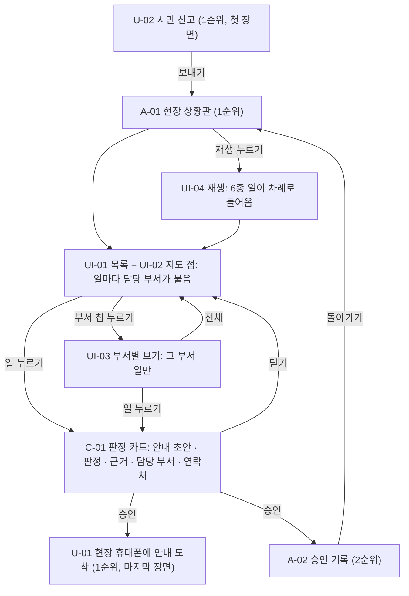

# 현장 상황판 사용자 흐름

> 이 파일이 사용자 흐름의 원본이다(11-06 PM vault에서 옮김, 내용은 11-01 판 그대로).

## 흐름도

- 와우 장면은 U-02에서 시작한다. 시민이 「보내기」 → 상황판에 출구 앞 흡연이 건강관리과 일로 올라옴 → 「재생」으로 나머지 101건(번호 단 여섯 건: 자전거PM과 둘 · 주차계획과 · 동물보호과 · 정원도시정책과 · 청년정책담당관, 그리고 배경 95건. 동규 11-01) → 「부서별 보기」에서 건강관리과 → 출구 앞 흡연 카드에서 「승인」 → 왼쪽 휴대폰(U-01)에 안내 도착. [전략.md 4절]
- 시연 데이터에는 6종 밖 일이 없다(동규 10-31). 6종 밖 일은 아래 예외 분기에만 둔다.
- A-03 다른 현장 예시는 그림 한 장(나중)이라 흐름도에서 뺐다.

## 화면별 표

| 코드 | 경로(주소) | 확인할 내용 | 다음 행동 |
|---|---|---|---|
| U-02 | 발표 화면 왼쪽 틀 · `/report` [짐작] | 칸에 미리 정한 값(무엇 · 어디 · 가상 연락처)이 들어 있는가. 「보내기」를 누르면 A-01에 한 줄 · 점이 생기고, 이 화면에 맡은 부서가 보이는가 | 「보내기」 |
| A-01 | `/` [짐작] | 「가상 데이터」와 「2026-10-01 시행본 기준」이 보이는가. 들어온 일마다 담당 부서가 붙는가 | 「재생」, 부서 칩, 일 누르기 |
| UI-04 | A-01 안 | 6종 일 101건(번호 단 여섯 건 + 배경 95건)이 정해진 순서 · 간격으로 들어오고, 여섯 부서 칩이 모두 1건 이상이 되는가 | 목록 · 지도 |
| UI-03 | A-01 안 | 부서 칩을 누르면 그 부서 일만 남고, 「전체」로 돌아오는가 | 일 누르기 |
| C-01 | A-01 위에 열림 | 안내 초안 · 판정 · 근거(조항 원문 · 시행일 · 링크) · 담당 부서 · 연락처가 한 장에 있는가. 과태료 금액이 보이지 않는가 | 「승인」 또는 닫기 |
| U-01 | 발표 화면 왼쪽 틀 | 승인한 안내가 근거 · 담당 부서와 함께 도착하는가 | — |
| A-02 (2순위) | `/log` [짐작] | 승인이 한 줄씩(부서 · 시각 · 안내) 쌓이는가 | A-01로 |

## 예외 분기

| 상황 (PRD 예외 상황과 같은 이름) | 어디서 | 어떻게 되나 |
|---|---|---|
| 6종에 근거 없음 | C-01, 채점 API | 제품: 배정 없이 회색 「6종으로는 확인할 수 없음」. 시연 데이터에는 없다. 엔진은 `확인 불가` |
| 6종과 바깥에 같은 내용이 둘 다 있음 | C-01, 채점 API | 6종으로 답한다 |
| 질문의 핵심이 바깥에만 있음 | C-01, 채점 API | `확인 불가` |
| 자치구 조례 · 규칙, 다른 시 · 도를 묻는 질문 | C-01, 채점 API | `확인 불가` |
| 조례가 「지정할 수 있다」고만 정한 곳 | C-01 | 판정은 「지정 대상」, 추가 확인에 「실제 지정 여부는 고시 확인」 |
| 기준 시점 전후 값 | C-01, 채점 API | 2026-10-01 시행본 값으로 답함 |
| 조문은 있는데 금액 · 기준이 없음(위임 규정형) | C-01, 채점 API | 맡긴 조항을 인용하고 「조례에는 정해져 있지 않다」와 누가 정하는지 · 어디서 확인하는지를 안내한다. 「확인 불가」는 0점(11-11 답, 11-19 채점 공지로 확정, `docs/engine/scoring-rules.md` 1절) |
| 「조례에 없는 내용」을 묻는 질문 | C-01, 채점 API | 6종 안에 그 주제를 다루는 조항이 있으면 그 조항을 인용해 「조례에는 정해져 있지 않다」고 답하고, 다루는 조항 자체가 없으면 `확인 불가`(11-11 답, 11-19 채점 공지) |
| 질문에 「서울시」가 없음 | 채점 API | 6종 범위로 답한다(평가셋도 이런 질문을 6종 근거로 둔다, `eval/README.md`). 운영진에 물은 적이 없고, 11/19부터 개별 기술 문의를 받지 않아 답을 받을 길이 없다 |
| 들어온 일 없음 | A-01 | 지도는 그대로, 아직 들어온 일이 없다는 상태를 보임 |
| 「부서별 보기」에서 그 부서 일이 없음 | A-01 | 그 부서에 온 일이 아직 없다는 상태와 「전체」로 돌아가는 길 |
| 한 일에 여러 조례를 인용함 | A-01, C-01 | 미정: 인용한 부서 모두 vs 첫 인용 부서 + 「함께 볼 부서」(PRD 미정 18) |
| 불러오지 못함 | A-01, C-01, U-02 | 불러오지(보내지) 못했다는 상태와 다시 시도. 엔진은 정해진 JSON |
| 90초 안에 못 끝냄 | 채점 API, C-01 | 75초에서 끊고 `확인 불가` |
| 업스테이지 API 오류 · 429 | 채점 API, C-01 | 다시 시도, 그래도 실패하면 정해진 JSON |
| 시연 중 연결 끊김 | A-01, C-01 | 저장해 둔 엔진 답으로 재생 |
| 다른 일 누르기 · 뒤로 가기 | A-01 | 지도 위치와 확대 정도, 「부서별 보기」 상태는 그대로 남고, 열린 카드만 바뀐다 [짐작, 미정 14] |

## 관련 문서

- [사이트맵](sitemap.md) - 흐름도에 쓴 화면 코드의 출처
- [PRD](PRD.md) - 예외 분기의 출처(예외 상황 표)
