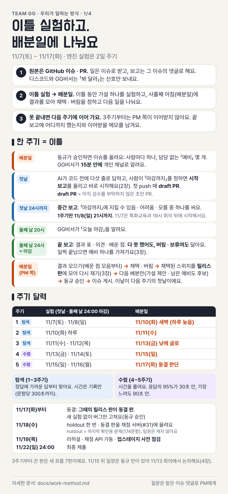
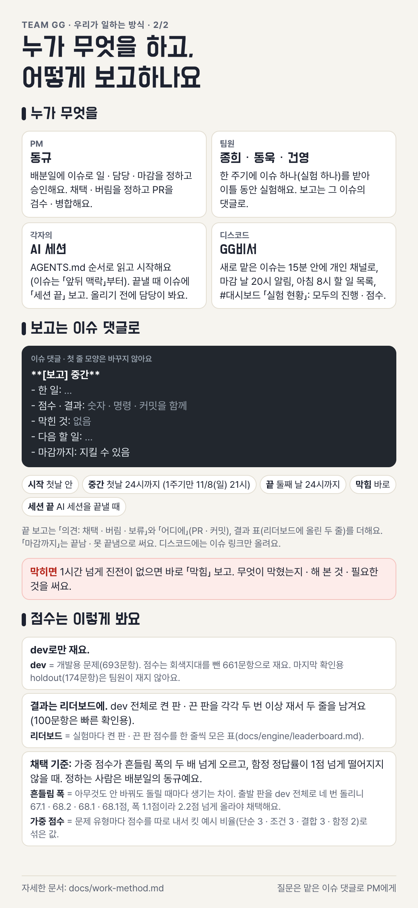

# 일하는 방식: 2일 주기 · 지시 · 보고 · 이어받기





11/7부터 11/17까지 네 명이 엔진 실험을 **2일 주기**로 돌린다. 일은 GitHub 이슈로 받고, 보고는 그 이슈의 댓글로 하고, 결과는 리더보드와 PR로 낸다. **GitHub가 원본이다.** 디스코드와 GG비서는 「봐 달라」는 신호만 보낸다.

oss-hub에서 쓰던 방식을 우리 팀 크기와 대회 일정에 맞게 줄였다. 다른 점은 7절에 있다. 가장 큰 차이는 둘이다. **이틀마다 결과를 보고 다음 가설을 나누고, 못 끝낸 실험은 배분일 아침에 PM 쪽(동규와 동규의 Claude 세션)이 이어받는다.**

처음 왔다면 아래 「앞뒤 맥락」과 맨 아래 「낱말 풀이」부터 읽는다.

## PM 한 장 (동규)

배분일과 그 사이 세 장면에서 이것만 본다. 까닭과 자세한 절차는 괄호 속 절에 있다.

**배분일** (11/9 · 11/11 · 11/13 · 11/15 · 11/17, 1 · 4 · 5절)
1. [ ] 결과 모으기: 리더보드와 이슈마다 「끝」 보고 (Claude 세션이 모아 온다)
2. [ ] 못 끝낸 실험 넘겨받기: 담당을 동규로 바꾸고 사실 한 줄을 남긴다. Claude 세션이 마저 돌린다
3. [ ] 채택 · 버림: 이슈의 채택 기준대로 정한다. 채택은 PR 병합, 버림은 PR · 이슈 닫기(숫자는 「결과만 PR」로 리더보드에 남긴다)
4. [ ] 다음 배분안: 다음 가설 · 사람 · 기준선(병합 뒤 main). Claude 세션이 이슈 초안까지 쓴다
5. [ ] 동규 승인
6. [ ] 이슈 게시와 담당 지정. 그날이 다음 주기의 첫날이다

**이슈를 올리기 전** (2절)
- [ ] 처음 보는 사람이 이 글만 보고 시작할 수 있나. 「앞뒤 맥락」 여섯 줄이 다 있고, 낯선 낱말에 풀이나 링크가 있나
- [ ] 한 사람 · 한 주기 · 한 실험인가. 제목에 「및 · 그리고」가 있으면 쪼갠다
- [ ] 완료 조건을 남이 재도 같은 답이 나오나. 기준선(점수 + 커밋)과 채택 기준을 먼저 적었나
- [ ] 같은 파일을 고치는 다른 이슈와 「하지 않을 것」으로 경계를 그었나
- [ ] 링크는 팀원이 열 수 있는 곳(팀 레포 전체 주소 · 공유 링크)인가. 키 · 실명 · 연락처는 없나

**중간 보고를 받을 때** (첫날 밤, 3 · 5절)
- [ ] 「마감까지」 줄부터 본다. 어려움 · 모름이거나 보고가 없으면 둘째 날 아침에 5절 1의 셋 중 하나를 정한다
- [ ] 점수에 숫자 · 명령 · 커밋이 다 있고, 기준선과 같은 조건(dev · 같은 명령)으로 쟀나. holdout 점수가 보이면 왜 쟀는지 묻는다
- [ ] 막힘이 내가 풀 것(결정 · 정보 · 키)이면 바로 답한다. 범위를 넓히자는 제안은 다음 배분안으로 뺀다

**PR을 검수할 때** (4절, `REVIEW.md` 7절 순서)
- [ ] 완료 조건을 다 채웠나(`Closes`). 일부만이면 `Refs`로 바꾸고 남은 일은 다음 배분으로 뺀다
- [ ] GG비서 리뷰가 마지막 커밋에서 끝났나(👍 또는 P0 · P1 처리). 「리뷰 중」이면 기다린다
- [ ] 엔진 점수는 「검증」의 명령으로 다시 재서 같은 숫자가 나오나 (Claude 세션에 맡겨도 된다)
- [ ] 평가셋 정답을 바꾼 것과 점수를 올린 것이 한 PR에 섞이지 않았나. 출력 4필드와 「확인 불가」 꼴이 그대로인가

## 앞뒤 맥락

모든 이슈의 「앞뒤 맥락」이 여기를 가리킨다. 이슈에는 그 일에 해당하는 것만 쓰고, 공통 설명은 여기에 둔다.

**대회와 채점**

- 2026 AI 부트캠프 경진대회의 업스테이지 주제 「Upstage AI Studio를 활용한 공공 법령 Q&A AI」에 나간다. 서울특별시 조례 6종(주차장 · 동물보호 · 자전거 · 도시공원 · 금연 · 청년)에 대한 시민 질문을 받아, 답과 근거 조항(「제○조 제○항」)을 함께 돌려주는 API를 만든다.
- 11/22(일) 24:00에 API 주소를 내면 운영진이 비공개 문항으로 **딱 한 번** 채점한다. 그래서 우리 평가셋(`eval/`)으로 미리 재 가며 고친다.
- 업스테이지 채점 100점 중 엔진이 맡는 것은 80점이다(`docs/engine/plan.md` 1-1절).

| 영역 | 배점 | 어떻게 매기나 |
|---|---|---|
| 근거 정확도 | 40 | 자동 채점. 항까지 맞으면 1, 조까지만 맞으면(항이 달라도) 0.5, 다른 조 · 자치구 조례 · 인용 없음은 0 |
| 신뢰도 | 20 | 근거가 없는 질문(함정)에 정확히 「확인 불가」로 답하나, 답에 원문 링크 · 시행일이 붙나 |
| 답변 품질 | 20 | 심사위원이 읽는다. 맞는 답을 쉬운 말로, 조건을 묻는 질문은 첫 낱말이 「네 · 아니요」 |
| 서비스 시연 | 20 | 발표 (엔진 밖) |

- 문항이 0점이 되는 경우: 90초 초과, 오류 응답, 출력 칸 이름이 틀림, 인용 없음, 함정에 지어낸 답. 채점 때 서버가 꺼져 있으면 모든 문항이 0점이다.
- 출력은 네 칸(`answer` · `citation` · `source_url` · `effective_date`)이고, 확인 불가 꼴은 하나로 정해져 있다(`engine/contract.py`).

**우리 팀 방식**

- 엔진은 2일 주기로 실험한다(1절). 한 사람이 한 주기에 가설 하나를 시험하고, 배분일에 동규가 결과를 보고 채택 · 버림을 정한 뒤 다음 가설을 나눈다.
- 모든 실험은 같은 자(점수 재는 틀, `eval/run.py`)로 dev에서 재고, 켠 판과 끈 판을 리더보드에 한 줄씩 남긴다. 그래서 누구의 숫자든 나란히 견줄 수 있다. 채택 판단은 dev 전체로, 켠 판 · 끈 판을 각각 두 번 이상 재서 한다(`docs/engine/reproducibility.md` 3절 「재는 법 기본값」).
- 엔진 성능의 최종 책임과 채택 결정은 동규가 진다. 팀원은 맡은 가설을 구현하고 재서 보고한다.

**지금 엔진 상태**

- 출발 판은 스타터 킷을 단계별 파일로 나눈 엔진이다: 질문 받기 → 검색 → 근거 고르기 · 답 쓰기 → 판정 → 출력(`engine/README.md`).
- 지금 점수는 리더보드의 지금 main 줄을 본다. 이슈에는 그 줄을 옮겨 적는다.
- 출발 판을 dev 전체(661문항)로 끝까지 돌린 가중 점수는 68.1점이고, 흔들림 폭은 1.1점이다(11/6, `docs/engine/leaderboard.md`).
- 11/6에 키 없이 잰 dev 검색 적중률은 top-6 70%다. 놓친 문항은 다른 조를 찾았거나(107문항), 근거 둘 이상 중 일부만 찾았거나(65문항), 조는 맞고 항이 달랐다(51문항)(`docs/engine/plan.md` 1-3절).

## 1. 2일 주기

팀원은 이틀 동안 가설 하나를 실험한다. 사흘째 아침(배분일)에 동규와 Claude 세션이 결과를 모아 채택 · 버림을 정하고 다음 가설을 나눈다. 동규가 승인하면 그날 이슈를 올리고, 그날이 다음 주기의 첫날이다.

| 주기 | 첫날 | 둘째 날 (마감 24:00) | 배분일 |
|---|---|---|---|
| 1 (탐색) | 11/7(토) | 11/8(일) | 11/9(월) |
| 2 (탐색) | 11/9(월) | 11/10(화) | 11/11(수) |
| 3 (탐색) | 11/11(수) | 11/12(목) | 11/13(금) 19:00 정기회의 |
| 4 (수렴) | 11/13(금) | 11/14(토) | 11/15(일) |
| 5 (수렴) | 11/15(일) | 11/16(월) | 11/17(화) 동결 판단 |

- **탐색(1~3주기)**: 응답 시간은 따지지 않고 정답에 가까운 답부터 찾는다. 시간은 기록만 한다(문항당 300초까지. 비용 상한은 두지 않고, 크레딧이 모자라면 동규에게 알린다).
- **수렴(4~5주기)**: 시간을 줄인다. 응답의 95%가 30초 안, 가장 느려도 90초 안이어야 한다.
- **1주기만**: 11/7은 13~19시 특화교육과 19시 회의 뒤에 시작해서, 중간 보고는 11/8(일) 21시까지다.
- **그 뒤**: 11/17(화)부터 동결이다(새 실험 없이 버그만 고친다, 동규 승인). 11/18(수) holdout 한 번 · 동결 판 배포, 11/19(목) 리허설 · 채점 API 가동, 11/22(일) 24:00 최종 제출.
- 날짜의 원본은 `docs/schedule.md` 「엔진 실험 주기」다. 위 표는 같은 날짜를 옮긴 것이다.

| 단계 | 누가 | 어디에 | 언제 |
|---|---|---|---|
| 1 배분 · 지시 | 동규 + Claude 세션 | 이슈(「작업」 양식), 담당자 지정 | 배분일, 동규 승인 뒤 |
| 2 시작 보고 | 담당 | 이슈 댓글 | 주기 첫날 안 |
| 3 실험 | 담당 | 브랜치 `이름/이슈번호-짧은설명`과 draft PR, 설정 파일의 스위치 | 첫날 ~ 둘째 날 |
| 4 중간 보고 | 담당 | 이슈 댓글 | 첫날 24시까지 |
| 5 끝 보고 | 담당 | 리더보드 + 이슈 댓글. 채택 의견이면 PR을 Ready for review로 | 둘째 날 24시까지 |
| 6 채택 · 버림 · 병합 | 동규 | 리더보드 · PR | 배분일 아침 (4절) |
| 7 못 끝낸 실험 이어받기 | 동규 + Claude 세션 | 그 브랜치 · draft PR | 배분일 아침 (5절) |

GG비서는 디스코드로 알려 주기만 한다(원본은 이슈다). 새로 맡은 이슈는 15분 안에 그 사람 개인 채널로, 마감 날 20시에 「오늘 마감」을, 아침 8시 할 일 목록의 「맡은 이슈」 칸에 맡은 이슈를 보여 준다. #대시보드 「실험 현황」에는 모두의 진행 · 점수(사람별 이번 주기 일 · 보고 · PR · 점수와 점수 순위)가 15분마다 고쳐져 보이고, 「이번 주 마감」에는 모두의 이슈와 마감이 보인다.

## 2. 지시: 이슈 쓰기 (PM)

- 양식은 `작업`(`.github/ISSUE_TEMPLATE/task.md`) 하나다. **이슈 하나 = 한 사람 · 한 주기 · 한 실험**이고, 마감은 그 주기 둘째 날 24:00이다. 실험이 아닌 일(뼈대 · 서버 · 문서)도 주기에 맞춰 이틀 몫으로 끊어 낸다.
- **「앞뒤 맥락」은 필수다.** 팀원은 회의에 없었을 수도 있고 다른 이슈를 안 읽었을 수도 있다. 이 글 하나만 읽고 시작할 수 있게 아래 여섯 줄을 쓴다.

| 줄 | 쓸 것 |
|---|---|
| 대회와 채점 | 이 일이 닿는 채점 항목 한두 줄 + 위 「앞뒤 맥락」 링크 |
| 우리 팀 방식 | 양식에 미리 적힌 문장 그대로 (2일 주기, 이 문서 링크) |
| 지금 엔진 상태 | 리더보드의 지금 main 줄(가중 점수 · 적중률 · 커밋)과 이 일에 닿는 약점 숫자 |
| 이 일이 고치는 것 | 어느 단계의 어떤 실패를 줄이나. 실제 질문 하나를 예로 든다 |
| 이번 주기 일정 | 주기 번호, 첫날 · 마감 · 배분일 |
| 낱말 풀이 | 이 이슈에 나오는 낱말. 맨 아래 「낱말 풀이」에 있으면 링크, 없으면 그 자리에서 한 줄로 푼다 |

- **완료 조건은 재는 법으로 쓴다.** 다른 사람이 같은 명령을 돌려도 같은 답이 나와야 한다.
  - 나쁨: 「검색 성능 개선」
  - 좋음: 「dev 전체로 켠 판 · 끈 판을 두 번씩 재서, 가중 점수가 흔들림 폭의 두 배 넘게 오르고 함정 정답률이 1점 넘게 떨어지지 않는다」
- 엔진 실험은 「실험」 절을 채운다: 가설 · 스위치 · 지표 · 기준선(지금 점수와 그 커밋) · 채택 기준. 점수는 dev로만 잰다. 채택 판단은 dev 전체로 켠 판 · 끈 판을 각각 두 번 이상 재서 하고, 100문항 표본은 빠른 확인용이다(`docs/engine/reproducibility.md` 3절). holdout은 팀원이 재지 않는다(동결 판에서 동규가 잰다).
- 같은 파일을 고치는 이슈가 둘이면 「하지 않을 것」에 경계를 긋는다. 엔진은 검색 · 프롬프트 · 출력 규격 파일이 겹치기 쉽다.
- 이슈 본문에서는 상대 경로 링크가 열리지 않는다. 팀 레포 파일은 `https://github.com/team-gg-aibc/aibc2026-gg/blob/main/…` 꼴 전체 주소로 건다. PM 개인 노트의 경로는 팀원이 열 수 없다.
- 이슈 본문은 CI 비밀값 검사가 돌지 않는다. 키 · 실명 · 연락처를 넣지 않았는지 올리기 전에 직접 본다.

## 3. 보고: 이슈 댓글 (담당)

보고는 디스코드가 아니라 **맡은 이슈의 댓글**로 한다. 디스코드에는 이슈 링크만 올린다. AI에게 「이슈 #12 보고 써 줘」라고 해도 된다. 보고는 주기마다 세 번이고, 막히거나 AI 세션을 끝낼 때 더한다.

| 종류 | 언제 | 꼭 채울 줄 |
|---|---|---|
| 시작 | 주기 첫날 안 | 다음 할 일(어떻게 할지 2~3줄), 마감까지 |
| 중간 | 첫날 24시까지(1주기만 11/8(일) 21시까지) | 다섯 줄 모두. 「마감까지」가 어려움 · 모름이면 PM이 둘째 날 아침에 정한다(5절) |
| 끝 | 둘째 날 24시까지. 다 못 했어도 단다 | 다섯 줄 + 의견 + 어디에 + 결과 표. 못 끝냈으면 이어받을 메모까지 |
| 막힘 | 1시간 넘게 진전이 없을 때 바로 | 막힌 것: 무엇이 · 해 본 것 · 필요한 것 |
| 세션 끝 | AI 세션을 끝낼 때(일이 안 끝났어도) | 다섯 줄 + 어디에 + 이어받을 메모. 다음 세션이 이 댓글부터 읽는다 |

때가 겹치면 댓글 하나로 쓰고 첫 줄에 종류를 함께 적는다(예: `**[보고] 시작 · 중간**`). 틀:

```markdown
**[보고] 중간**
- 한 일: 설정 파일에 후보 20개 스위치를 만들고 키 없이 적중률을 쟀다
- 점수 · 결과: dev top-20 적중률 87% (출발 판 top-6 70%) (명령: python3 eval/run.py --config eval/configs/<내 실험>.json --mode retrieval, 커밋 abc1234)
- 막힌 것: 없음
- 다음 할 일: dev 전체를 끝까지 돌려 켠 판 · 끈 판을 리더보드에 올리기
- 마감까지: 지킬 수 있음
```

끝은 아래 줄과 결과 표를 더한다. 세션 끝은 「어디에」와 「이어받을 메모」를 더한다.

```markdown
- 의견: 채택 — dev 전체 두 번씩 재서 가중 점수가 흔들림 폭의 두 배 넘게 올랐고 함정 정답률도 떨어지지 않았다
- 어디에: PR #40 (Ready로 바꿈) · 커밋 abc1234
- 이어받을 메모: 후보가 늘어 답 쓰기 입력이 길어졌다. 90초에 가까운 문항이 있는지는 아직 안 봤다

(결과 표: 리더보드에 올린 켠 판 · 끈 판 두 줄을 그대로 붙인다)
```

- 첫 줄의 `[보고]` 뒤에는 종류(시작 · 중간 · 끝 · 막힘 · 세션 끝)를 쓴다.
- 「마감까지」는 시작 · 중간 · 세션 끝 보고에서 셋 중 하나로 쓴다: 지킬 수 있음 · 어려움(이유) · 모름. 끝 보고에서는 끝남 · 못 끝냄(이유)으로 쓴다.
- 「의견」은 채택 · 버림 · 보류 중 하나와 이유다. 정하는 것은 배분일의 동규지만, 실험을 가장 잘 아는 사람의 의견이 먼저 있어야 한다. 채택 의견이면 PR을 Ready for review로 바꿔 배분일 아침까지 GG비서 리뷰가 끝나게 한다. 버림 의견이면 draft로 둔다.
- 「이어받을 메모」에는 다음 사람이 다시 알아내느라 시간을 쓸 것만 쓴다: 알아낸 사실 · 함정 · 아직 확인하지 않은 것.
- 점수는 **숫자 · 명령 · 커밋**을 함께 쓴다. 셋 중 하나라도 없으면 다른 사람이 다시 잴 수 없다. 끝 보고의 숫자는 리더보드에 올린 줄과 같아야 한다. 채택 · 버림 의견은 dev 전체로 잰 줄로 낸다(100문항 표본만으로 정하지 않는다).
- 틀의 모양(첫 줄 `[보고]`, `- 마감까지:` 줄)은 바꾸지 않는다. GG비서가 보고를 모아 볼 때 이 모양을 읽는다.

## 4. 배분일: 채택 · 버림과 검수 (PM)

배분일 아침에 리더보드와 끝 보고를 보고 실험마다 채택 · 버림 · 보류를 정한다. 기준은 이슈 「실험」 절의 채택 기준이다. 숫자를 보고 감으로 정하지 않는다.

- **채택**: PR을 병합한다. 순서와 병합 조건은 `REVIEW.md` 6 · 7절 그대로다. 판단은 셋 중 하나다: 병합 / 고쳐서 다시 / 큰 제안은 이슈로 빼고 병합. 병합하면 기준선이 바뀌니, 다음 주기 실험은 병합된 main에서 기준선을 다시 잰다.
- **버림**: 병합하지 않는다. 숫자와 이유를 리더보드와 이슈 「실험」 절에 남기고 PR과 이슈를 닫는다. 브랜치는 이슈에 링크로 남긴다. 닫은 PR의 실행 요약은 main에 들어가지 않으니, 배분일에 PM 쪽이 그 주기의 실행 요약만 모은 「결과만 PR」로 리더보드에 남긴다(`docs/engine/reproducibility.md` 8절).
- **보류**: 더 잴 것이 있으면 다음 주기 이슈로 다시 낸다. 이번 이슈는 닫는다.

## 5. 못 끝낸 실험: 배분일 아침에 이어받기

둘째 날 24시까지 완료 조건을 못 채운 실험은 **배분일 아침에 PM 쪽(동규와 동규의 Claude 세션)이 이어받아 마저 돌린 뒤 배분한다.** 주기가 이틀이라, 한 실험이 늦어지면 그 결과를 기다리는 다음 배분이 밀린다. 이어받기는 벌이 아니라 주기를 지키는 장치다.

1. **첫날 밤 중간 보고에서 먼저 본다.** 「마감까지」가 어려움 · 모름이거나 보고가 없으면, PM이 둘째 날 아침에 셋 중 하나를 정해 이슈에 적는다.
   - 범위를 줄여 마감 지키기 (예: dev 전체 대신 100문항 빠른 확인까지. 채택 판단은 dev 전체로 잰 뒤에 한다)
   - 배분일에 PM 쪽이 이어받기 (따로 정하지 않으면 이것)
   - 버리기 (동결(11/17) 전에 꼭 필요하지 않으면)

   마감은 늦추지 않는다. 더 할 가치가 있으면 배분일에 다음 주기 이슈로 다시 낸다. 범위를 바꾸면 이슈 본문을 고치고, 댓글에 무엇을 바꿨는지 한 줄 남긴다.
2. 담당은 둘째 날 24시까지 한 것을 push하고 「끝」 보고를 단다. 못 끝냈어도 「어디에」와 「이어받을 메모」를 쓴다.
3. 배분일 아침, PM은 이슈 담당자를 동규로 바꾸고 사실만 한 줄 남긴다. 예: 「주기 2가 끝나 동규가 이어받음. 앞 작업은 브랜치 이름/12-filter」.
4. Claude 세션이 6절 순서로 보고, 그 브랜치(draft PR이 있으면 그 PR)에서 이어서 돌린다. 결과는 리더보드에 올리고, 채택 · 버림은 4절대로 정한다. 원래 담당의 커밋은 squash 병합 메시지에 공동 작성자(`Co-authored-by`) 줄로 남는다. 병합 직전 메시지 칸에서 그 줄을 확인하고 지우지 않는다.
5. 원래 담당은 같은 배분일에 다음 주기 이슈를 받는다. PM은 끝 보고를 보고 다음 일의 크기를 맞춘다.

## 6. 이어받을 때 보는 순서 (사람이든 AI 세션이든)

남이 하던 일을 넘겨받을 때도, 내가 다른 AI 세션에서 하던 일을 이어 갈 때도 이 순서로 본다.

1. **이슈**: 앞뒤 맥락 · 완료 조건 · 하지 않을 것 · 마감. 본문이 바뀌었으면 댓글에 바뀐 까닭이 있다
2. **마지막 보고**: 「어디에」(브랜치 · 커밋 · PR), 「다음 할 일」, 「이어받을 메모」
3. **브랜치 · draft PR**: 마지막 커밋과 바뀐 파일. 새 브랜치를 만들지 않고 그 브랜치에서 이어서 커밋한다
4. **실험 기록**: 이슈 「실험」 절과 리더보드에서 어디까지 쟀는지, 그 기준선이 지금 main 커밋과 같은지

담당이 바뀌었으면 이슈에 「시작」 보고를 단다. 누가 이어받았는지가 이슈에 남는다.

## 7. oss-hub와 다른 점

| 무엇 | oss-hub | 우리 | 왜 |
|---|---|---|---|
| 일을 나누는 사람 | 팀원 누구나 티켓을 쓰고, 담당이 시작 전에 이슈로 선점한다 | 배분일에 PM이 이슈를 쓰고 담당을 정한다. 새 일이 필요하면 이슈로 PM에게 묻는다 | 네 명이 같은 엔진을 동시에 고친다. 나누는 곳이 하나여야 겹치지 않는다 |
| 마감 정하기 | 우선순위로 정한다: P0 1영업일 · P1 3영업일 · P2 5영업일 | 2일 주기. 이슈 하나 = 한 사람 · 한 주기 · 한 실험, 마감은 둘째 날 24:00 | 주말에도 이어지는 2주짜리 대회다. 가설을 빨리 돌리고 결과로 다음 가설을 고른다 |
| 마감을 넘기면 | 저장소 규칙에 따로 없다 | 배분일 아침에 PM 쪽이 이어받아 마저 돌린다 (5절) | 제출 · 발표 날짜가 고정이고, 다음 배분이 그 결과를 기다린다 |
| 중간 보고 | PM은 결과(PR)를 받고, 상태가 바뀌거나 위험 · 마감 영향이 있을 때만 보고한다 | 주기마다 시작 · 중간 · 끝, 그리고 막힘 · AI 세션 끝 (3절) | 이틀이면 첫날 밤에 신호가 와야 둘째 날에 손쓸 수 있다. AI 세션이 바뀌어도 이슈만 보면 이어진다 |
| 이슈 단위와 양식 | 화면 하나. 결함 · UX 두 양식, 요소 캡처와 영역별 증거 | 실험 하나. 한 양식에 「앞뒤 맥락」(필수) · 「실험」 절 | 엔진 일은 화면이 없고 점수로 판단한다. 회의에 없던 사람도 이슈 하나로 시작해야 한다 |
| 완료 조건 | 역할별 시나리오, 배포 환경에서 다시 확인, UX 안티패턴 24줄 점검 | 재는 법(명령 + 기대 숫자, 또는 눌러서 보이는 것) | 같은 이유. 팀 크기에 맞춰 줄였다 |
| 진행 상태 보기 | GitHub 프로젝트 보드(카드를 In Review로 옮긴다) | 보드 없이 이슈 열림 · 닫힘, 보고 댓글, 리더보드 | 네 명이면 이슈 목록으로 충분하다. 보드를 옮기는 일이 하나 더 생긴다 |
| 공개 안전 검사 | 공개 레포라 CI가 이슈 · 댓글까지 검사한다 | CI는 PR 커밋의 비밀값만 본다. 이슈 · 댓글은 쓰는 사람이 직접 본다 | 비공개 레포다 |

병합 조건 · 자동 리뷰 · PR 증거처럼 이미 정한 차이는 `REVIEW.md`와 `CONTRIBUTING.md`에 있다.

## 낱말 풀이

이슈와 보고에 자주 나오는 낱말이다. 이슈의 「낱말 풀이」 줄이 여기를 가리킨다. 여기 없는 낱말이 이슈에 나오면 이슈에서 한 줄로 푼다.

| 낱말 | 뜻 | 예 |
|---|---|---|
| 적중률 | 정답 근거 조항이 검색 후보 안에 들어온 정도(킷 채점식: 항까지 맞으면 1, 조까지만 맞으면 0.5). 답을 쓰기 전 검색 단계만 재서 키 없이도 잰다 | 후보에 없는 조항은 모델이 고를 수 없다. top-6 적중률이 70%면, 후보 6개만 보는 엔진의 근거 점수는 70%를 넘기 어렵다 |
| 끝까지 점수 | 검색 → 근거 고르기 · 답 쓰기 → 판정 → 출력까지 엔진 전체를 돌려 대회와 같은 채점식으로 잰 점수. 키와 크레딧이 든다 | 적중률이 70%여도 모델이 후보 중 틀린 조를 고르면 끝까지 점수는 그보다 낮다 |
| dev · holdout | 우리 평가셋(실제 비슷한 세트 867문항)을 개발용 dev 693문항과 마지막 확인용 holdout 174문항으로 나눴다. 점수는 회색지대를 뺀 dev 661문항으로 잰다. 엔진을 고칠 때는 dev만 보고, holdout은 동결 판에서 동규가 한 번 잰다 | holdout을 보고 고치면 시험 문제를 미리 보고 공부한 셈이라 마지막 확인이 쓸모없어진다 |
| 가중 점수 | 문항 유형마다 점수를 따로 내서 킷 예시 비율(단순 조회 3 · 조건 판단 3 · 여러 조항 결합 3 · 함정 2)로 섞은 값. 우리 평가셋은 단순 · 조건이 73%라 그냥 평균하면 실제보다 쉬워 보인다 | (3 × 단순 + 3 × 조건 + 3 × 결합 + 2 × 함정) ÷ 11 |
| 흔들림 폭 | 아무것도 바꾸지 않아도 돌릴 때마다 점수가 조금씩 달라진다. 같은 설정을 같은 문항에 여러 번 돌린 가중 점수의 가장 높은 값 − 가장 낮은 값이 흔들림 폭이다(`docs/engine/reproducibility.md` 6절). dev 전체는 1.1점, 100문항 표본은 2.5~4.9점이라 채택 판단은 dev 전체로 한다. 이 폭 안의 차이는 실험 효과로 보지 않고, 채택하려면 이 폭의 두 배 넘게 올라야 한다 | 출발 판을 dev 전체로 네 번 돌리니 67.1 · 68.2 · 68.1 · 68.1점이라 흔들림 폭은 1.1점이다. 채택하려면 2.2점 넘게 올라야 한다 |
| 판단 기록 | 엔진이 문항마다 남기는 기록: 검색 후보, 고른 근거, 판정, 확인 불가를 낸 까닭, 단계별 시간, 켠 스위치(`engine/README.md` 「판단 기록」). 왜 틀렸는지 찾을 때 본다 | `reason`이 `점수 낮음`이면 검색 1위의 의미 점수가 문턱보다 낮아 확인 불가로 끝난 것이다 |
| 스위치 | 실험 하나를 켜고 끄는 설정 이름. 코드를 손으로 바꿔 가며 재지 않고 설정 파일(`eval/configs/`)에서 스위치를 켜서 잰다. 그래야 남이 같은 설정으로 다시 잴 수 있다 | 후보 넓히기 실험은 설정 파일에 `"top_k": 20`을 쓴다. 출발 판은 6이다 |
| 리더보드 | 실험마다 켠 판 · 끈 판 점수를 한 줄씩 모은 표(`docs/engine/leaderboard.md`). `python3 eval/board.py`가 실행 기록으로 만들고, 손으로 고치지 않는다. 같은 문항으로 잰 줄끼리만 견준다. 버린 실험의 줄은 배분일에 PM 쪽이 「결과만 PR」로 넣는다(남기는 법은 `docs/engine/reproducibility.md`) | 배분일에 동규가 이 표를 보고 채택 · 버림을 정한다 |
| 기준선 | 실험과 견줄 점수. 같은 날 같은 main 커밋에서 스위치를 끈 판으로 잰다 | 끈 판 68.1점, 켠 판 70.5점이면 효과는 +2.4점이다 |
| 함정 | 조례 6종에 근거가 없는 질문. 정답은 「확인 불가」 꼴 하나뿐이고, 지어내서 답하면 0점이다 | 6종이 다루지 않는 일(예: 지하철 운행 시간)을 묻는 질문 |
| 회색지대 | 조문은 있는데 금액 · 기준을 시장이나 규칙에 맡겨 조례만으로는 답할 수 없는 질문(40문항). 정답 꼴을 운영진에게 묻는 중이라 점수 잴 때 뺀다 | 「얼마예요?」에 조례가 「시장이 정한다」고만 쓴 경우 |
| 주기 · 배분일 | 이틀 실험하는 묶음이 주기, 그다음 날 아침 결과를 모아 다음 일을 나누는 날이 배분일이다(1절) | 주기 1은 11/7 · 11/8이고 배분일은 11/9 |
| draft PR | 아직 검수를 부탁하지 않은 초안 PR. 첫 push 때 열어 두면 하던 일을 남이 볼 수 있다. GG비서는 draft를 리뷰하지 않는다 | 완료 조건을 채우고 채택 의견이면 「Ready for review」로 바꾸고, 버림 의견이면 draft로 둔다 |
| 동결 | 11/17부터 기능을 더하지 않고 버그만 고친다(동규 승인). 그 판으로 holdout을 재고 서버에 올린다 | 11/18에 동결 판으로 holdout을 한 번 잰다 |
