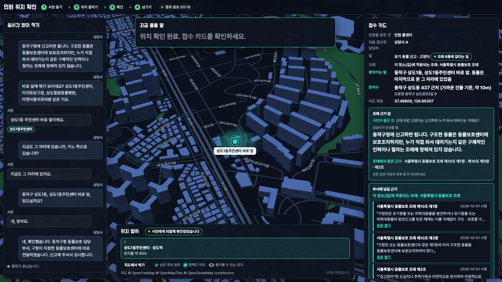
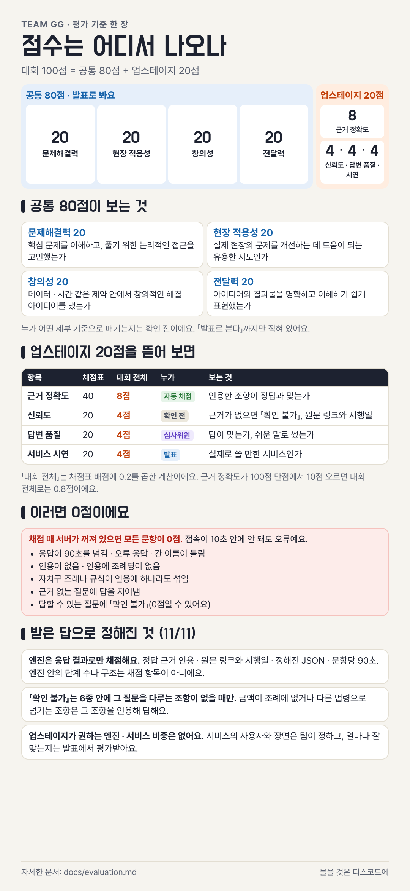

# 우리 시스템 공부 자료 (11/20 멘토링 전, 30분)

> 6차 회의 할 일 「우리 시스템 공부 자료 올리기(11/20 멘토링 전)」의 결과물이다. 맨 위 「먼저 이것만」을 5분에 읽고, 나머지는 시간이 되는 만큼 읽는다. 어려운 낱말은 맨 끝 「낱말 풀이」에 있다.
> 숫자와 사실은 팀 레포 문서와 PM 쪽 측정 기록에서 옮겼다. **11-20 저녁(18시) 기준.** 오전 판에서 바뀐 것: 낼 엔진 판(오전에 정한 위임 꼴 고침 판 c8 → 「채점 서버 판 + 쉬운 말 검사」), 11/20에 main에 들어간 PR 여섯, 위치의 현장 실패 고침 넷과 따로 만든 잣대(다양한 사례 93통). 위치의 첫 사람 통화 숫자는 11/21에 나온다.

## 먼저 이것만: 5분 요약

1. **무엇을 푸나.** 법이 위치 조회를 허락한 전화는 119 · 112 · 122뿐이다. 120 같은 민원 전화는 자리를 말로만 듣는다. 그런데 그런 전화에도 다친 동물 구조처럼 급하고 중요한 민원이 들어온다. 말로 들은 자리는 정확하지 않을 수 있다.
2. **무엇을 만들었나.** 120 상담사가 통화하는 동안 보는 화면 「통화로 위치 좁히기」다. 민원인의 말에서 위치 단서를 읽어 지도 위 범위를 줄이고, 다음에 물을 질문을 하나 띄운다. 자리가 정해지면 접수 카드에 번지수 · 넘길 곳이 채워지고, 조례 6종에 걸리는 일이면 우리 엔진이 근거 조항을 붙인 답을 함께 보인다.
3. **엔진(채점받는 부분).** 질문을 받으면 읽을 조례를 고르고, 그 조례 원문 전체를 읽어 답을 쓰고, 원문에 글자 그대로 있는 구절만 인용으로 남긴다. 낼 판은 **「채점 서버 판 + 쉬운 말 검사」**다(11/20 17시 확정, 채점 서버 반영은 11/21 오전). 쉬운 말 검사는 답을 쉬운 말로 다시 쓰다가 맞는 초안을 망치면 초안을 그대로 내는 안전장치다. 11/19 공지의 위임 꼴 질문을 고친 후보 다섯은 처음 보는 문항에서 나아지지 않아 넣지 않았다. 그래서 공지 예시 꼴 위임 질문에는 약한 곳이 남아 있다(3-2).
4. **우리 숫자.** 엔진: 개발에 쓰지 않은 문항(새 정답 표기 174문항)에서 낼 판 12번 평균 **93.1점**(90.5~95.9, 같은 판도 잴 때마다 이만큼 흔들림). 위치: **우리가 만든 가상 시민**으로 잰 600통에서는 421통이 한 점까지 좁혀지고 틀린 확정 0통이었지만, **현실에서 사람이 자유롭게 건 4통(11/19 현장 테스트)은 한 점 확정 0통 · 평균 10.5번 물음**이었다. 거기서 나온 실패 꼴 넷을 11/20에 고쳤고(같은 통화를 다시 넣으면 수 km 튐 5 → 0번, 틀린 확정 1 → 0건), 고치는 코드를 보지 않고 따로 만든 93통 묶음에서는 **한 점 39통(42%) · 틀린 확정 0**이다. 첫 사람 통화 숫자는 11/21 시험에서 나온다.
5. **채점.** 대회 100점 = 공통 80점(문제해결력 · 현장 적용성 · 창의성 · 전달력) + 업스테이지 20점. 11/19 마지막 공지: 조례가 세부 내용을 다른 곳에 맡긴 질문은 **맡긴 조항을 인용**해 안내해야 하고 「확인 불가」는 0점.
6. **마지막 한 문장**: 「주소를 못 대는 민원 전화도, 통화로 자리를 좁히고 조례 원문에서 근거를 찾아 접수 한 건으로 만듭니다.」

**11/20에 main에 들어간 것 여섯**

| PR | 무엇 |
|---|---|
| #129 | 팀 기준 문서를 11/19 채점 공지 · 운영사무국 답 · 사전 점검 회신에 맞춤 |
| #130 | 정답 표기를 11/19 공지 기준으로 맞춤(dev 함정 2문항 · holdout 8문항 · 극한 함정 1문항). holdout 점수에 드는 문항이 166 → 174개 |
| #131 | 이 공부 자료의 첫 판 |
| #133 | 넘길 곳 표의 추측 줄을 공식 안내로 확인. 30갈래 가운데 확인 11 → 24갈래 |
| #132 | 길가 흡연은 자리가 좁혀진 뒤 가까운 버스 정류장 · 지하철 출구를 엔진 물음에 넣음(금연구역은 「길」이 아니라 장소로 정해지기 때문). 따릉이 대여소 · 거치대에 세운 킥보드는 자전거 조례로 받음 |
| #134 | 위치: 11/19 현장 테스트 실패 꼴 고침 넷(5절) |

---

## 1. 전체 그림 — 전화 한 통을 따라가 보기 (7분)

시연의 주 장면은 「주택가 골목의 다친 고양이」다. 팀이 지어낸 가상 통화이고 실제 민원이 아니다.

화면 맨 위에는 단계 넷이 있다: **사정 듣기 → 위치 좁히기 → 확인 → 넘기기**.

| 차례 | 민원인의 말(대본) | 화면이 하는 일 |
|---|---|---|
| 1 | 「여보세요, 집 앞 골목에 고양이가 한 마리 웅크리고 있는데요, 다리를 다쳤는지 절뚝거려요.」 | 일의 종류를 「유기 동물 신고 · 고양이」로 읽는다. 아직 자리는 모른다 |
| 2 | 「상도1동 주민센터 근처 골목이에요. 상도역에서 올라오는 길이요. 번지는 모르겠어요.」 | 지명 표에서 「상도1동주민센터」 · 「상도역」을 찾고 범위를 **반지름 약 210m**로 줄인다 |
| 3 | 「목줄은 없어요. 근데 이런 고양이는 신고하면 누가 와서 데려가는 거예요?」 | 넘길 곳이 갈리는 질문(목줄)을 먼저 물었다. 민원인이 조례 질문을 하자 엔진에 물어 「조례 근거 답」 칸에 답과 근거 조항(동물보호 조례 제10조 제1항 등)을 띄운다 |
| 4 | (「바로 앞에 뭐가 보이세요?」에) 「상도1동 주민센터 바로 앞이에요.」 | 「바로 앞」이라는 관계를 읽어 범위를 **반지름 약 40m**로 줄인다 |
| 5 | (그 사이 「지금도 그 자리에 있습니까?」를 한 번 더 묻고) 「동작구 상도1동, 상도1동주민센터 바로 앞, 맞으실까요?」에 「네, 맞아요.」 | 범위가 50m 안이라 좁힌 자리를 되물어 확인받는다. 「네」를 듣고 핀을 찍는다 |
| 6 | (통화 끝) | 접수 카드: 번지수 「동작구 상도동 437 근처 (가까운 건물 기준, 약 10m)」, 처리할 담당 부서 「동작구청 동물보호 담당 부서 · 구청이 지정한 동물보호센터」(공식 안내에서 확인). 상담 기록에 쌓인다 |

이 장면에서 알아 둘 것 셋.

- **자리가 정하는 것은 넘길 곳과 번지수다.** 살아 있는 유기 동물은 어디서든 동물보호 조례이고 넘길 곳도 「그 구의 동물보호 담당 부서」다. 자리에 따라 넘길 곳이 갈리는 것은 동물 **사체**다(자동차전용도로 · 한강공원 · 시 공원 · 동네 공원 · 그 밖의 길). 「고양이도 자리에 따라 조례 답이 달라진다」고 말하면 틀린다.
- **번지수는 그 자리의 번지가 아니다.** 정한 자리에서 가장 가까운, 가게가 있는 건물의 번지다. 그래서 거리를 늘 같이 보인다.
- **넘길 곳 표 30갈래 가운데 24갈래를 공식 안내 · 조례 원문으로 확인했다**(11/20, #133). 나머지 6갈래는 화면에 「확인 전(추측)」으로 보인다.

시연 화면은 열쇠 없이 띄울 수 있다(「저장된 답」 방식, 레포 맨 위에서 `OPENBLAS_NUM_THREADS=1 CALL_MODE=saved python3 demo/call/server.py` → `http://127.0.0.1:8772`). 자세한 것은 [`demo/call/README.md`](../demo/call/README.md).

## 2. 문제 — 왜 이 화면이 필요한가 (4분)

11-20에 PM이 정한 이야기 틀은 두 줄이다.

**① 법 때문에 위치를 조회할 수 없는 전화가 있다.**

- 위치정보법 제29조는 긴급구조기관과 경찰이 「긴급구조요청」을 받았을 때 위치정보사업자에게 위치를 **요청할 수 있게** 한다. 그 요청은 대통령령으로 정한 특수번호 전화로 들어온 것으로 한정한다.
- 같은 법 시행령 제29조가 정한 특수번호는 **119 · 122 · 112** 셋이다. 120은 없다.
- 그래서 120 같은 민원 전화는 자리를 말로 듣는다. 120에서 위치를 받으려면 본인 동의를 따로 받아야 한다(위치정보법 제15조 제1항).
- 예: 119에 전화하면 소방이 통신사에 위치를 요청할 수 있다. 같은 사람이 같은 자리에서 120에 전화하면 상담사는 「거기가 어디세요?」라고 물을 수밖에 없다.

**② 그중에는 급하고 중요한 민원이 있다.**

- 다친 · 길 잃은 동물의 구조 신고는 120으로 들어온다(서울시 환경 누리집 「유기동물 구조」 안내: 「120다산콜센터 또는 자치구 동물보호 부서」).
- 도로 위 동물 사고(로드킬)는 사망사고와 2차사고의 원인으로 꼽힌다(국토교통부 보도자료, 2020-07-05. **국도 집계이고 서울 숫자가 아니다**).
- 2025년 120 상담 6,443,378건 가운데 전화가 3,310,889건(51.4%)으로 가장 큰 경로다(120다산콜재단 정보공개 회신, 2026-11-17).
- 현장의 말: 현장 담당자는 번지수로 찾는데 민원인은 「○○ 사거리에서 ○○ 가는 방향」처럼 말해서 자리를 추정할 수밖에 없고, 못 찾으면 민원인에게 다시 전화한다(한 구청의 도로 민원 담당자, 전화 5분. 「다시 전화한다」는 우리가 먼저 묻고 받은 답이다).

**말할 때 조심할 것**: 「걸기만 해도 위치가 뜬다」(법은 위치를 *요청할 수 있게* 한 것), 「여러 번 다시 전화한다」(건수가 없다), 「120의 동물 신고가 사망사고로 이어졌다」(그런 자료 없음)는 쓰지 않는다. 근거마다의 출처는 [`docs/call-locate/근거.md`](call-locate/근거.md).

## 3. 엔진 — 조례 질문에 답하는 부분 (7분)

엔진은 채점 API다. `POST /ask {"question": "..."}`에 네 칸 JSON(`answer` · `citation` · `source_url` · `effective_date`)으로 답한다. 시연 화면도 같은 엔진을 그대로 부른다.

### 3-1. 단계 (새 흐름 flow2)

| 단계 | 누가 | 하는 일 | 예(「장애인 주차요금 감면되나요?」) |
|---|---|---|---|
| ① 검색 | 업스테이지 임베딩 + 코드 | 조문 조각에서 후보 20개를 찾는다. **결과는 읽을 조례 고르기에만 쓴다**(답에 그대로 붙이지 않는다) | 주차장 조례 쪽 조각이 위로 |
| ② 질문 분석 | solar-pro4 | 답하지 않고 질문을 칸으로만 푼다(묻는 대상 · 알고 싶은 것 · 유형 · 지역) | 대상 「장애인 주차요금」, 알고 싶은 것 「감면 여부」 |
| ③ 조례 확정 | 코드 규칙 | 읽을 조례를 많아야 둘 정한다. 6종 밖 조례나 자치구 · 다른 시도의 일을 물으면 여기서 「확인 불가」로 끝낸다 | 주차장 조례 하나 |
| ④ 조례 읽기 · 답 쓰기 | solar-pro4 | 고른 조례의 **원문 전체**를 읽고 답과 근거(조항 + 그 조항에서 옮긴 구절)를 낸다. 별표(요금표 등)는 Document Parse enhanced로 칸을 살려 「머리글: 값」 줄로 펼친 것을 읽는다 | 「제7조 제1항 … 100분의 80을 할인」 |
| ⑤ 구절 관문 | 코드 | 옮긴 구절이 그 조항 글에 **글자 그대로** 있어야 인용으로 남긴다. 지어낸 구절은 여기서 떨어진다 | 통과 |
| ⑥ 질문 대조 | solar-pro4 + 코드 | 질문이 묻는 것을 남은 근거가 정말 정하는지 판정한다 | 통과 |
| 쉬운 말 · 출력 | solar-pro4 + 코드 | 답을 쉬운 말로 다듬고(숫자 · 결론이 바뀌면 버림, 다듬은 답이 맞는 초안을 망치면 초안을 냄 = plain_guard), 원문 링크와 시행일은 **코드가** 붙인다. 인용이 없으면 「확인 불가」 | 「네, … 80%가 할인됩니다」 + 「서울특별시 주차장 설치 및 관리 조례 제7조 제1항」 |

- 「예」 칸은 꼴을 보이려고 적은 것이다. 마지막 줄의 답 · 인용만 11-18에 그때의 제출 판(c4) 설정으로 실제로 받은 응답이다.
- 핵심 한 줄: **검색은 킷 것을 그대로 쓰되, 검색 결과를 답에 붙이지 않는다.** 검색으로는 읽을 조례만 고르고, 그 원문을 통째로 읽힌 뒤, 원문에 글자 그대로 있는 구절만 근거로 남긴다. 「킷 RAG를 버리고 새로 만들었다」고 말하면 틀린다(검색 · 색인은 킷 것 그대로).
- 지어내면 안 되는 것(조항 이름 · 링크 · 시행일)은 모델이 아니라 목록과 원문에서만 나온다.
- 질문 하나에 업스테이지 호출은 약 4번(임베딩 포함)이다.

### 3-2. 낼 판은 「채점 서버 판 + 쉬운 말 검사」

**정한 것(11/20 17시).** 지금 채점 서버에 있는 판(11/15에 낸 c4)에 「쉬운 말 검사」(plain_guard)만 더한 판을 낸다(설정 지문 7327ca7e355b). 쉬운 말 검사는 답을 쉬운 말로 다시 쓰다가 맞는 초안을 망치면(예: 「5일 이내」가 「정해져 있지 않다」로 바뀜) 초안을 그대로 내는 안전장치다. 인용과 「확인 불가」는 바꾸지 않아 점수는 채점 서버 판과 같다. 채점 서버 반영은 11/21 오전이다.

- 사전 점검 꼴로 해 본 시험 17문항: 모두 정상 응답, 공개 예시 11문항 모두 맞음, 함정 3개 모두 「확인 불가」, 가장 느린 답 20.3초.
- 처음 보는 174문항에 12번 잰 점수: 90.5~95.9(평균 93.1). 같은 판도 잴 때마다 이만큼 흔들린다.

**오늘 잰 후보.** 판 이름(c5 · c6 …)은 시험한 차례일 뿐이다. 다수결(c5)을 빼면 모두 11/19 공지의 위임 꼴(조례가 세부를 시장에게 맡긴 질문에 맡긴 조항을 인용해 답하기)을 고치려던 후보이고, c6부터는 모두 쉬운 말 검사가 들어 있다. 점수는 처음 보는 174문항에서 낼 판과 같은 순간 나란히 세 번씩 잰 평균이다.

| 후보가 더한 것 (판 이름) | 점수 평균 (후보 대 낼 판) | 판정 |
|---|---|---|
| 다수결: 조례 읽기를 세 번 해서 많은 쪽을 고름 (c5) | 안 잼. 개발용 문항에서 점수는 같고 느려짐(답 시간 95% 지점 37초) | 안 씀 |
| 위임 꼴 답 살리기 + 조 제목만 적은 근거 잇기 (c6) | 92.9 대 92.0 | 안 씀 |
| c6 + 함정 지키기: 넘기는 구절만 보고 단정한 답을 거절 (c8) | 92.6 대 92.0 | 오전에 낼 판으로 정했다가 바뀜(아래) |
| c8 + 질문에 자치구 이름이 있으면 위임 꼴 답 살리기를 하지 않음 (c9) | 91.7 대 92.8 | 안 씀(PM) |
| 위임 꼴 답 살리기를 좁힘 + 근거 잇기 + 함정 지키기 (c11) | 91.6 대 93.2. 함정에 답을 내보낸 수 1 · 3 · 2 대 1 · 1 · 1 | 기준 ① 못 넘음 |
| 조 제목만 적은 근거 잇기 하나만 (c12) | 92.6 대 94.5. 함정에 답을 내보낸 수 1 · 1 · 1 대 0 · 1 · 1 | 기준 ① 못 넘음 |

**미리 정한 채택 기준**(재기 전에 정함): ① 처음 보는 문항에서 세 번 모두, 함정에 답을 내보낸 수가 낼 판보다 많지 않다. ② 위임 꼴 문항에서 낼 판보다 낮지 않다. ③ 오류가 0이고 답 시간이 비슷하다. 하나라도 어기면 채택하지 않는다. 평균 1점 안쪽 차이로는 판정하지 않는다.

**오전에 c8로 정했다가 바뀐 까닭.** 오전에는 위임 꼴에서 나은 c8로 가기로 했다. 그런데 c8에 든 「위임 꼴 답 살리기」는 자치구 조례 · 다른 법령을 묻는 함정에도 조항을 붙여 답을 내보내는 꼴이 있었다. 그래서 그 길을 좁힌 후보 셋(c9 · c11 · c12)을 차례로 쟀고, 어느 것도 기준을 넘지 못해 낼 판으로 돌아왔다.

**숨기지 않고 적는 것.**
- 후보들은 「뚜렷이 나쁘다」기보다 「나아진 것이 없다」다. c11이 더 내보낸 함정 3건 가운데 2건은 정답 표기 판단이 갈린 문항이고, c12의 차이는 한 번 측정의 한 문항이다.
- 그래도 방향은 한쪽이다. 오늘 같은 순간 나란히 잰 짝 18개 가운데 13개에서 후보가 낮았다(평균 −0.8점).
- **남은 약점: 낼 판은 공지 예시 꼴 위임 질문에 약하다.** 「반려견 놀이터 운영 시간은?」처럼 조례가 시장에게 맡긴 질문을 우리가 만든 묶음(22 + 2문항)에서 낼 판은 88.6~93.2점, 후보들은 97.7~100점이었다. 처음 보는 174문항의 위임 꼴 8문항에서는 「위임 꼴 답 살리기」를 넓게 켠 후보(c6 · c8 · c9)만 91.7점으로 낼 판(83.3 · 87.5)보다 높았다. 그 길은 함정에도 답을 내보냈고, 함정을 지키려고 좁힌 후보(c11 · c12)는 8문항도 낼 판과 같아졌다(87.5).
- 그래서 처음 보는 문항에서 함정 위험이 작은 낼 판을 고른다. 대회의 비공개 문항에 공지 예시 꼴 위임 질문이 많으면 그만큼 잃을 수 있다.
- 출처: PM 쪽 측정(낼 판 후보 비교 11-20 17:30, 후보마다 같은 순간 나란히 잰 기록).

## 4. 채점 기준과 우리 숫자 (5분)

**배점**: 대회 100점 = 공통 80점(문제해결력 · 현장 적용성 · 창의성 · 전달력, 각 20점, 발표로 봄) + 업스테이지 20점. 업스테이지 20점은 채점표 100점(근거 정확도 40 · 신뢰도 20 · 답변 품질 20 · 서비스 시연 20)을 줄인 것이다. 자세한 것은 [`docs/evaluation.md`](evaluation.md).

**11/19 마지막 채점 공지**(채점 기준 안내는 이번이 마지막이라고 했다):

| 질문의 꼴 | 맞는 답 | 예 |
|---|---|---|
| 조례가 주제를 다루면서 세부(금액 · 기준 · 절차)를 시장 · 규칙 · 고시에 **위임** | 맡긴 조항을 인용하고, 조례에 구체 내용이 없다는 점과 누가 정하는지를 안내. 「확인 불가」는 **0점** | 「반려견 놀이터 운영 시간은?」 → 동물보호 조례 제29조 제3항(운영에 필요한 사항은 시장이 따로 정함)을 인용 |
| 별표나 조항이 다른 법령 · 공고를 **준용** | 준용을 정한 이 조례의 조항(또는 별표)을 인용하고 어느 법령 · 공고를 따르는지 안내 | — |
| 6종 어디에도 그 주제를 다루는 조항이 없음 | 「확인 불가」 + 빈 인용 | 서울도서관 대출 권수 |
| 자치구 · 다른 시도 조례를 물음 | 「확인 불가」 + 빈 인용 | — |

- 인용은 조례명 + 조 + 항까지 맞으면 만점, 조까지만 맞으면 부분 점수다.
- 인용 수가 **정답 근거 수 + 2**를 넘으면 넘친 비율만큼 깎는다(정답 근거 1개에 인용 4개 → 3/4점).
- 자치구 조례 · 규칙을 하나라도 인용하면 **0점**이다. 시행규칙 · 고시 · 공고는 채점 대상 인용이 아니다.
- 확인 불가가 아닌 답은 `source_url` · `effective_date`를 채워야 한다.
- 팀 규칙 문서: [`docs/engine/scoring-rules.md`](engine/scoring-rules.md). 11/19 기준으로 고친 판이 11/20에 main에 들어갔다(#129).

**운영사무국 답(11/19)**: 채점 서버는 11/25(수)부터 11/27(금) 대회 끝까지 켜 둔다. 저장소는 제출 때 공개, 발표자료는 PDF(시연 영상은 그 안 링크). 자세한 것은 [`docs/운영사무국-문의-답변.md`](운영사무국-문의-답변.md).

**사전 점검(11/19 20:00)**: 공개 예시 11문항 모두 정상 응답, 90초 넘은 것 0(가장 오래 걸린 문항 17.9초), 형식 문제 0. 「지금 상태를 최종 채점 때까지 유지해 달라」는 답을 받았다(점수에는 넣지 않는 점검).

**우리 숫자**

| 무엇 | 값 | 조건 |
|---|---|---|
| 엔진, 개발에 쓰지 않은 문항 | **93.1**(낼 판, 12번 90.5~95.9) | 새 정답 표기 174문항. 11-20 09:58 · 13:47 · 16:13 · 16:44에 후보와 같은 순간 나란히 세 번씩 잰 12번의 평균. 예전 「166문항 93.0」은 옛 표기로 잰 지난 값 |
| 엔진, 개발용 문항 | 95.5(채점 서버 판 c4, 6번 95.1~96.0) | 693문항, 새 정답 표기. 쉬운 말 검사를 더한 낼 판은 3번 평균 94.9(93.5~96.2). 쉬운 말 검사는 인용 · 확인 불가를 바꾸지 않아 점수가 같아야 하는 판이라, 차이는 흔들림으로 본다 |
| 엔진, 스타터 킷에서 | 67.0 → 94.8 | 개발용 문항. 중간에 문항 묶음 · 채점 기준이 바뀌어 바로 빼서 견주지 않는다 |
| 위치, 가상 시민 600통 | 한 점 421통(70.2%), 틀린 확정 0 | **우리가 만든 가상 시민**, 본 대로 답할 때. 틀리게 말하면 398통 · 0, 「네」로 기울면 417통 · 5 |
| 위치, **현실 통화 4통** | **한 점 확정 0통**, 질문 6~19번(평균 10.5) | 11/19 현장 테스트에서 사람이 자유롭게 건 통화(고치기 전 판). 실제 위치 기록이 없어 거리로는 못 쟀다 |
| 위치, 현실 통화 다시 넣기 | 수 km 튐 5 → 0번, 틀린 확정 1 → 0건 | 11/19 통화 5통(자유 4 + 대본 1)을 고친 판(#134)에 실제 Solar로 세 번씩 다시 넣음. 가상 600통 숫자는 고치기 전과 같다 |
| 위치, **다양한 사례 93통** | **한 점 39통(42%)**, 틀린 확정 0 | 고치는 코드를 보지 않고 따로 만든 가상 통화(5절). 코드로만 읽기. 같은 판이 600통에서는 70% |
| 위치, 사람 통화 시험 | 11/21에 처음 잰다 | 통화 끝에 실제 위치를 꼭 남기게 해서 거리로 잰다 |

- 엔진 숫자는 팀이 만든 문항으로 잰 것이고 대회의 비공개 문항이 아니다.
- 가상 600통의 가상 시민은 지명 표에 있는 이름을, 우리 질문에 맞춰, 끊지 않고 답한다. 지금 판을 고치며 함께 본 시민이라 지금 판에 유리하다. 현실의 사람은 지명 표에 없는 부르는 이름을 대고, 멀리 보이는 큰 건물을 대고, 질문과 상관없는 말을 하고, 10번쯤 묻히면 끊는다. 그래서 600통은 이제 「틀린 확정이 늘지 않는지」만 보는 안전 잣대로 쓰고, 주 잣대는 현실 통화(되돌려 넣기 + 11/21 사람 시험)와 따로 만든 93통 묶음이다.
- 가중 점수는 유형별 점수를 단순 3 · 조건 3 · 결합 3 · 함정 2로 가중 평균한 팀의 측정값이다.

## 5. 위치 찾기 방식 (5분)

말 한 마디가 들어올 때마다 아래를 한 바퀴 돈다.

1. **이름 찾기**: 지명 표(오픈스트리트맵 143,988곳 + 상가정보 348,712곳 + 교차로 이름 등)에서 말 속 이름을 찾는다. 받아쓰기가 조금 틀린 이름(「상도 일동」 · 「뚝성역」)도 잇는다.
2. **관계 읽기**: 이름 바로 뒤의 말로 「바로 앞 · 근처 · 지나서 · 못 미쳐」를 가린다. 「아, 아니다」로 고친 이름은 뺀다. 이어서 solar-pro4가 같은 말을 정해진 칸으로 다시 읽어 고친다(목록에 없는 이름은 버림).
3. **범위 셈**: 단서가 가리키는 곳에 20m 간격으로 후보 점을 깔고, 점마다 「여기라면 그렇게 말했을 가능성」을 곱한다. 가능성 90%가 모인 곳이 범위다. 학교 · 역처럼 60m 넘게 넓은 곳은 한 점이 아니라 그 넓이를 범위에 더한다.
4. **다음 질문**: 넘길 곳이 갈리는 질문(살았나 · 목줄 · 공원 안팎)을 먼저, 그다음 범위를 가장 잘 가를 위치 질문 하나. 위치 질문은 많아야 10번(6번으로 줄이는 안은 재 보니 손해라 넣지 않았다, 아래).
5. **되묻기**: 범위가 반지름 50m(길 위는 구간 200m) 안이면 좁힌 자리를 말해 「…맞으실까요?」로 되묻는다.
6. **핀**: 민원인이 「네」라고 해야 핀을 찍고, 넘길 곳 표 · 주소 표로 접수 카드를 채운다. 「아니요」면 그 자리의 가능성을 낮추고 다시 좁힌다.

**현실에서 나온 실패(11/19 현장 테스트).** 사람이 자유롭게 건 4통은 한 통도 한 점까지 가지 못했다(질문 6~19번). 흔한 꼴은 넷이다: 멀리 보이는 큰 건물을 댐, 지명 표에 없는 부르는 이름(「롯데타워」 · 「북촌한옥마을」), 흔한 말이 가게 이름으로 읽힘(대본을 되풀이한 통화에서 「자리에」를 가게 이름으로 읽어 4.9km 떨어진 동으로 「네」 확정까지 감), 지쳐서 끊음.

**11/20에 고친 것 넷(#134, 기본 켬).** 같은 통화(11/19 통화 5통 = 자유 4 + 대본 1)를 실제 Solar로 세 번씩 다시 넣으니 수 km 튐 5 → 0번, 틀린 확정 1 → 0건이었다. 가상 600통 · 말투 120통 · 사례 68개의 숫자는 고치기 전과 같다.

| 현장에서 본 꼴 | 고친 것 |
|---|---|
| 「그 자리에 있어요」의 「자리에」를 가게 이름으로 읽어 4.9km 떨어진 동으로 확정 | 「자리 · 여기 · 근처」 같은 흔한 말이 가게 이름으로만 있으면 읽지 않는다 |
| Solar가 「잠실역이요」를 두 번에 한 번 「잠실역 아님」으로 읽어 범위가 사라짐 | 민원인의 그 말이나 바로 앞 말에 「아니 · 말고 · 없」 같은 말이 있을 때만 「아님」을 받는다 |
| 좁혀진 범위가 새 말 하나로 수 km 튐 | 1.5km 안으로 좁혀진 뒤 가운데가 2km 넘게 옮겨 가면 그 말의 장소는 받지 않는다(「아니, 사실은」처럼 고쳐 말하거나 「바로 앞 · 옆」처럼 또렷하게 댄 곳은 받음) |
| 「병설유치원이요」 · 「안 보여요」 같은 짧은 답을 못 알아들어 같은 질문을 다시 함 | 보기 이름의 일부로 고른 답과 목줄 질문의 「안 보여요」를 답으로 읽는다 |

**넣지 않은 것 둘.**
- **위치 질문 6번 상한**: 현장 통화가 평균 10.5번 묻고도 확정하지 못해, 6번에서 좁힌 자리를 되묻는 안을 쟀다. 사례 68개에서 맞게 끝낸 수가 58 → 50, 93통 묶음의 한 점 확정(세 번 합)이 101 → 88로 줄었다. 잃는 통화는 거의 다 와서 멈춘 것이었다. 그래서 상한 10을 그대로 두고, 11/21 사람 통화 시험에서 실제로 몇 번 묻는지 보고 다시 판단한다.
- **별칭 사전**(「롯데타워」 같은 부르는 이름을 찾기): 못 찾는 이름은 줄지만, 사람이 정말 타워 바로 앞에 있는 사례 둘을 잃었다. 「멀리 보인다」와 「바로 앞이다」를 같은 이름에서 가르는 원칙을 아직 못 세워 기본 끔으로 남겼다.

**아직 정하지 않은 것: 큰 건물 둘레 계산.** 큰 건물 · 행사 자리를 가운데 한 점이 아니라 둘레까지 계산하는 안이다. 「롯데타워 앞」 꼴 13건에서 「찾지 못했습니다」가 10 → 0건으로 줄었지만, 93통 묶음에서 한 점 확정은 늘지 않았다(세 번 합 101 → 100, 고친 뒤 98). 오늘 밤 고쳐 11/21 오전에 다시 재고, 한 점 확정이 늘고 틀린 확정이 늘지 않을 때만 넣는다. 못 넘으면 이번 대회에는 넣지 않고 발표의 「한계와 다음 할 일」에 적는다.

**따로 만든 잣대: 다양한 사례 93통(11/20).** 기존 묶음(가상 600통 · 말투 120통 · 사례 68개)은 위치를 고치던 쪽이 만들었고, 시민이 지명 표의 이름을 「○○ 앞」 꼴로 말했다. 93통은 고치는 코드를 보지 않고 따로 만들었다.
- 만든 방법: 사람이 서 있는 자리를 먼저 정하고, 그 자리에서 보이는 것으로 말하게 했다. 큰 건물의 뒤 · 옆 · 길 건너, 멀리서 보이기만 하는 자리, 행사장 가장자리, 지명 표에 없는 별명을 넣었다. 사람이 질문 6~7번에 지쳐 끊기도 하고 「잘 모르겠어요」나 딴말도 한다. 모두 11/19 현장 테스트에서 실패한 꼴이다.
- 결과(11/20에 고친 판, 코드로만 읽기): 한 점 39통(42%), 틀린 확정 0. 가상 600통의 70%보다 훨씬 낮다. 끊거나 자리를 정하지 못하고 넘기는 통화가 절반이다.
- 약한 곳: 큰 상가 · 대학 · 경기장 둘레 0/3씩, 행사 자리 4/12, 다리 위 · 도로 갓길 · 고가 밑 0/7. 예: 도로 갓길에서는 차를 탄 사람이 답할 수 없는 질문(가로등 번호 · 방금 지나온 다리 이름)을 되풀이한다.
- 마지막에 한 번만 재는 묶음(90통, 다른 장소)이 따로 있고, 채점을 맡은 세션만 가진다.

**찾은 한계(11-19 ~ 20 다시 설계 조사)**: 경직된 곳은 범위 셈이 아니라 그 앞뒤였다. 앞은 이름 읽기(코드가 이름 하나를 먼저 정함 → 「롯데타워」 같은 별칭을 놓침), 뒤는 묻는 흐름(50m 전에는 되묻지 않고, 「어느 쪽」 · 「몇 걸음」처럼 답하기 어려운 질문을 고름)이다. 그래서 **맞히는 개수보다 묻는 횟수 차이가 크다**: 사례 68개에서 지금 코드는 58개 맞힘 · 묻기 평균 4.9번, 같은 사례를 Claude로 푼 기준선은 64개 · 2.6번, 시제품 「갈래로 좁히기」(Solar)는 60개 · 2.0번이었다. 다만 이 68개 사례도 우리가 「○○ 바로 앞」 꼴로 지어낸 것이라 시제품에 유리했다.

**시제품으로 갈아타지 않는 까닭**: ① 시제품의 묻는 흐름을 지금 서비스에 옮긴 판 다섯을 쟀더니, 묻기는 모든 판에서 줄었지만(600통 주고받기 6.49 → 5.7 ~ 6.1번) **틀린 확정이 늘었다**(가장 나은 판도 0 · 0 · 5 → 2 · 2 · 8). ② 현실 통화를 시제품에 되돌려 넣자 「○○가 보여요」의 첫 큰 건물 이름에 바로 핀을 찍어 **470~570m 빗나갔다**(롯데타워). 그래서 지금 판을 현실 실패에 맞춰 고쳤고(위 고침 넷, 시제품 스위치 `CALL_FLOW`는 기본 끔), 시제품의 질문 꼴째 옮기는 것은 다음 판으로 미뤘다.

## 6. 질의응답에서 나올 질문 10개 (동규 확정 전)

> 발표 질의응답 대응표에서 골라 11-20 사실로 짧게 줄였다. **답은 동규가 고치는 중이라 확정 전이다.** 답은 「결론 → 근거 하나」로 30초 안에.

| # | 질문 | 짧은 답 |
|---|---|---|
| 1 | 그래서 누가 씁니까? | 120 상담사가 씁니다. 통화하는 동안 화면이 물을 말을 추천하고, 자리가 좁혀지면 넘길 곳과 조례 근거가 접수 카드에 채워집니다. 결과는 현장에 나가는 부서가 받습니다 |
| 2 | 실제 통화에서도 좁혀지나요? | 아직 충분하지 않습니다. 11/19 현장 테스트에서 사람이 자유롭게 건 4통은 한 점까지 가지 못했습니다(평균 10.5번 물음). 거기서 나온 실패 꼴 넷(흔한 말을 가게 이름으로 읽음 · 범위가 수 km 튐 등)을 11/20에 고쳐, 같은 통화를 다시 넣으면 수 km 튐 5 → 0번, 틀린 확정 1 → 0건입니다. 따로 만든 93통 묶음에서는 한 점까지 가는 통화가 42%입니다. 11/21 사람 통화 시험에서 통화 끝에 실제 위치를 받아 거리로 잽니다 |
| 3 | 틀린 자리로 넘기면요? | 좁힌 자리를 되물어 「네」를 받아야 핀을 찍습니다. 끝까지 못 좁히면 확정하지 않습니다. 틀린 자리에도 「네」라고 하는 사람은 다 막지 못합니다(가상 시민 600통 중 5통). 현장에서 엉뚱한 동으로 확정한 1통의 꼴은 11/20에 고쳤고, 따로 만든 93통 묶음에서도 틀린 확정은 0입니다 |
| 4 | 그 숫자는 어떤 데이터 기준인가요? | 엔진은 개발하며 열지 않은 174문항(팀이 만든 문항, 정답 표기는 11/19 공지 기준)에 낼 판을 12번 잰 평균 93.1점이고, 같은 판도 90.5~95.9점으로 흔들립니다. 위치의 600통은 우리가 만든 가상 시민이라 현실보다 쉽습니다. 그래서 현실 통화 다시 넣기와, 고치는 코드를 보지 않고 따로 만든 93통 묶음(한 점 42%)을 주 잣대로 쓰고, 11/21 사람 통화 시험 값으로 말씀드리겠습니다 |
| 5 | 환각은 어떻게 막았나요? | 코드가 막습니다. 6종 밖 질문은 읽기 전에 끝내고, 옮긴 구절이 조문에 글자 그대로 없으면 인용을 버리고, 링크와 시행일은 코드가 붙입니다 |
| 6 | 근거가 없을 때는요? | 엔진은 「확인 불가」와 어디에 물을지 한 줄을 냅니다. 다만 조례가 세부를 맡긴 질문은 확인 불가가 아니라 맡긴 조항을 인용해 안내하는 것이 기준입니다(11/19 공지). 이 꼴을 고친 후보는 처음 보는 문항에서 나아지지 않아, 낼 판에 약한 곳으로 남아 있습니다 |
| 7 | 119 · 112는 이미 위치가 뜨는데요? | 119 · 112 · 122는 법이 허락해 통신사에 위치를 요청할 수 있습니다. 120 같은 민원 전화는 그 법의 대상이 아닙니다 |
| 8 | 조례 Q&A 과제인데 왜 위치에 힘을 썼나요? | 자리가 정해져야 어느 구청 어느 부서가 맡는지와 번지수가 정해지고, 엔진에 묻는 질문도 그 자리로 시작합니다. 보여 드린 고양이 통화는 자리가 달라도 조례 답은 같습니다 |
| 9 | 음성은 어느 모델입니까? | 받아쓰기와 목소리는 업스테이지 모델이 아니라 영상 제작용으로만 씁니다. 서비스가 부르는 모델은 업스테이지 모델뿐이고, 음성 스위치는 기본 꺼짐입니다(외부 서비스 사용은 업스테이지가 확인 중) |
| 10 | 스타터 킷에서 무엇을 바꿨나요? | 검색 결과 조각을 바로 답에 붙이던 흐름을, 읽을 조례를 정한 뒤 원문 전체를 읽고 코드가 인용을 검사하는 흐름으로 바꿨습니다. 개발용 문항 67.0 → 94.8(c4까지). 낼 판은 거기에 쉬운 말 검사만 더했습니다. 11/19 공지의 위임 꼴을 고친 후보 다섯은 처음 보는 문항에서 나아지지 않아 넣지 않았습니다 |

**발표에서 쓰지 않을 말**: 「처음 · 최초 · 유일」, 「한 화면에 모은 것은 저희뿐」, 「질문 추천은 저희 방식」, 「AI가 가장 좋은 질문을 계산」, 「걸기만 해도 위치가 뜨는 번호」, 「여러 번 다시 전화」, 「고양이도 자리에 따라 조례 답이 달라진다」, 「킷 RAG를 버리고 새로 만들었다」.

## 7. 마지막 한 문장 (11-20 바뀐 것)

> 「주소를 못 대는 민원 전화도, 통화로 자리를 좁히고 조례 원문에서 근거를 찾아 접수 한 건으로 만듭니다.」

발표 마지막 장에서 이 문장을 글자 그대로 말한다.

## 8. 이번에 배운 것 — 판을 떨어뜨리기 전에 잣대부터 (2분)

11/20 새벽에 내린 결론 둘이 오전에 뒤집혔다. 둘 다 판이 나빠서가 아니라 **잣대**를 먼저 보지 않아서였다. 오후에는 따로 만든 잣대가 좋아 보이던 개선 셋을 걸러 냈다. 자기 실험을 볼 때도 아래 넷을 먼저 본다.

1. **정답 표기가 지금 기준인가.** holdout 정답은 한 번도 새 공지(11/19) 기준으로 고친 적이 없었다. 위임 꼴 8문항을 고치자 점수에 드는 문항이 166 → 174개가 됐고, 바로 그 꼴에서 위임 꼴 고침 후보가 앞섰다(오전 측정). 기준이 바뀌면 dev만이 아니라 holdout 표기도 같이 고친다.
2. **평가 묶음이 어디서 왔나.** 위치의 600통은 지금 판을 고치며 함께 본 가상 시민이라 지금 판에 유리했고, 사례 68개는 우리가 지어낸 꼴이라 시제품에 유리했다. 현실에서 사람이 건 4통은 어느 묶음에도 없던 꼴(멀리 보이는 큰 건물 · 부르는 이름 · 흔한 말 · 끊음)로 실패했다. 묶음이 현실 기록과 닿아 있는지부터 본다.
3. **흔들림 폭보다 큰 차이인가.** 같은 판도 잴 때마다 2~3점 흔들렸다. 새벽에 「c8(위임 꼴 고침 후보)이 채점 서버 판보다 2.0점 낮다」고 한 것은 그 안쪽이었다(오전에 같은 순간 다시 재니 겹쳤다). 점수 차이를 말할 때는 같은 판을 여러 번 잰 흔들림 폭을 같이 적고, 그보다 작은 차이로 판정하지 않는다.
4. **고친 쪽과 따로 만든 잣대로 한 번 더 잰다.** 엔진 후보는 우리가 만든 위임 묶음에서 올랐지만, 처음 보는 174문항에서는 전체 점수가 오르지 않고 함정에 답을 내보내는 수가 늘었다. 위치 질문 6번 상한은 질문을 줄였지만 93통 묶음에서 한 점 확정을 줄였다. 큰 건물 둘레 계산은 못 알아듣는 일을 10 → 0건으로 줄였지만 93통 묶음에서 한 점 확정을 늘리지 못했다. 셋 다 고친 쪽이 만든 묶음에서는 좋아 보였다.

---

## 낱말 풀이

| 낱말 | 뜻 · 예 |
|---|---|
| 조례 6종 | 대회가 정한 서울특별시 조례 여섯: 주차장 · 동물보호 · 자전거 · 도시공원 · 청년 · 금연. 인용은 이 여섯의 조항만 |
| 확인 불가 | 조례 6종에 근거가 없을 때의 답. `{"answer": "확인 불가", "citation": []}` 꼴 |
| 위임 | 조례가 세부를 다른 곳에 맡기는 것. 예: 「운영에 필요한 사항은 시장이 따로 정한다」 |
| 준용 | 조례가 다른 법령 · 공고를 「따른다」고 정하는 것. 이때도 그 조항을 인용한다 |
| 인용(citation) | 답의 근거로 대는 조항. 예: 「서울특별시 주차장 설치 및 관리 조례 제7조 제1항」 |
| dev · 개발에 쓰지 않은 문항(holdout) | dev = 엔진을 고치며 보는 문항(693개). holdout = 한 번도 보지 않고 큰 변경 끝에만 재는 문항(11/20부터 174개: 위임 꼴 8문항이 새 기준으로 점수에 듦). 둘이 크게 다르면 dev에 맞춰졌다는 신호지만, 먼저 흔들림 폭과 정답 표기부터 본다 |
| 함정 | 근거가 없어 「확인 불가」가 정답인 문항 |
| 과잉 포기 | 답이 있는데 「확인 불가」로 답한 비율 |
| 가중 점수 | 유형별(단순 · 조건 · 결합 · 함정) 점수를 3 · 3 · 3 · 2로 평균 낸 팀의 점수 |
| flow2 · 판(c4 등) | flow2 = 우리가 설계한 엔진 흐름. 판 이름은 시험한 차례다. c4 = 11/15에 낸 판(지금 채점 서버), 낼 판 = c4 + 쉬운 말 검사, c5 = 다수결(느려서 안 씀), c6 · c8 · c9 · c11 · c12 = 11/19 공지의 위임 꼴을 고치려던 후보(처음 보는 문항에서 나아지지 않아 안 씀) |
| 쉬운 말 검사(plain_guard) | 쉬운 말로 다시 쓴 답이 맞는 초안을 망치면 초안을 내는 스위치. 예: 「5일 이내」가 「정해져 있지 않다」로 바뀌면 초안을 냄 |
| 같은 순간 나란히 | 두 판을 같은 시각에 함께 돌려 재는 것. 시간대에 따라 점수가 흔들리는 것을 덜고 견주려고 |
| 미리 정한 채택 기준 | 후보를 재기 전에 정해 둔 넘을 선(3-2). 하나라도 못 넘으면 채택하지 않는다 |
| Document Parse | 업스테이지의 문서 읽기 모델. 별표(요금표)의 표 칸을 살려 읽는 데 썼다 |
| solar-pro4 · solar-embedding-2 | 업스테이지 모델. solar-pro4 = 읽고 쓰는 모델, solar-embedding-2 = 글을 숫자로 바꿔 비슷한 조각을 찾는 모델 |
| 저장된 답 | 대본을 실제 호출로 한 번 돌려 받아 둔 모델 응답을 다시 보여 주는 방식. 열쇠 없이 시연이 돈다 |
| 가상 통화 | 코드가 서울 안 참 위치를 하나 뽑고, 가상의 민원인이 그 자리에서 보이는 것으로 답하게 해 재는 통화. 가상 민원인은 지명 표의 이름을 바르게 대고 끊지 않아, 현실보다 쉽다 |
| 현실 통화 · 되돌려 넣기 | 실제 사람이 건 통화의 말을 그대로 지금 판에 다시 넣어 보는 것. 11/20부터 위치의 주 잣대 |
| 다양한 사례 93통 | 위치를 고치는 코드를 보지 않고 따로 만든 가상 통화 묶음. 사람이 서 있는 자리를 먼저 정하고 그 자리에서 보이는 것으로 말하게 했다. 11/20부터 위치의 주 잣대 |
| 한 점 · 틀린 확정 | 한 점 = 반지름 50m(길 위 구간 200m) 안으로 좁혀 확인받고 참 위치에서 60m(길 위 120m) 안. 틀린 확정 = 확인받은 점이 그보다 멀리 |
| 되묻기 | 좁힌 자리를 민원인에게 말해 「…맞으실까요?」로 확인받는 것 |
| 넘길 곳(확인 · 추측) | 일의 종류 × 장소 종류로 정한 처리 부서. 공식 안내로 확인한 것은 「확인」, 아닌 것은 「확인 전(추측)」 |
| 사전 점검 | 업스테이지가 11/19에 공개 예시 문항으로 우리 채점 API를 불러 형식 · 시간을 본 것(점수 아님) |
